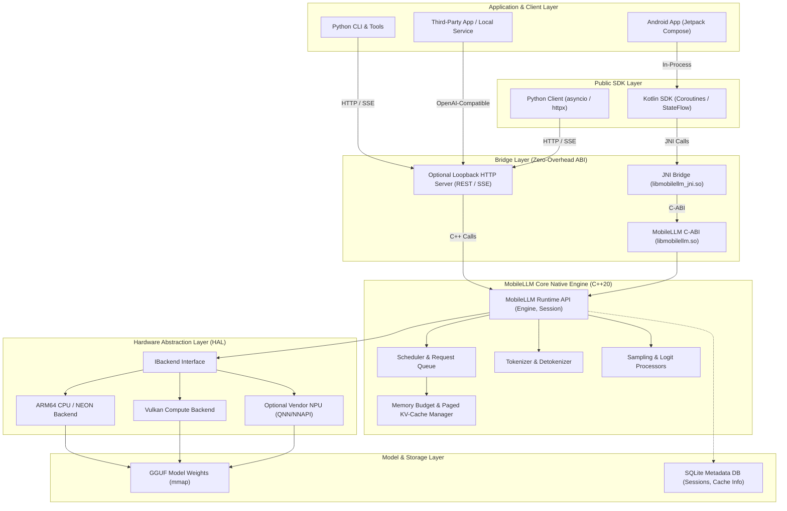
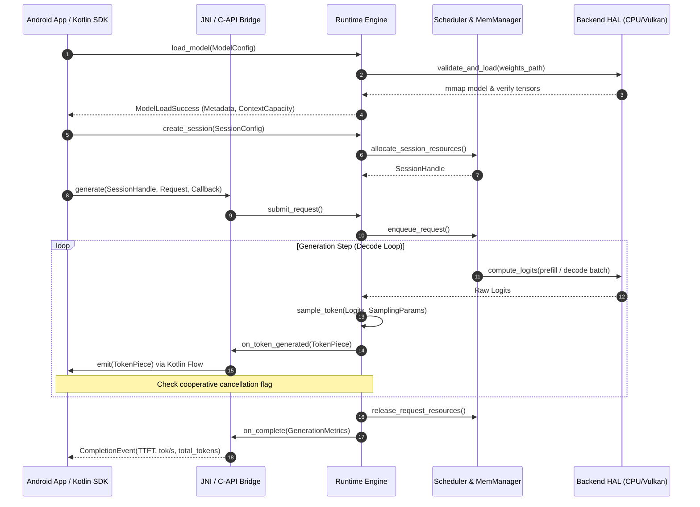

# MobileLLM Engine — Architecture Specification

> **Status:** Approved Baseline (Phase 0)  
> **Document Version:** 1.0.0  
> **Target Platform:** Android ARM64 (Initial), Linux/macOS (Developer/Desktop)  
> **Core Language:** C++20 (Native Runtime), Kotlin (Android SDK), Python 3.11+ (Developer Tooling)  
> **Primary Specification:** Aligned with [`CONTEXT.md`](file:///Users/Apple/Developer/ai-apps/MobileLLM/CONTEXT.md)

---

## 1. Executive Summary & Vision

**MobileLLM Engine** is an open-source, mobile-first Large Language Model (LLM) inference runtime engineered specifically for resource-constrained client environments, with Android ARM64 as its foundational target.

Inspired by core architectural innovations of high-performance server runtimes (notably **vLLM**—such as paged memory management, request queue scheduling, and continuous execution abstractions), MobileLLM Engine adapts these principles to the strict physical constraints of mobile devices:
- **Hard RAM ceilings** and aggressive operating system out-of-memory (OOM) killer daemons.
- **Dynamic thermal throttling** and battery drain constraints.
- **Heterogeneous hardware execution** spanning asymmetric big.LITTLE ARM CPUs, diverse Vulkan-capable mobile GPUs (Adreno, Mali, Immortalis), and proprietary vendor NPUs (Qualcomm QNN, MediaTek NeuroPilot).
- **Zero-cloud dependence:** Guaranteeing 100% offline local inference once model weights are on device.

MobileLLM Engine adopts a **pragmatic, incremental engineering strategy**: it initializes its compute foundation on an established, battle-tested tensor library (`llama.cpp` / GGML) while layering an independent, mobile-optimized architectural ecosystem around it: memory budgeting, paged KV-cache accounting, a clean C-ABI boundary, a native Kotlin/Coroutines SDK, an optional loopback HTTP server, and Python verification tooling.

---

## 2. System Architecture & Topology

The MobileLLM Engine monorepo is layered to isolate hardware-specific native code, memory scheduling, high-level developer bindings, and user-facing applications.

### 2.1 High-Level Component Topology



### 2.2 Data Flow: Streaming Inference Lifecycle



---

## 3. Subsystem Breakdown

### 3.1 C++ Native Runtime (`runtime/`)
- **Location:** `runtime/`
- **Ownership:** C++ Runtime Engineer (Agent 1)
- **Role:** High-performance, memory-safe C++20 engine encapsulating model loading, tokenization, context evaluation, and sampling.
- **Key Modules:**
  - `include/mobilellm/`: Public headers, C-API contract (`c_api.h`), C++ client classes (`engine.h`, `types.h`).
  - `src/engine/`: `Engine` implementation, session state-machine, cooperative cancellation handles.
  - `src/model_loader/`: GGUF file validator, header parser, tensor metadata extractor, memory-mapped tensor loader.
  - `src/tokenizer/`: Vocabulary indexing, BPE/SentencePiece tokenization, streaming UTF-8 safe detokenizer.
  - `src/inference/`: Context execution pipeline, prefill orchestration, single-token decode loop.
  - `src/sampling/`: Temperature, Top-K, Top-P, Min-P, Repetition Penalty, logit bias.

### 3.2 Memory & Scheduler Subsystem (`scheduler/`)
- **Location:** `scheduler/`
- **Ownership:** Memory & Scheduler Engineer (Agent 2)
- **Role:** Mobile resource guardian preventing OOM crashes, allocating KV-cache blocks, and managing request lifecycle.
- **Key Modules:**
  - `memory_manager/`:
    - Physical RAM query (`/proc/meminfo` or Android OS APIs).
    - Device categorization (Entry: 4–6 GB, Mid: 8 GB, Flagship: 12–16 GB).
    - Strict memory budget enforcement: Model budget + KV-cache budget + Working scratch buffer + OS safety margin (minimum 512MB left to system).
    - Emergency memory reclamation on Android `onTrimMemory` events.
  - `kv_cache/`:
    - Paged KV-cache tracker: Divides KV memory into discrete blocks (e.g., 16 tokens/block).
    - Dynamic allocation and block freeing upon session release or truncation.
    - Zero SQLite persistence for KV tensors: Tensors reside strictly in native/backend memory.
  - `request_queue/`: Thread-safe FIFO with priority support (e.g., interactive prompt preemption over background jobs).
  - `session_manager/`: Tracks context states, conversation prefixes, and multi-turn KV eviction.

### 3.3 Hardware Abstraction Layer & Backends (`backends/`)
- **Location:** `backends/`
- **Ownership:** Hardware Engineer (Agent 5)
- **Role:** Decouple inference math from specific hardware APIs, guarantee safe fallbacks, and run reproducible benchmarks.
- **Key Modules:**
  - `common/`: `IBackend` interface, backend registry, capability query structs (`BackendCapabilities`).
  - `cpu/`: ARM64 optimized compute paths utilizing ARM NEON SIMD intrinsics; thread affinity control (binding compute to Cortex-X or Cortex-A performance cores).
  - `vulkan/`: SPIR-V compute shaders, Vulkan instance/device capability detection (checking required extensions e.g. `VK_KHR_16bit_storage`, `VK_KHR_shader_float16_int8`), pipeline cache, fallback to CPU on shader compilation failure.
  - `qnn/` & `nnapi/`: Sandboxed, isolated vendor NPU experimental implementations; strictly gated behind runtime feasibility and capability checks.

### 3.4 Android SDK & Native Integration (`android/`)
- **Location:** `android/`
- **Ownership:** Android Engineer (Agent 3)
- **Role:** Idiomatic Kotlin developer experience, leak-free JNI bridge, lifecycle-aware Android Service, and reference Jetpack Compose UI.
- **Key Modules:**
  - `jni/`: JNI C++ boundary (`mobilellm_jni.cpp`). Validates all inputs, pins string buffers safely, catches C++ exceptions before they hit the JVM, and maps native tokens to JVM callbacks without allocating garbage collector pressure.
  - `sdk/`: Modern Kotlin library exposing `MobileLLMClient`, `ModelSession`, and Coroutines-native `Flow<TokenChunk>`. Handles Android lifecycle (`ProcessLifecycleOwner`, `ComponentActivity`).
  - `runtime/`: Android Archive (AAR) packaging scripts, bundling `libmobilellm.so` across `arm64-v8a` (and optional `x86_64` for emulator sanity builds).
  - `app/`: Production-grade sample chat app in Jetpack Compose featuring offline model loading, streaming output, TTFT/TPS metrics display, and thermal warning indicators.

### 3.5 Python SDK & Developer Tooling (`python/`, `tools/`)
- **Location:** `python/`, `tools/`
- **Ownership:** Python SDK Engineer (Agent 4)
- **Role:** High-productivity tooling for testing, automating benchmarks, validating model conversions, and interacting with local or remote runtimes.
- **Key Modules:**
  - `python/mobilellm/`: Asynchronous Python client built on top of `httpx` and `pydantic`. Supports both direct loopback HTTP calls and OpenAI-compatible client libraries (`openai.OpenAI(base_url="http://localhost:8080/v1")`).
  - `python/cli/`: `mobilellm-cli` for terminal-based model testing, bench running, device inspection, and conversion verification.
  - `python/bindings/`: Optional `pybind11` native bindings for Linux/macOS host debugging without requiring Android hardware.
  - `tools/benchmark/`: Reproducible test harness measuring Time to First Token (TTFT), tokens per second (TPS), peak resident set size (RSS), and temperature delta over sustained generation.

### 3.6 Loopback HTTP & OpenAI Server (`server/`)
- **Location:** `server/`
- **Ownership:** Python & Runtime Engineers (Agent 4 + Agent 1)
- **Role:** Optional, self-contained local REST server exposing standard endpoints for desktop tooling and cross-app communication.
- **Safety Policy:**
  - **Loopback-only by default:** Bound strictly to `127.0.0.1`. Binding to `0.0.0.0` or LAN interfaces requires explicit flag `--allow-remote-connections` with mandatory API key token authentication.
  - **Endpoints:**
    - `GET  /v1/health`
    - `GET  /v1/models`
    - `POST /v1/models/load`
    - `POST /v1/models/unload`
    - `POST /v1/chat/completions` (SSE streaming & unary)
    - `POST /v1/completions`
    - `GET  /v1/metrics`
    - `DELETE /v1/sessions/{id}`

### 3.7 Quality Assurance, Security & Performance (`tests/`, `docs/`)
- **Location:** `tests/`, `docs/security/`, `docs/benchmarks/`
- **Ownership:** QA & Security Engineer (Agent 6)
- **Role:** Independent adversarial verification, sanitizer fuzzing, security validation, and reproducible device benchmarking.
- **Key Modules:**
  - `tests/integration/`: End-to-end load -> generate -> stream -> cancel -> unload lifecycles.
  - `tests/stress/`: Continuous generation under tight memory budgets, rapid load/unload loops (leak detection).
  - `docs/security/`: Threat modeling, GGUF parser vulnerability analysis, path traversal defense verification.
  - `fuzzing/`: LLVM `libFuzzer` targets for GGUF parsing, tokenizer byte inputs, and HTTP JSON payload processing.

---

## 4. Cross-Module Public Interfaces & C-ABI Contract

To maintain modular independence and ensure binary compatibility across NDK revisions, C++, Kotlin, and Python, MobileLLM Engine defines a strict **C-ABI boundary** (`mobilellm/c_api.h`) backed by clean C++20 domain objects (`mobilellm/engine.h`).

### 4.1 Canonical C++ Core Interface (`include/mobilellm/engine.h`)

```cpp
#pragma once

#include <string>
#include <string_view>
#include <memory>
#include <functional>
#include <optional>
#include <cstdint>
#include "mobilellm/types.h"

namespace mobilellm {

class IEngine {
public:
    virtual ~IEngine() = default;

    // Lifecycle
    virtual Status initialize(const EngineConfig& config) noexcept = 0;
    virtual Result<ModelHandle> load_model(const ModelLoadConfig& config) noexcept = 0;
    virtual Status unload_model(ModelHandle handle) noexcept = 0;

    // Session Management
    virtual Result<SessionHandle> create_session(ModelHandle model, const SessionConfig& config) noexcept = 0;
    virtual Status destroy_session(SessionHandle session) noexcept = 0;

    // Inference & Streaming
    virtual Result<GenerationHandle> generate_async(
        SessionHandle session,
        const GenerationRequest& request,
        TokenCallback token_cb,
        CompletionCallback complete_cb
    ) noexcept = 0;

    virtual Status cancel(GenerationHandle handle) noexcept = 0;

    // Telemetry & Diagnostics
    virtual EngineMetrics get_metrics() const noexcept = 0;
    virtual HardwareProfile query_hardware() const noexcept = 0;
};

// Factory method
std::unique_ptr<IEngine> create_engine() noexcept;

} // namespace mobilellm
```

### 4.2 Type Definitions & Status Codes (`include/mobilellm/types.h`)

```cpp
#pragma once

#include <cstdint>
#include <string>
#include <variant>
#include <functional>

namespace mobilellm {

enum class StatusCode : int32_t {
    OK = 0,
    INVALID_ARGUMENT = 1,
    FILE_NOT_FOUND = 2,
    UNSUPPORTED_FORMAT = 3,
    OUT_OF_MEMORY = 4,
    BACKEND_INITIALIZATION_FAILED = 5,
    BACKEND_EXECUTION_ERROR = 6,
    SESSION_NOT_FOUND = 7,
    MODEL_NOT_LOADED = 8,
    CANCELLED = 9,
    CONTEXT_EXCEEDED = 10,
    TIMEOUT = 11,
    INTERNAL_ERROR = 99
};

struct Status {
    StatusCode code{StatusCode::OK};
    std::string message;

    bool is_ok() const noexcept { return code == StatusCode::OK; }
    static Status ok() { return {StatusCode::OK, ""}; }
    static Status error(StatusCode c, std::string msg) { return {c, std::move(msg)}; }
};

template <typename T>
class Result {
public:
    Result(T value) : data_(std::move(value)) {}
    Result(Status status) : data_(std::move(status)) {}

    bool is_ok() const noexcept { return std::holds_alternative<T>(data_); }
    const T& value() const { return std::get<T>(data_); }
    T& value() { return std::get<T>(data_); }
    const Status& status() const { return std::get<Status>(data_); }

private:
    std::variant<T, Status> data_;
};

using ModelHandle = uint64_t;
using SessionHandle = uint64_t;
using GenerationHandle = uint64_t;

struct BackendType {
    enum Value {
        AUTO = 0,
        CPU_NEON = 1,
        VULKAN = 2,
        VENDOR_NPU = 3
    };
};

struct ModelLoadConfig {
    std::string model_path;
    BackendType::Value preferred_backend{BackendType::AUTO};
    uint32_t context_length{2048};
    uint32_t n_threads{4};
    bool use_mmap{true};
    bool use_mlock{false};
    float memory_budget_mb{0.0f}; // 0 = auto-detect
};

struct SamplingParams {
    float temperature{0.7f};
    float top_p{0.9f};
    int32_t top_k{40};
    float min_p{0.05f};
    float repetition_penalty{1.1f};
    uint32_t max_tokens{512};
    std::vector<std::string> stop_sequences;
};

struct GenerationRequest {
    std::string prompt;
    SamplingParams sampling;
};

struct TokenChunk {
    std::string text;
    int32_t token_id;
    bool is_special;
    float logprob;
};

struct GenerationMetrics {
    uint32_t prompt_tokens{0};
    uint32_t completion_tokens{0};
    double time_to_first_token_ms{0.0};
    double decode_tokens_per_second{0.0};
    double peak_memory_mb{0.0};
};

using TokenCallback = std::function<bool(const TokenChunk&)>; // Return false to request cancellation
using CompletionCallback = std::function<void(const Status&, const GenerationMetrics&)>;

} // namespace mobilellm
```

### 4.3 Stable C-ABI Contract (`include/mobilellm/c_api.h`)

All JNI, desktop FFI, and cross-language bridges bind exclusively to this extern "C" interface:

```c
#ifndef MOBILELLM_C_API_H
#define MOBILELLM_C_API_H

#include <stdint.h>
#include <stdbool.h>
#include <stddef.h>

#if defined(_WIN32)
  #define MOBILELLM_EXPORT __declspec(dllexport)
#else
  #define MOBILELLM_EXPORT __attribute__((visibility("default")))
#endif

#ifdef __cplusplus
extern "C" {
#endif

typedef uint64_t mllm_engine_t;
typedef uint64_t mllm_model_t;
typedef uint64_t mllm_session_t;
typedef uint64_t mllm_gen_handle_t;

typedef struct {
    int32_t code;
    const char* message;
} mllm_status_t;

typedef struct {
    const char* model_path;
    int32_t backend; // 0=auto, 1=cpu, 2=vulkan, 3=npu
    uint32_t context_length;
    uint32_t n_threads;
    bool use_mmap;
    float max_memory_mb;
} mllm_model_config_t;

typedef struct {
    const char* text;
    int32_t token_id;
    bool is_special;
} mllm_token_chunk_t;

typedef struct {
    uint32_t prompt_tokens;
    uint32_t completion_tokens;
    double ttft_ms;
    double tps;
    double peak_rss_mb;
} mllm_metrics_t;

// Callbacks
typedef bool (*mllm_token_callback_fn)(const mllm_token_chunk_t* chunk, void* user_data);
typedef void (*mllm_complete_callback_fn)(mllm_status_t status, const mllm_metrics_t* metrics, void* user_data);

// Engine Lifecycle
MOBILELLM_EXPORT mllm_status_t mllm_engine_create(mllm_engine_t* out_engine);
MOBILELLM_EXPORT mllm_status_t mllm_engine_destroy(mllm_engine_t engine);

// Model Operations
MOBILELLM_EXPORT mllm_status_t mllm_model_load(mllm_engine_t engine, const mllm_model_config_t* config, mllm_model_t* out_model);
MOBILELLM_EXPORT mllm_status_t mllm_model_unload(mllm_engine_t engine, mllm_model_t model);

// Session Operations
MOBILELLM_EXPORT mllm_status_t mllm_session_create(mllm_engine_t engine, mllm_model_t model, mllm_session_t* out_session);
MOBILELLM_EXPORT mllm_status_t mllm_session_destroy(mllm_engine_t engine, mllm_session_t session);

// Generation Operations
MOBILELLM_EXPORT mllm_status_t mllm_generate(
    mllm_engine_t engine,
    mllm_session_t session,
    const char* prompt,
    float temperature,
    float top_p,
    int32_t top_k,
    uint32_t max_tokens,
    mllm_token_callback_fn token_cb,
    mllm_complete_callback_fn complete_cb,
    void* user_data,
    mllm_gen_handle_t* out_handle
);

MOBILELLM_EXPORT mllm_status_t mllm_cancel(mllm_engine_t engine, mllm_gen_handle_t handle);

// Hardware & Telemetry
MOBILELLM_EXPORT mllm_status_t mllm_get_version(char* buffer, size_t max_len);
MOBILELLM_EXPORT mllm_status_t mllm_detect_hardware(char* json_buffer, size_t max_len);

#ifdef __cplusplus
}
#endif

#endif // MOBILELLM_C_API_H
```

---

## 5. Memory Management & Paged KV-Cache Strategy

Mobile devices do not have dedicated GPU VRAM; system RAM is dynamically shared between the OS, background apps, the foreground UI, and inference memory. Running out of memory results in an instant, uncatchable `SIGKILL` from the Android Low Memory Killer Daemon (`lmkd`).

### 5.1 Device Memory Categorization

```
+-----------------------------------------------------------------------+
| Category      | Physical RAM | Allowed Model Size | Recommended Context |
+---------------+--------------+--------------------+---------------------+
| Entry-Level   | 4 GB - 6 GB  | 0.5B - 1.5B (Q4_K) | 1,024 - 2,048 tokens|
| Mid-Range     | 8 GB         | 1.5B - 3B   (Q4_K) | 2,048 - 4,096 tokens|
| Flagship      | 12 GB - 16 GB| 3B - 7B     (Q4_K) | 4,096 - 8,192 tokens|
+-----------------------------------------------------------------------+
```

### 5.2 Memory Allocation Budget Equation

To ensure runtime survival under mobile memory pressure:
$$\text{Available RAM} = \text{Total System RAM} - \text{OS Baseline (\~1.5 GB)} - \text{Foreground App (\~500 MB)}$$
$$\text{Runtime Budget} = \min(\text{Available RAM} \times 0.70, \text{Hard Config Ceiling})$$

Inside the Runtime Budget:
$$\text{Runtime Budget} = \text{Model Weights (mmap)} + \text{Paged KV-Cache} + \text{Scratch Workspace} + \text{Safety Buffer (512 MB)}$$

### 5.3 Paged KV-Cache on Mobile

In contrast to desktop vLLM, which allocates gigabytes of static memory pages in VRAM upfront, MobileLLM Engine implements a **dynamic, demand-paged KV-cache**:
1. **Block Granularity:** KV memory is divided into virtual blocks of 16 tokens.
2. **On-Demand Allocation:** As prompt tokens are evaluated or new tokens generated, blocks are pulled from an arena pool.
3. **Prefix Sharing:** Multi-turn sessions share system prompt blocks across turns without data duplication.
4. **Emergency Eviction:** When Android broadcasts `TRIM_MEMORY_RUNNING_CRITICAL` or `TRIM_MEMORY_COMPLETE`, the memory manager:
   - Suspends background sessions.
   - Truncates context history to the earliest stable checkpoint.
   - Releases inactive KV pages back to the OS.
5. **Strict No-SQLite for Tensors:** SQLite is used exclusively for relational metadata (session IDs, model names, tokens-per-second logs). Tensors never touch disk-backed relational databases.

---

## 6. Hardware Acceleration Strategy & Fallback Architecture

Heterogeneous hardware on Android requires an evidence-based capability detection hierarchy:

```
Runtime Hardware Selection Hierarchy:
           +-----------------------------+
           | Request Backend Preference  |
           +-----------------------------+
                          |
              +-----------v-----------+
              | Is Vulkan Selected?   |
              +-----------+-----------+
                     /         \
              (Yes) /           \ (No)
                   v             v
       +--------------------+  +----------------------+
       | Probe Vulkan Caps: |  | Is NPU Selected?     |
       | - Vulkan 1.1+      |  +----------+-----------+
       | - float16 storage  |         /        \
       | - shaderInt8       |  (Yes) /          \ (No)
       | - memory limits    |       v            v
       +---------+----------+  +----------+  +-------------+
            /         \        | QNN/NNAPI|  | ARM64 CPU   |
     (Pass)/           \(Fail) | Validated|  | + NEON SIMD |
          v             v      +----+-----+  | Baseline    |
     [Vulkan GPU]  [Fallback]       |        +-------------+
                        |      (Fail)|              ^
                        +------------+--------------+
```

### 6.1 Acceleration Safeguards
1. **ARM64 NEON is the Golden Baseline:** All models and operators must compile, run, and pass numerical equivalence tests on CPU first.
2. **Runtime Vulkan Capability Probing:** Vulkan is never enabled blindly based on device name. It executes a dry-run test: initializing `VkInstance`, querying physical device limits (`VkPhysicalDeviceFeatures`), and verifying float16 compute support before compiling shaders.
3. **Graceful Fallback:** If Vulkan initialization, shader compilation, or memory allocation fails, the engine logs the diagnostic error, transitions backend state to `CPU_NEON`, and completes the request without an app crash.
4. **Isolated Vendor NPU Modules:** Qualcomm QNN or Android NNAPI code resides in strictly isolated compilation units (`backends/qnn/`, `backends/nnapi/`). If vendor dynamic libraries (`.so`) are absent on the device, the backend cleanly declares `UNAVAILABLE`.

---

## 7. Security, Privacy & Threat Model

MobileLLM Engine processes untrusted user prompts, loads local binary model files, and potentially exposes local network endpoints. The threat model mitigates risks across five vectors:

### 7.1 Model & File System Boundaries
- **Path Traversal Prevention:** Model paths are sanitized to ensure they reside in designated application-internal storage (`context.getFilesDir()`) or explicitly authorized user SAF (Storage Access Framework) locations. Paths containing `../` or symlink escapes to protected Android system directories are rejected.
- **Malicious GGUF File Parsing:** GGUF headers, tensor offsets, and string tables are strictly boundary-checked against actual file size before any memory-map or read operations occur. Buffer offsets that extend past EOF immediately abort with `UNSUPPORTED_FORMAT`.
- **Zero-Code Execution:** Model weights are loaded exclusively as read-only data arrays; no executable code or embedded bytecode within model containers is ever executed.

### 7.2 API & Local Network Security
- **Loopback Enforcement:** The optional HTTP server binds exclusively to `127.0.0.1` by default. It is not reachable from the cellular network, Wi-Fi LAN, or other devices.
- **Explicit LAN Opt-In:** Enabling LAN binding requires an explicit command-line or programmatic parameter and automatically activates mandatory Bearer Token authentication (`Authorization: Bearer <secret>`).
- **Resource Exhaustion Throttling:** Request bodies are capped at 4MB; max simultaneous sessions are constrained by the memory manager; requests beyond capacity return HTTP 429 (Too Many Requests).

### 7.3 Data Privacy & Ephemeral Processing
- **No Prompt Logging by Default:** Prompts, completions, and intermediate token logits are processed ephemerally in RAM and are never written to Android logcat or persistent databases unless explicitly enabled in debug diagnostics.
- **Zero Cloud Leakage:** In offline mode, network permissions are unnecessary for native inference; no analytics or telemetry pings are transmitted.

---

## 8. Build System & Standards

```
Monorepo Build Infrastructure:
├── CMakeLists.txt              # Root native build (C++20, GoogleTest, Sanitizers)
├── runtime/CMakeLists.txt      # Core engine library (libmobilellm.so)
├── backends/CMakeLists.txt     # HAL & backend modules (CPU, Vulkan)
├── android/                    # Gradle / NDK Project
│   ├── build.gradle.kts        # Root Android build configuration
│   ├── sdk/build.gradle.kts    # Kotlin SDK library build (AAR)
│   └── app/build.gradle.kts    # Sample Compose Chat Application
├── pyproject.toml              # Python package metadata (uv / pip / hatchling)
└── .github/workflows/          # Continuous Integration matrices
```

### 8.1 Toolchain Standards
- **C++ Standard:** C++20 (`-std=c++20`), strict warnings (`-Wall -Wextra -Wpedantic -Werror`), symbols hidden by default (`-fvisibility=hidden`).
- **Android NDK:** Target NDK r26c+ (minSdkVersion 26, targetSdkVersion 34, ABI `arm64-v8a`).
- **Kotlin:** Kotlin 1.9.20+, Jetpack Compose, Coroutines 1.8+.
- **Python:** Python 3.11+, typed with strict `mypy` / `pyright`, tested with `pytest`.
- **Format & Linters:** `clang-format` (Google style), `clang-tidy`, `ktlint`, `ruff`.

---

## 9. Module Ownership Matrix

| Subsystem Path | Module Description | Primary Owner | Reviewer Gate |
| :--- | :--- | :--- | :--- |
| `docs/`, Root | Architecture, Roadmap, Interfaces | **Lead Architect (Agent 0)** | Maintainer / Architect |
| `runtime/` | Core C++ Engine, Tokenizer, Loader | **Runtime Engineer (Agent 1)** | Lead Architect |
| `scheduler/` | Memory Budget, Paged KV-Cache | **Scheduler Engineer (Agent 2)** | Lead Architect |
| `android/` | JNI Bridge, Kotlin SDK, Compose App | **Android Engineer (Agent 3)** | Lead Architect |
| `python/`, `server/` | Python Client, CLI, Loopback API | **Python Engineer (Agent 4)** | Lead Architect |
| `backends/` | ARM NEON, Vulkan Compute, NPU | **Hardware Engineer (Agent 5)** | Lead Architect |
| `tests/`, Security | Test Suites, Fuzzers, CI, Sanitizers | **QA & Security (Agent 6)** | Lead Architect |

---

## 10. Conclusion & Approval Checklist

This Architecture Specification sets the structural, technical, and operational boundaries for MobileLLM Engine. Implementation proceeds strictly in accordance with the phased plan in [`ROADMAP.md`](file:///Users/Apple/Developer/ai-apps/MobileLLM/ROADMAP.md) and the agent role charters in [`docs/agents/`](file:///Users/Apple/Developer/ai-apps/MobileLLM/docs/agents/).
