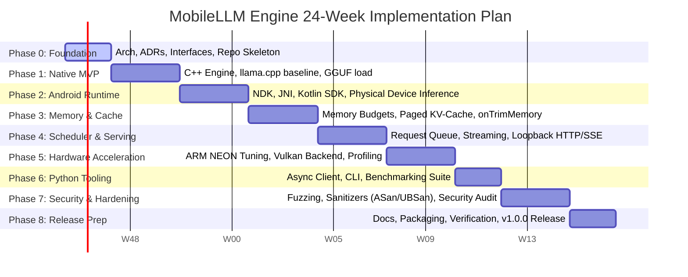

# MobileLLM Engine — Implementation Roadmap

> **Specification Baseline:** Aligned with [`CONTEXT.md`](file:///Users/Apple/Developer/ai-apps/MobileLLM/CONTEXT.md) and [`ARCHITECTURE.md`](file:///Users/Apple/Developer/ai-apps/MobileLLM/ARCHITECTURE.md)  
> **Status:** Active Master Plan  
> **Total Timeline:** 24 Weeks (Phases 0 through 8)  
> **Immediate Focus:** Phase 0 (Foundation) & Phase 1 (Native Inference MVP)

---

## 1. Master 24-Week Phased Progression



### Phase Summary Table

| Phase | Duration | Primary Focus | Key Milestone Deliverable | Primary Agent |
| :--- | :--- | :--- | :--- | :--- |
| **0. Foundation** | Weeks 1–2 | Architecture, ADRs, C-ABI contracts, build system | Build skeleton, verified contracts, CI setup | Agent 0 (Architect) |
| **1. Native MVP** | Weeks 3–5 | Core C++ engine, backend integration, GGUF loader | Standalone native CLI loads GGUF & generates text | Agent 1 (Runtime) |
| **2. Android Runtime** | Weeks 6–8 | JNI bridge, Kotlin SDK, Compose demo app | Physical ARM64 device offline streaming inference | Agent 3 (Android) |
| **3. Memory Management** | Weeks 9–11 | Memory budgets, paged KV-cache, eviction | Zero OOM crashes under high memory load | Agent 2 (Scheduler) |
| **4. Scheduler & Serving**| Weeks 12–14| Request queuing, preemption, loopback HTTP/SSE | Multi-turn chat, OpenAI-compatible local API | Agent 2 & Agent 4 |
| **5. Hardware Accel** | Weeks 15–17| Vulkan GPU compute, NEON tuning, vendor NPU | Measured 2x+ speedup on Vulkan over CPU | Agent 5 (Hardware) |
| **6. Python Ecosystem** | Weeks 18–19| Async SDK, developer CLI, automated bench | `pip install mobilellm`, reproducible benchmarks | Agent 4 (Python) |
| **7. Security Hardening**| Weeks 20–22| Fuzzing GGUF parser, ASan/UBSan, threat defense | 0 security vulnerabilities, sanitizer-clean builds | Agent 6 (QA/Sec) |
| **8. Release Prep** | Weeks 23–24| Documentation, sample apps, license audit | `v1.0.0` stable release | All Agents |

---

## 2. Immediate Execution: First 14 Days Bootstrap Plan

The first 14 days establish the end-to-end vertical proof of concept. No agent initiates large-scale parallel refactoring until this vertical slice functions on a physical Android device.


### Daily Task Breakdown

#### Day 1: Architecture, Contracts & Repository Blueprint
- **Owner:** Agent 0 (Lead Architect)
- **Deliverables:**
  - `ARCHITECTURE.md` (System design, interfaces, error handling).
  - `ROADMAP.md` (24-week plan, 14-day schedule, acceptance gates).
  - `docs/adr/0001` through `0007` (Core architectural decisions).
  - `docs/agents/` (Role specifications for Agents 1 through 6).
- **Validation:** All docs peer-reviewed and committed to `main`.

#### Day 2: Native Runtime Interface Definitions
- **Owner:** Agent 1 (Runtime) + Agent 0 (Architect)
- **Deliverables:**
  - `runtime/include/mobilellm/c_api.h` (C-ABI contract).
  - `runtime/include/mobilellm/engine.h` (C++ interface).
  - `runtime/include/mobilellm/types.h` (Data types, error codes).
- **Validation:** Clean C++20 header compilation with `-Wall -Wextra -Wpedantic -Werror`.

#### Day 3: CMake & Android Build Skeleton
- **Owner:** Agent 1 (Runtime) + Agent 3 (Android)
- **Deliverables:**
  - Root `CMakeLists.txt` and `runtime/CMakeLists.txt`.
  - Android Gradle configuration (`android/build.gradle.kts`, `android/sdk/build.gradle.kts`).
  - GitHub Actions CI workflow for host C++ and Android NDK build (`arm64-v8a`).
- **Validation:** Reproducible build of `libmobilellm.so` on host and Android NDK toolchain.

#### Day 4: Baseline Inference Backend Integration
- **Owner:** Agent 1 (Runtime)
- **Deliverables:**
  - Pin external backend dependency (`llama.cpp` submodule/vendoring at verified commit).
  - Initial `backends/cpu/` bridge wrapping GGML context.
  - Implement `create_engine()` factory returning native engine instance.
- **Validation:** Native test compiles and links against backend without symbol collisions.

#### Day 5: Native GGUF Loading & Verification Test
- **Owner:** Agent 1 (Runtime) + Agent 6 (QA)
- **Deliverables:**
  - GGUF header parser and tensor metadata inspection.
  - GoogleTest suite (`runtime/tests/test_model_loader.cpp`) testing valid and invalid GGUF files.
  - Host-side CLI tool (`tools/developer-cli`) that loads a test model (e.g., Qwen 2.5 0.5B / Llama 3.2 1B).
- **Validation:** Model loads cleanly into memory, extracts metadata, and unloads with zero leaks.

#### Day 6: JNI Bridge & Memory-Safe Marshalling
- **Owner:** Agent 3 (Android)
- **Deliverables:**
  - `android/jni/mobilellm_jni.cpp` implementing JNI methods.
  - Zero-copy string handling and JVM exception guards.
  - Native pointer lifecycle wrapper in Kotlin (`NativeEngineHandle`).
- **Validation:** Android unit tests load native `.so` library and query version string and hardware capabilities.

#### Day 7: First Physical Android Device Inference
- **Owner:** Agent 3 (Android) + Agent 6 (QA)
- **Deliverables:**
  - Minimal test Activity or instrumentation test running on physical ARM64 Android device.
  - Load 0.5B–1B quantized GGUF from app internal storage.
  - Execute prompt evaluation and generate first token.
- **Validation:** Physical device logcat confirms generation without crashes; record first TTFT.

#### Day 8: Python Client Skeleton & HTTP Protocol
- **Owner:** Agent 4 (Python)
- **Deliverables:**
  - `python/mobilellm/` package skeleton (`pyproject.toml`, `client.py`).
  - Define HTTP/SSE wire protocol matching `c_api.h` types.
  - Mock server test verifying streaming chunks and cancellation events.
- **Validation:** `pytest` passes with 100% type checking via `mypy --strict`.

#### Day 9: Mobile Memory Budget Guardrails
- **Owner:** Agent 2 (Scheduler)
- **Deliverables:**
  - `scheduler/memory_manager/` querying device total/available RAM.
  - Memory budget validator preventing model loading if `required_ram > available_ram * 0.70`.
  - Android `onTrimMemory` signal listener hook.
- **Validation:** Attempting to load an oversized model returns `StatusCode::OUT_OF_MEMORY` gracefully without process kill.

#### Day 10: Request Lifecycle & Session Management
- **Owner:** Agent 2 (Scheduler)
- **Deliverables:**
  - `scheduler/session_manager/` managing conversation context state.
  - Request queue handling concurrent generation requests sequentially with thread safety.
  - Cooperative cancellation flag checked at every token generation step.
- **Validation:** Cancelling an ongoing generation stops backend computation within 1 token step.

#### Day 11: Real-Time Token Streaming & SSE Bridge
- **Owner:** Agent 1 (Runtime) + Agent 4 (Python)
- **Deliverables:**
  - Streaming callback implementation in C++ engine.
  - Native callback -> JNI Kotlin Flow emission bridge.
  - Server SSE handler streaming standard OpenAI-compatible chunks (`data: {"choices": [...]}`).
- **Validation:** Client receives token stream in real time; verify zero buffering delays.

#### Day 12: Device Profiling & Hardware Telemetry
- **Owner:** Agent 5 (Hardware) + Agent 6 (QA)
- **Deliverables:**
  - Telemetry collector recording: TTFT, tokens/sec, peak RSS, CPU frequency, and battery temp.
  - Android benchmark script executing 5 consecutive runs with warm-up.
- **Validation:** Benchmark report artifact created with exact device specs and repeatable numbers.

#### Day 13: Regression, Leak & Error-Handling Tests
- **Owner:** Agent 6 (QA & Security)
- **Deliverables:**
  - Rapid load -> generate -> unload stress test (100 iterations) checking for memory leaks.
  - Fuzzed input prompts (empty prompt, massive prompt exceeding context window, invalid UTF-8).
  - ASan (AddressSanitizer) run on native test suite.
- **Validation:** Zero memory leaks, zero buffer overflows, all error codes handled cleanly.

#### Day 14: Milestone 1 Acceptance Review & Gate
- **Owner:** Agent 0 (Lead Architect)
- **Deliverables:**
  - Review all 10 Milestone 1 Acceptance Criteria against live execution results.
  - Compile Milestone 1 Audit Report.
  - Greenlight parallel development for Phases 2, 3, and 4.
- **Validation:** Human maintainer sign-off on Milestone 1 report.

---

## 3. Milestone 1 Acceptance Gate

The first milestone is strictly evaluated against the **10 non-negotiable criteria** established in `CONTEXT.md` Section 13:

```
[ ] 1. The native project builds reproducibly across clean environments.
[ ] 2. A supported GGUF model loads successfully from local storage.
[ ] 3. Inference runs on a physical Android ARM64 device (emulator alone fails).
[ ] 4. Text generation streams tokens to the Android application in real time.
[ ] 5. Generation cancellation works cooperatively and cleanly halts decode.
[ ] 6. Inference works 100% offline with device network interfaces disabled.
[ ] 7. Memory use (RSS and peak allocation) is measured and reported.
[ ] 8. Errors (missing file, OOM, context exceeded) surface gracefully without crashes.
[ ] 9. Automated host and unit test suites pass completely in CI.
[ ] 10. Complete documentation details device specs, model details, and reproduction steps.
```

---

## 4. Work Breakdown Structure (WBS) by Module

### 4.1 Module: `runtime/` (Agent 1)
- [ ] **T1.1**: Setup C++20 CMake build with GoogleTest and compile flags (`-Wall -Wextra -Werror -fPIC`).
- [ ] **T1.2**: Define public headers in `runtime/include/mobilellm/` (`c_api.h`, `engine.h`, `types.h`).
- [ ] **T1.3**: Implement GGUF model validator and metadata extractor (`src/model_loader/`).
- [ ] **T1.4**: Integrate baseline GGML/llama.cpp inference backend (`backends/cpu/`).
- [ ] **T1.5**: Implement BPE/SentencePiece streaming detokenizer with UTF-8 byte boundary preservation (`src/tokenizer/`).
- [ ] **T1.6**: Implement sampling algorithms (`src/sampling/`): Greedy, Temperature, Top-K, Top-P, Min-P, Repetition Penalty.
- [ ] **T1.7**: Implement `Engine` orchestration class with token callback and cooperative cancellation handle.
- [ ] **T1.8**: Unit test suite for tokenizer, sampling math, and model loading.

### 4.2 Module: `scheduler/` (Agent 2)
- [ ] **T2.1**: Implement device RAM inspection and available memory budgeting logic (`memory_manager/`).
- [ ] **T2.2**: Implement paged KV-cache tracker with 16-token block granularity (`kv_cache/`).
- [ ] **T2.3**: Implement session context tracker with multi-turn prefix caching (`session_manager/`).
- [ ] **T2.4**: Implement thread-safe request queue with priority support (`request_queue/`).
- [ ] **T2.5**: Integrate Android `onTrimMemory` callback handler to trigger emergency cache eviction.
- [ ] **T2.6**: Memory stress tests simulating low-memory device conditions.

### 4.3 Module: `android/` (Agent 3)
- [ ] **T3.1**: Configure Android Gradle build with NDK r26c+ targeting `arm64-v8a` (`android/sdk/`).
- [ ] **T3.2**: Implement JNI C++ bridge (`android/jni/`) wrapping `c_api.h` with exception boundaries.
- [ ] **T3.3**: Implement Kotlin SDK classes (`MobileLLMClient`, `ModelSession`, `GenerationFlow`).
- [ ] **T3.4**: Connect token callbacks to Kotlin `SharedFlow` / `StateFlow` for streaming UI consumption.
- [ ] **T3.5**: Implement reference Jetpack Compose chat application (`android/app/`).
- [ ] **T3.6**: Create physical device instrumentation test verifying offline execution with airplane mode enabled.

### 4.4 Module: `python/` & `server/` (Agent 4)
- [ ] **T4.1**: Setup `python/pyproject.toml` with `hatchling`, `httpx`, `pydantic`, `pytest`, `mypy`.
- [ ] **T4.2**: Implement async `MobileLLMClient` supporting streaming SSE responses.
- [ ] **T4.3**: Implement `mobilellm-cli` with commands: `run`, `bench`, `info`, `validate`.
- [ ] **T4.4**: Implement optional loopback HTTP server (`server/http/`) with `/v1/chat/completions` and `/v1/models`.
- [ ] **T4.5**: Enforce loopback-only binding (`127.0.0.1`) and token authentication for LAN mode.
- [ ] **T4.6**: Write automated contract tests verifying OpenAI API compatibility.

### 4.5 Module: `backends/` (Agent 5)
- [ ] **T5.1**: Define `IBackend` abstraction layer and hardware capability query interface (`backends/common/`).
- [ ] **T5.2**: Optimize ARM64 NEON SIMD routines for quantized matrix multiplication (`backends/cpu/`).
- [ ] **T5.3**: Setup Vulkan compute pipeline, shader compilation, and device feature probing (`backends/vulkan/`).
- [ ] **T5.4**: Implement automatic graceful fallback to CPU if Vulkan fails at runtime.
- [ ] **T5.5**: Build benchmarking tool measuring TTFT, TPS, RSS, and battery thermals (`tools/benchmark/`).
- [ ] **T5.6**: Feasibility investigation of Qualcomm QNN NPU integration (`backends/qnn/`).

### 4.6 Module: `tests/` & Security (Agent 6)
- [ ] **T6.1**: Setup CI workflows in `.github/workflows/` (host tests, Android NDK build, Python tests).
- [ ] **T6.2**: Configure AddressSanitizer (ASan) and UndefinedBehaviorSanitizer (UBSan) in CMake.
- [ ] **T6.3**: Implement `libFuzzer` targets for GGUF parsing and tokenizer inputs (`tests/fuzzing/`).
- [ ] **T6.4**: Write integration test suite: full lifecycle (load -> generate -> cancel -> unload) x 100 runs.
- [ ] **T6.5**: Audit dependency licenses and verify Apache-2.0 compliance for distribution.
- [ ] **T6.6**: Verify path traversal defenses for model loading and local file storage.

---

## 5. Release Progression & Versioning

MobileLLM Engine follows Semantic Versioning (`MAJOR.MINOR.PATCH`):

```
v0.1.0  Native inference proof of concept (C++ CLI loads GGUF & generates on host)
  │
v0.2.0  Android JNI runtime (ARM64 library compiles & loads via NDK)
  │
v0.3.0  Kotlin SDK & Compose Demo (Streaming chat on physical Android device)
  │
v0.4.0  Mobile Memory & Session Management (Paged KV-cache, budget limits)
  │
v0.5.0  Optional Local API & Python Client (OpenAI-compatible HTTP/SSE)
  │
v0.6.0  Experimental Vulkan Backend (GPU acceleration with CPU fallback)
  │
v0.9.0  Release Candidate (Full test matrix, fuzzing clean, device benchmarks)
  │
v1.0.0  Stable Documented Release (Production-ready Android SDK and runtime)
```
