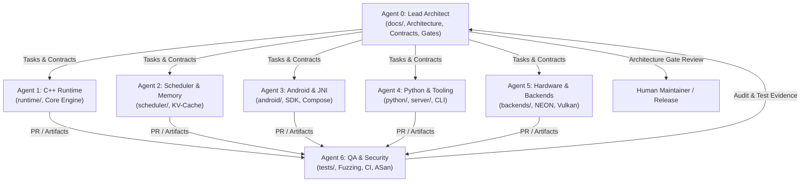

# MobileLLM Engine — Multi-Agent Operating Model

> **Governing Document:** Aligned with [`CONTEXT.md`](file:///Users/Apple/Developer/ai-apps/MobileLLM/CONTEXT.md) Section 7 & 8  
> **Target Audience:** All AI Coding Agents, Human Maintainers, and Reviewers

---

## 1. Multi-Agent Ecosystem Architecture

MobileLLM Engine is built using specialized, autonomous AI coding agents working in coordination. To maintain project velocity, architectural integrity, and code quality, every agent operates under strict functional boundaries, explicit file ownership, and disciplined branch workflows.



---

## 2. Agent Roster & Module Ownership

| Agent Identifier | Role | Primary Directory Ownership | Secondary / Shared Touchpoints |
| :--- | :--- | :--- | :--- |
| **Agent 0** | Lead Architect & Orchestrator | `docs/`, Root configs, Cross-module contracts | All modules (review only) |
| **Agent 1** | C++ Runtime Engineer | `runtime/` | `include/mobilellm/`, `backends/common/` |
| **Agent 2** | Memory & Scheduler Engineer | `scheduler/` | `runtime/src/engine/`, `include/mobilellm/` |
| **Agent 3** | Android Engineer | `android/`, `examples/android-chat/` | `android/jni/` -> `runtime/include/mobilellm/` |
| **Agent 4** | Python SDK & Tooling Engineer | `python/`, `server/`, `tools/developer-cli/` | `examples/python-inference/`, `examples/local-api/`|
| **Agent 5** | Hardware & Acceleration Engineer | `backends/`, `tools/profiling/`, `tools/benchmark/`| `runtime/src/inference/` |
| **Agent 6** | QA, Benchmark & Security Engineer | `tests/`, `.github/workflows/`, Fuzzers | Cross-cutting independent test harness |

---

## 3. Non-Negotiable Operational Rules

Every agent operating within this repository must adhere to the following rules without exception:

1. **Never Commit Directly to `main`:** All work must take place on dedicated task branches or isolated worktrees.
2. **Never Claim Unverified Success:** Never report that code "works" or that tests pass without providing executable command output as evidence.
3. **Never Invent Benchmark or Profiling Data:** Performance numbers (TTFT, TPS, RSS, temperature) must be captured from actual execution scripts and verifiable test runs.
4. **Never Silently Alter Public Contracts:** Public C++ headers (`runtime/include/mobilellm/`), C-ABI declarations (`c_api.h`), HTTP OpenAPI schemas, and Kotlin public APIs require explicit review and approval from Agent 0 (Architect).
5. **Never Break the Build:** A pull request or branch cannot be merged if any build step or test fails in CI.
6. **No Dependencies Without Justification:** No third-party library, package, or submodule may be added without documenting its purpose, binary size impact, and license compatibility (Apache-2.0, MIT, or BSD required).
7. **No Direct Shared-File Race Conditions:** Agents must never edit the same files concurrently. If a dependency on another agent's module exists, mock the interface or coordinate through Agent 0.
8. **Document Limitations and Errors:** Always report known bugs, edge cases, platform limitations, and test failures transparently.

---

## 4. Branching & Git Worktree Conventions

All parallel agent development is organized into branch prefixes indicating role ownership:

- **Feature Work:** `feature/agent-<N>-<task-name>` (e.g., `feature/agent-1-gguf-loader`, `feature/agent-3-jni-bridge`)
- **Bug Fixes:** `fix/agent-<N>-<bug-description>` (e.g., `fix/agent-2-kv-block-leak`)
- **Optimization / Hardware:** `perf/agent-5-<backend-name>` (e.g., `perf/agent-5-vulkan-fp16`)
- **Testing & Security:** `test/agent-6-<suite-name>` (e.g., `test/agent-6-fuzzer-gguf`)

### Isolation via Git Worktrees
When multiple agents run simultaneously in the same environment, agents must operate in dedicated worktrees to avoid overwriting workspace files:
```bash
git worktree add -b feature/agent-1-runtime-mvp ../mobilellm-agent1 main
```

---

## 5. Mandatory Agent Task Report Format

Whenever an agent completes a task, opens a pull request, or reports status, the agent **must** use the canonical reporting template:

```markdown
### Agent Task Report

**Agent:** Agent [N] — [Role Title]
**Task ID & Name:** [e.g., T1.3 GGUF Model Loader]
**Branch:** [e.g., feature/agent-1-gguf-loader]

#### 1. Files Changed
- `runtime/src/model_loader/gguf_parser.cpp` (New: Header parsing & offset checks)
- `runtime/include/mobilellm/model_loader.h` (New: Public parser API)

#### 2. Design Decisions
- Utilized memory-mapped file I/O (`mmap`) on POSIX/Android to eliminate redundant buffer copying.
- Implemented strict bounds validation to prevent out-of-bounds reads on truncated GGUF files.

#### 3. Implementation Summary
- Parsed GGUF header magic (`GGUF`), version (v2/v3), tensor count, and metadata key-value pairs.
- Extracted architecture string and quantization type.

#### 4. Commands Executed & Build Evidence
```bash
cmake -B build -DMOBILELLM_BUILD_TESTS=ON
cmake --build build --target test_model_loader -j8
```
*Build Result:* 0 warnings, 0 errors. Target binary built successfully.

#### 5. Test Evidence
```bash
./build/runtime/tests/test_model_loader
```
*Output:*
```
[==========] Running 4 tests from 1 test suite.
[ RUN      ] ModelLoaderTest.ValidGGUFHeader
[       OK ] ModelLoaderTest.ValidGGUFHeader (12 ms)
[ RUN      ] ModelLoaderTest.RejectMalformedMagic
[       OK ] ModelLoaderTest.RejectMalformedMagic (2 ms)
[ RUN      ] ModelLoaderTest.RejectTruncatedFile
[       OK ] ModelLoaderTest.RejectTruncatedFile (3 ms)
[ RUN      ] ModelLoaderTest.ExtractMetadata
[       OK ] ModelLoaderTest.ExtractMetadata (8 ms)
[==========] 4 tests ran. (25 ms total).
[  PASSED  ] 4 tests.
```

#### 6. Known Limitations & Risks
- Currently validates GGUF v2 and v3 only; GGUF v1 files are rejected as unsupported.
- Large tensor parsing requires 64-bit offsets; verified on ARM64 and x86_64.

#### 7. Next Dependency / Downstream Handoff
- Ready for Agent 3 (Android) to bind JNI loader method and Agent 6 (QA) to execute libFuzzer target.
```

---

## 6. Agent Role Specifications Index

Detailed role charters, technical constraints, initial backlogs, and interface contracts for each specialized agent are maintained in:

1. [**Agent 1 — C++ Runtime Engineer**](file:///Users/Apple/Developer/ai-apps/MobileLLM/docs/agents/agent-1-runtime.md)
2. [**Agent 2 — Memory & Scheduler Engineer**](file:///Users/Apple/Developer/ai-apps/MobileLLM/docs/agents/agent-2-scheduler.md)
3. [**Agent 3 — Android & JNI Engineer**](file:///Users/Apple/Developer/ai-apps/MobileLLM/docs/agents/agent-3-android.md)
4. [**Agent 4 — Python SDK & Tooling Engineer**](file:///Users/Apple/Developer/ai-apps/MobileLLM/docs/agents/agent-4-python.md)
5. [**Agent 5 — Hardware & Acceleration Engineer**](file:///Users/Apple/Developer/ai-apps/MobileLLM/docs/agents/agent-5-hardware.md)
6. [**Agent 6 — QA, Benchmark & Security Engineer**](file:///Users/Apple/Developer/ai-apps/MobileLLM/docs/agents/agent-6-qa-security.md)
