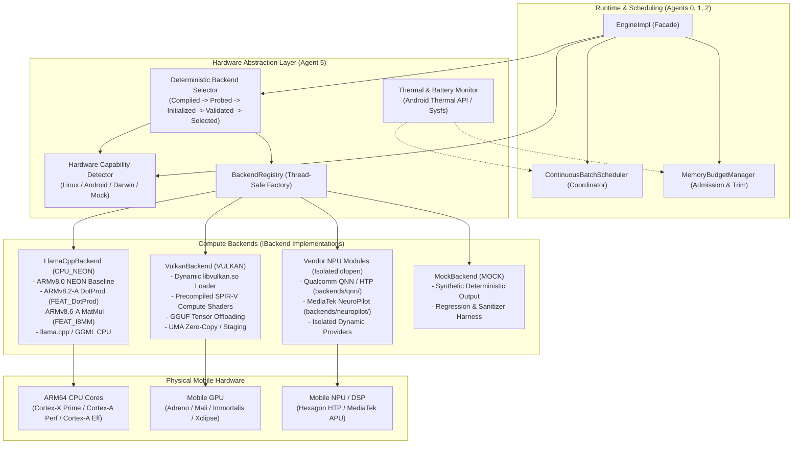
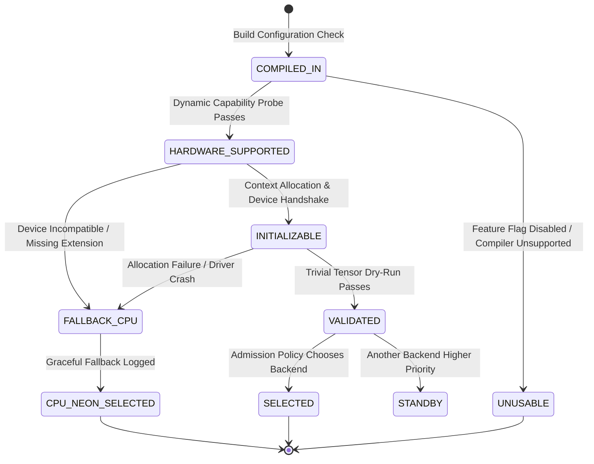
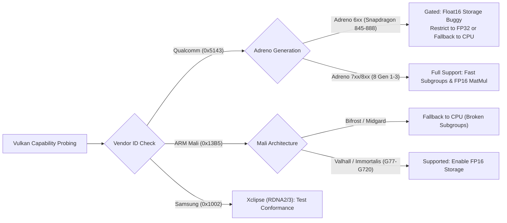
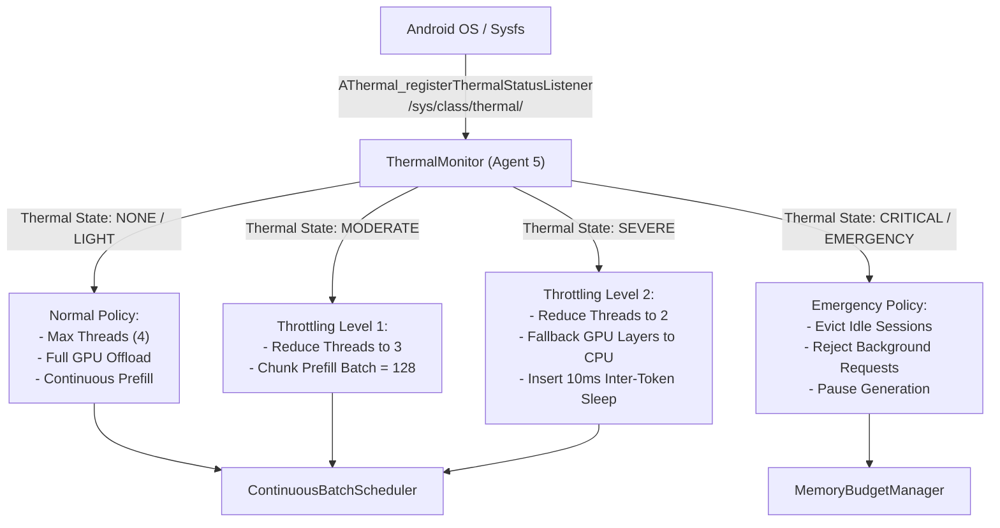

# MobileLLM Engine — Hardware Acceleration Architecture

> **Module Ownership:** `backends/`, `tools/profiling/`, `tools/benchmark/`  
> **Author:** Agent 5 (Principal Hardware Acceleration Engineer)  
> **Reviewers:** Agent 0 (Lead Architect), Agent 1 (C++ Runtime), Agent 2 (Scheduler), Agent 3 (Android)  
> **Status:** Proposed Architecture  
> **Date:** November 14, 2026  
> **Governing ADR:** [ADR-0005](file:///Users/Apple/Developer/ai-apps/MobileLLM/docs/adr/0005-hardware-backend-abstraction-and-fallback-policy.md), [ADR-0008](file:///Users/Apple/Developer/ai-apps/MobileLLM/docs/adr/ADR-0008-scheduler-runtime-integration.md), and [ADR-0009](file:///Users/Apple/Developer/ai-apps/MobileLLM/docs/adr/0009-hardware-capability-detection-and-modular-acceleration-architecture.md)

---

## 1. Executive Summary & Architectural Scope

MobileLLM Engine is designed to deliver deterministic, low-latency, and memory-safe local LLM inference across fragmented mobile environments. Mobile hardware introduces severe physical constraints:
- **Heterogeneous Compute:** Asymmetric ARM big.LITTLE / DynamIQ CPU topologies, mobile GPUs with diverse driver revisions, and proprietary vendor Neural Processing Units (NPUs).
- **Physical Memory Budgets:** Total RAM ranging from 4 GB to 16 GB, with strict Android Low Memory Killer Daemon (`lmkd`) eviction policies and zero swap space.
- **Thermal and Battery Envelopes:** Rapid thermal throttling within 60–120 seconds of sustained peak compute, dropping clock frequencies by 30% to 60%.
- **Driver Fragility:** Severe fragmentation across Qualcomm Adreno, ARM Mali, and Samsung Xclipse Vulkan drivers, where advertised API versions frequently do not guarantee conformance or stability.

This document defines the **Hardware Abstraction Layer (HAL)**, **Capability Detection Subsystem**, **Deterministic Backend Selection State Machine**, **ARM64 NEON Optimization Strategy**, **Vulkan GPU Acceleration Architecture**, **Vendor NPU Evaluation**, and **Thermal/Battery Management Policy**.

---

## 2. System Hardware Topology & Execution Model

The hardware acceleration architecture is strictly decoupled from high-level scheduling, memory budgeting, and public SDK interfaces.



### Architectural Ownership Boundaries
1. **Separation from Scheduler:** As mandated by [ADR-0008](file:///Users/Apple/Developer/ai-apps/MobileLLM/docs/adr/ADR-0008-scheduler-runtime-integration.md), `ContinuousBatchScheduler` coordinates request queues, priorities, iteration steps, and cooperative cancellation. `IBackend` is strictly an execution sink (prefill, token sample, decode).
2. **Separation from Memory Budgeting:** `MemoryBudgetManager` owns device-level RAM ceiling enforcement, process RSS queries, and Android `onTrimMemory` processing. Compute backends register their active allocations (model weights, scratch buffers, VRAM staging) through the budget manager.
3. **Immutability of Golden CPU Standard:** The ARM64 CPU path using ARM NEON SIMD is the foundational reference implementation. All accelerated paths (Vulkan, NPU) must demonstrate numerical equivalence ($\Delta \text{logit} < 10^{-4}$ for FP32, verified token sequence parity) against the CPU baseline.

---

## 3. Hardware Capability Detection Subsystem

### 3.1 Design Principles
1. **No Marketing Name Trust:** Never assume Vulkan or NPU capability based on Android `Build.MODEL`, marketing names, or OS version strings.
2. **Evidence-Based Dynamic Probing:** Every capability is detected via real platform queries, direct instruction-set probes, or dynamic library calls.
3. **Fail-Safe Probing:** Feature probes must never crash the host process. If a dynamic library (`libvulkan.so`, `libQnnHtp.so`) is absent, probing returns a negative result cleanly.
4. **Confidence-Labeled Reporting:** Capabilities report their detection method and confidence level (`CONFIRMED`, `UNSUPPORTED_EXTENSION`, `DRIVER_NOT_FOUND`, `PROBING_FAILED`, `MOCKED`).

### 3.2 Granular Hardware Capability Representation

The internal capability model expands the initial baseline `HardwareProfile` into a strongly-typed, comprehensive structure:

```cpp
namespace mobilellm::hardware {

enum class CapabilityConfidence : uint8_t {
    UNKNOWN = 0,
    UNSUPPORTED = 1,
    MOCKED_TEST = 2,
    DRIVER_PRESENT_UNVALIDATED = 3,
    VERIFIED_AVAILABLE = 4
};

enum class CpuArchitecture : uint8_t {
    UNKNOWN = 0,
    ARM64 = 1,
    ARM32 = 2,
    X86_64 = 3,
    X86 = 4
};

struct CpuTopology {
    uint32_t total_logical_cores{0};
    uint32_t total_physical_cores{0};
    uint32_t prime_cores{0};       // Cortex-X class (> 3.0 GHz)
    uint32_t performance_cores{0}; // Cortex-A7x class (2.0 - 2.8 GHz)
    uint32_t efficiency_cores{0};  // Cortex-A5x class (< 2.0 GHz)
    bool is_heterogeneous{false};  // big.LITTLE / DynamIQ detected
};

struct ArmIsaFeatures {
    bool has_neon{false};
    bool has_fp16{false};          // FEAT_FP16 / ARM_FEATURE_FP16_VECTOR_ARITHMETIC
    bool has_dotprod{false};       // FEAT_DotProd / ARM_FEATURE_DOTPROD (UDOT/SDOT)
    bool has_i8mm{false};          // FEAT_I8MM / ARM_FEATURE_MATMUL_INT8 (UMMLA/SMMLA)
    bool has_sve{false};           // SVE / SVE2
    uint32_t sve_vector_length{0}; // Vector length in bits if SVE active
};

struct VulkanDeviceCapabilities {
    CapabilityConfidence confidence{CapabilityConfidence::UNKNOWN};
    bool driver_loaded{false};
    std::string device_name;
    uint32_t api_version{0};       // e.g. VK_MAKE_API_VERSION(0, 1, 3, 0)
    uint32_t driver_version{0};
    uint32_t vendor_id{0};         // 0x5143 = Qualcomm, 0x13B5 = ARM Mali, 0x1002 = AMD/Samsung
    uint64_t dedicated_video_memory_bytes{0};
    uint64_t shared_system_memory_bytes{0};
    
    // Critical extensions required for GGUF LLM inference
    bool ext_16bit_storage{false};           // VK_KHR_16bit_storage
    bool ext_shader_float16_int8{false};     // VK_KHR_shader_float16_int8
    bool ext_storage_buffer_storage_class{false};
    bool ext_subgroup_size_control{false};   // VK_EXT_subgroup_size_control
    
    // Core feature flags
    bool shader_float16{false};
    bool shader_int8{false};
    bool storage_buffer_16bit_access{false};
    uint32_t subgroup_size{0};
    bool supports_subgroup_arithmetic{false};
};

struct NpuCapabilities {
    CapabilityConfidence qnn_confidence{CapabilityConfidence::UNSUPPORTED};
    std::string qnn_lib_version;
    CapabilityConfidence neuropilot_confidence{CapabilityConfidence::UNSUPPORTED};
    CapabilityConfidence nnapi_confidence{CapabilityConfidence::UNSUPPORTED};
    uint32_t nnapi_device_count{0};
};

struct SystemMemoryProfile {
    uint64_t total_physical_ram_bytes{0};
    uint64_t available_ram_bytes{0};
    uint64_t os_reserved_margin_bytes{512ULL * 1024ULL * 1024ULL}; // Minimum 512 MB safety reserve
    uint64_t max_model_budget_bytes{0};
};

struct HardwareCapabilities {
    CpuArchitecture cpu_arch{CpuArchitecture::UNKNOWN};
    std::string cpu_model_name;
    CpuTopology cpu_topology;
    ArmIsaFeatures arm_features;
    VulkanDeviceCapabilities vulkan;
    NpuCapabilities npu;
    SystemMemoryProfile memory;
    
    // Platform info
    std::string os_version;
    int32_t android_api_level{0};
    std::string soc_platform_name; // e.g. "Snapdragon 8 Gen 3", "Dimensity 9300", "Tensor G3"
};

} // namespace mobilellm::hardware
```

### 3.3 Platform-Specific Probing Interfaces

#### Android and Linux (ARM64 / x86_64)
- **CPU Architecture & ISA:**
  - Query `getauxval(AT_HWCAP)` and `getauxval(AT_HWCAP2)`.
  - Check `HWCAP_ASIMD` for ARM NEON.
  - Check `HWCAP_FPHP` / `HWCAP_ASIMDHP` for FP16 vector arithmetic.
  - Check `HWCAP_ASIMDDP` for Int8 Dot Product (`SDOT`/`UDOT`).
  - Check `HWCAP2_I8MM` for Int8 Matrix Multiply (`SMMLA`/`UMMLA`).
  - Check `HWCAP_SVE` for Scalable Vector Extension.
- **CPU Topology:**
  - Read `/sys/devices/system/cpu/online` for active core indices.
  - Parse `/sys/devices/system/cpu/cpu*/cpu_capacity` to classify cores into Efficiency ($< 400$), Performance ($400 - 800$), and Prime ($> 800$).
  - Fallback to reading `/sys/devices/system/cpu/cpu*/cpufreq/cpuinfo_max_freq` when capacity is not exported.
- **Android System Properties:**
  - Read `ro.board.platform`, `ro.soc.model`, `ro.hardware`, and `ro.product.model` via `__system_property_get` (or `<sys/system_properties.h>`).
  - Read Android API level via `android_get_device_api_level()`.
- **System Memory:**
  - Parse `/proc/meminfo` for `MemTotal` and `MemAvailable`.
  - Fallback to `sysconf(_SC_PHYS_PAGES) * sysconf(_SC_PAGE_SIZE)`.

#### Darwin / macOS (Host Development Baseline)
- **CPU & ISA:**
  - Query `sysctlbyname("hw.optional.AdvSIMD", ...)` for NEON.
  - Query `sysctlbyname("hw.optional.arm.FEAT_DotProd", ...)` for Dot Product.
  - Query `sysctlbyname("hw.optional.arm.FEAT_I8MM", ...)` for I8MM.
  - Query `sysctlbyname("hw.optional.arm.FEAT_FP16", ...)` for FP16 vector math.
- **Memory & Core Counts:**
  - Query `hw.memsize`, `hw.ncpu`, `hw.perflevel0.logicalcpu`, `hw.perflevel1.logicalcpu`.

#### Dynamic Vulkan Probing (Zero Hard Link-Time Dependency)
To prevent runtime link failures on devices without Vulkan libraries:
1. `dlopen("libvulkan.so", RTLD_NOW | RTLD_LOCAL)` (or `libvulkan.so.1` on desktop Linux, `libvulkan.1.dylib` on macOS).
2. Resolve `vkGetInstanceProcAddr`.
3. Create a minimal `VkInstance` with application info `apiVersion = VK_API_VERSION_1_1`.
4. Enumerate `VkPhysicalDevice`. If zero devices found, report `UNSUPPORTED`.
5. Query `vkGetPhysicalDeviceProperties` (vendor ID, device name, API version).
6. Query `vkEnumerateDeviceExtensionProperties` to verify `VK_KHR_16bit_storage` and `VK_KHR_shader_float16_int8`.
7. Query `vkGetPhysicalDeviceFeatures2` with `VkPhysicalDeviceVulkan11Features` and `VkPhysicalDeviceVulkan12Features` to confirm `shaderFloat16 = VK_TRUE`.
8. Destroy `VkInstance` and `dlclose()`.
9. Set `VulkanDeviceCapabilities::confidence` to `VERIFIED_AVAILABLE` only if all mandatory compute criteria pass.

---

## 4. Deterministic Backend Selection & Lifecycle State Machine

A common defect in inference engines is selecting a backend merely because its library is compiled or its device name is recognized. MobileLLM enforces a **5-Stage Verification State Machine**:



### 4.1 The Five Backend Lifecycle States
1. **`COMPILED_IN`:** The backend source code is compiled into the binary (e.g. `MOBILELLM_ENABLE_LLAMACPP=ON`, `MOBILELLM_ENABLE_VULKAN=ON`).
2. **`HARDWARE_SUPPORTED`:** Runtime hardware capability probing verified physical device presence, driver version, and mandatory ISA/extension support.
3. **`INITIALIZABLE`:** The backend successfully created its device context, command queue, and allocated memory without triggering OS or driver errors.
4. **`VALIDATED`:** The backend completed a non-allocating, dry-run inference step (e.g. evaluating 1 token or a trivial kernel) without numeric NaN, segmentation violation, or driver abort.
5. **`SELECTED`:** The runtime admitted the model onto this backend for active user generation.

### 4.2 Deterministic Selection Priority Matrix

| Priority | Backend Candidate | Pre-conditions Required for Selection | Fallback Action on Failure |
| :---: | :--- | :--- | :--- |
| **P0 (Highest)** | **User Explicit Override** | Caller passed explicit `BackendType::VULKAN` or `CPU_NEON` in `ModelLoadConfig`. Backend must reach `VALIDATED`. | If explicit backend fails, log error and fail request with descriptive `StatusCode::BACKEND_INITIALIZATION_FAILED` (do not silently disobey user request). |
| **P1** | **Validated Vulkan Backend** | `BackendType::AUTO` selected. Device has $\ge 6\text{ GB}$ RAM, Vulkan reaches `VALIDATED`, model context $\le \text{VRAM budget}$, and driver is not on the vendor blocklist. | Automatic, transparent fallback to **P2 (CPU_NEON)**. Log diagnostic warning with fallback reason. |
| **P2** | **CPU Backend with ARM NEON** | `BackendType::AUTO` selected or fallback from Vulkan. CPU reaches `VALIDATED`. Dynamically activates DotProd or I8MM if probed. | Final compute standard. If CPU cannot allocate model weights, return `StatusCode::OUT_OF_MEMORY`. |
| **P3 (Lowest)** | **Mock Backend** | Compiled in test builds (`MOBILELLM_ENABLE_LLAMACPP=OFF`) or unit test harness. | Internal testing only. |

### 4.3 Fail-Safe Fallback Implementation Rules
- **No Partial Leaks:** If a candidate backend fails at step `INITIALIZABLE` or `VALIDATED`, its partially allocated native resources (e.g., `VkDevice`, command buffers, pinned host buffers) must be destroyed immediately before falling back to CPU.
- **Log Diagnostic Error:** Fallback must produce a structured error message detailing: failed backend, failure phase, operating system error code or Vulkan result, and the fallback target.
- **Preserve ABI and Model Configuration:** The fallback target must accept the exact same `ModelLoadConfig` and model weights file without requiring the application layer to intervene.

---

## 5. CPU & ARM64 NEON Optimization Strategy

### 5.1 Architecture Baseline
The foundational compute engine for MobileLLM is ARM64 (AArch64). In the AArch64 ISA:
- 128-bit **ARM NEON Advanced SIMD** is an architectural requirement, providing 32 128-bit vector registers (`v0`–`v31`).
- Fused Multiply-Add (`FMA`) instructions (`FMLA`, `FMLS`) are mandatory in ARMv8.0-A.

### 5.2 ARM Feature Tiers & Compiler Flags

| Tier | Architecture Level | Key Instructions | Target Chipsets | Compiler Flags |
| :---: | :--- | :--- | :--- | :--- |
| **Tier 1 (Baseline)** | ARMv8.0-A | NEON 128-bit SIMD, 4-way FP32 FMA, 8-way FP16 (software convert), 16-way Int8 add | Cortex-A53, Cortex-A72, Snapdragon 835/845, Kirin 970 | `-O3 -DNDEBUG` (Standard AArch64 NDK default) |
| **Tier 2 (DotProd)** | ARMv8.2-A + `FEAT_DotProd` | `SDOT`, `UDOT` (4-way 8-bit dot product accumulating into 32-bit integer per lane) | Snapdragon 855/865/888, Dimensity 1000/1200, Exynos 990, Apple A12+ | `-march=armv8.2-a+dotprod+fp16` |
| **Tier 3 (MatMul / I8MM)** | ARMv8.6-A + `FEAT_I8MM` | `SMMLA`, `UMMLA`, `USMMLA` (8-bit integer matrix multiply accumulating $2 \times 2$ matrices into 32-bit integers) | Snapdragon 8 Gen 1/2/3, Dimensity 9000/9200/9300, Tensor G2/G3/G4, Apple A14+ | `-march=armv8.6-a+i8mm+fp16` |

### 5.3 Optimization Principles
1. **Leverage GGML Vectorized Kernels:** `llama.cpp`'s GGML submodule already provides highly optimized ARM64 assembly kernels in `ggml-cpu-aarch64.c` for `Q4_0`, `Q4_K`, `Q8_0`, and `F16` quantizations using both `SDOT` and `SMMLA`. **Do not write redundant duplicate NEON kernels.**
2. **Runtime Dispatch vs. Multi-Arch Build:**
   - On Android, distributing a single shared library (`libmobilellm.so`) targeting `-march=armv8.6-a+i8mm` directly causes `SIGILL` (Illegal Instruction) crashes on older devices lacking `FEAT_I8MM`.
   - Instead, compile the baseline library with standard AArch64 flags, and compile kernel dispatch units with compiler function attributes (`__attribute__((target("+dotprod")))`, `__attribute__((target("+i8mm")))`), selecting the optimal function pointer via runtime capability probing (`getauxval`).
3. **Memory Alignment & 16 KB Page Compatibility:**
   - All tensor buffers and scratch allocations must be 64-byte aligned (matching ARM Cortex cache lines) using `posix_memalign` or `std::aligned_alloc`.
   - Android 15 (API 35+) and Android 17 (API 37) mandate **16 KB ELF page alignment** (`-Wl,-z,max-page-size=16384`). All shared libraries (`libmobilellm.so`, `libmobilellm_jni.so`) must enforce this linker flag.

### 5.4 CPU Core Affinity & big.LITTLE Scheduling
Mobile SoCs feature heterogeneous CPU core clusters (DynamIQ):
- **Prime Core (1x):** Cortex-X class. Highest clock speed ($3.0 - 3.4\text{ GHz}$), largest L2 cache ($1 - 2\text{ MB}$), highest power consumption.
- **Performance Cores (3–4x):** Cortex-A7xx class. High clock speed ($2.4 - 2.8\text{ GHz}$), balanced efficiency.
- **Efficiency Cores (2–4x):** Cortex-A5xx class. Low clock speed ($1.8 - 2.0\text{ GHz}$), small L2 cache ($512\text{ KB}$), low power.

**Thread Sizing Policy:**
- **Autoregressive Token Decode:** Decode throughput is strictly memory-bandwidth bound. Spawning 8 threads across all cores causes severe cache thrashing and forces threads onto efficiency cores, slowing down the entire generation step.
- **Optimal Thread Count:** Pin thread count to **the number of Performance + Prime cores** (typically 3 to 4 threads on modern SoCs).
- **Prompt Prefill:** Prefill is compute-bound (GEMM). Prefill can scale to 6 threads momentarily if thermal headroom permits, then drop back to 4 threads during decode.

---

## 6. Vulkan GPU Acceleration Integration Architecture

### 6.1 Feasibility Assessment & Integration Path
`llama.cpp` contains an established Vulkan backend (`ggml-vulkan.cpp` in `third_party/llama.cpp/ggml/src/ggml-vulkan/`).
Rather than constructing an isolated custom Vulkan inference engine from scratch, MobileLLM integrates Vulkan through the **`ggml-vulkan` backend within `LlamaCppBackend` / `VulkanBackend`**.

### 6.2 Overcoming the Android Build & Shader Compilation Blocker
- **The Problem:** The stock `ggml-vulkan/CMakeLists.txt` executes `find_package(Vulkan COMPONENTS glslc REQUIRED)` and invokes `vulkan-shaders-gen` during CMake configuration. In Android NDK cross-compilation (e.g. from macOS or Linux x86_64), `glslc` cannot run as a host binary unless specifically configured, breaking standard Android SDK Gradle builds.
- **The Architectural Solution:**
  1. **Precompiled Embedded SPIR-V Headers:** Compile GLSL compute shaders (`.comp`) offline into static C/C++ header arrays (`ggml-vulkan-shaders.hpp`) during release preparation.
  2. **Decoupled Shader Compilation:** When `MOBILELLM_ENABLE_VULKAN=ON` is configured for Android NDK builds, bypass the host `glslc` target and compile directly against the pre-generated SPIR-V byte arrays.
  3. **Runtime SPIR-V Pipeline Creation:** At runtime, the mobile GPU driver compiles the precompiled SPIR-V binaries into device machine code via `vkCreateComputePipelines`.

### 6.3 Android Mobile GPU Driver Compatibility Matrix



#### Driver Quirks & Mitigation Policies:
1. **Adreno 6xx Buggy Float16 Storage:** Many Adreno 6xx drivers crash on `VK_KHR_16bit_storage` with certain quantization layouts. Proactively restrict Vulkan to Adreno 7xx+ (Snapdragon 8 Gen 1 and above) or enforce strict driver version verification.
2. **Unified Memory Architecture (UMA):** Unlike desktop GPUs with separate PCIe VRAM, mobile SoCs share physical RAM between CPU and GPU.
   - Use `VK_MEMORY_PROPERTY_HOST_VISIBLE_BIT | VK_MEMORY_PROPERTY_HOST_COHERENT_BIT` with `VK_MEMORY_PROPERTY_DEVICE_LOCAL_BIT` for zero-copy weight access where supported.
3. **GGUF Tensor Offloading Strategy:**
   - `ModelLoadConfig::n_gpu_layers`: Determine dynamically based on available device memory.
   - For a 30-layer model (e.g. SmolLM2 or Llama 3.2 1B/3B), offload all layers to GPU only if available device local memory $\ge 1.5 \times \text{model weight footprint}$.
   - If memory is constrained, support partial layer offloading (e.g. 15 layers on GPU, 15 layers on CPU).
4. **Vulkan Device Loss Recovery (`VK_ERROR_DEVICE_LOST`):**
   - On Android, incoming phone calls, background app switching, or thermal throttling can cause the OS to reclaim GPU contexts, emitting `VK_ERROR_DEVICE_LOST`.
   - The Vulkan backend must trap this error code, cleanly release all allocated Vulkan handles, and seamlessly rehydrate the active session on `CPU_NEON` without terminating the process.

---

## 7. Mobile NPU Landscape & Evaluation

Mobile NPUs offer up to $45 - 75\text{ TOPS}$ of compute at exceptional energy efficiency ($> 10\text{ TOPS/Watt}$). However, integrating NPUs into an open-source, GGUF-native runtime presents significant architectural challenges:

### 7.1 Comprehensive NPU Platform Comparison

| Evaluation Vector | Qualcomm QNN (Hexagon HTP) | MediaTek NeuroPilot (APU) | Samsung ENPU (Exynos) | Android NNAPI / LiteRT |
| :--- | :--- | :--- | :--- | :--- |
| **Hardware Core** | Hexagon Vector eXtensions (HVX) + HTP | MediaTek APU 790 / 890 | Exynos NPU | Generic HAL (Vendor Driver) |
| **Target Devices** | Snapdragon 8 Gen 1/2/3/4, 7+ Gen 2 | Dimensity 9000/9200/9300, 8300 | Galaxy S22/S24 (Exynos editions) | Android 8.1 - 14 (Fragmented) |
| **Android Market Share** | ~40% (Global Mid-to-Flagship) | ~35% (Global Entry-to-Flagship) | ~15% (Europe / Asia Samsung) | Global (Decreasing utility) |
| **Licensing** | Proprietary Qualcomm SDK License | Proprietary MediaTek NDA / SDK | Proprietary Samsung NDA | Apache 2.0 (AOSP) |
| **SDK Availability** | Qualcomm Developer Network (Public registration) | Restricted Partner Access / NDA | Restricted Partner Access | Standard Android NDK |
| **GGUF Compatibility** | **Zero Native Support** (Requires QNN Graph Compilation) | **Zero Native Support** (Requires NeuroPilot Model Converter) | **Zero Native Support** | **Zero Native Support** |
| **Supported Quantization** | INT4, INT8, FP16 (Fixed-point preferred) | INT4, INT8, FP16 | INT8, FP16 | INT8, FP16, FP32 |
| **Dynamic Shapes & LLM Ops** | Limited (Recent HTP updates add RoPE and dynamic batch) | Limited (Prefers static graphs) | Very Limited | **Unsupported** (Lacks RoPE, RMSNorm, SwiGLU) |
| **Maintenance Burden** | **High** (~500 MB binary toolchain, driver updates) | **Extreme** (Restricted partner SDKs) | **Extreme** | Low (Deprecated) |

### 7.2 Architectural Assessment & Recommendations
1. **The Android NNAPI Reality:** Google officially **deprecated NNAPI in Android 15 (API 35)**. NNAPI was designed for static convolutional networks (MobileNet) and completely lacks native operators required by modern LLMs (Rotary Position Embeddings, RMS Normalization, dynamic causal attention masking). **Do not invest engineering effort in legacy NNAPI.**
2. **Proprietary Vendor SDK Isolation:**
   - Under no circumstances should proprietary vendor libraries (`libQnnHtp.so`, `libneuron_adapter.so`) be committed to the repository or linked statically into `libmobilellm.so`.
   - All vendor NPU integrations must reside in isolated compilation units (`backends/qnn/`, `backends/neuropilot/`) and interact exclusively via dynamic runtime loading (`dlopen`).
3. **The GGUF Impedance Mismatch:**
   - GGUF is designed for dynamic tensor execution with variable context lengths. NPUs are optimized for ahead-of-time (AOT) static graph compilation with fixed tensor dimensions.
   - **Recommendation:** Keep NPU integration as an **isolated experimental research path** for Milestone 4/5. Prioritize Vulkan GPU acceleration for production, which natively supports dynamic context lengths and GGUF quantization formats without model recompilation.

---

## 8. Thermal & Battery Management Architecture

### 8.1 Mobile Thermal Dynamics
When an LLM executes continuous autoregressive token decoding on a mobile device:
1. SoC temperature increases at $0.2^\circ\text{C} - 0.5^\circ\text{C}$ per second.
2. At approximately $75^\circ\text{C} - 80^\circ\text{C}$ die temperature, the Linux kernel thermal throttling governor intervenes:
   - Prime cores throttled down from $3.3\text{ GHz}$ to $1.8\text{ GHz}$.
   - GPU throttled down from $900\text{ MHz}$ to $400\text{ MHz}$.
   - Result: Decode throughput drops from $8.5\text{ tok/s}$ to $3.2\text{ tok/s}$, and latency variance increases dramatically.

### 8.2 Thermal Advisory Subsystem Design



### 8.3 Platform Thermal Interfaces
- **Android NDK (API 30+):** `<android/thermal.h>` provides:
  - `AThermal_registerThermalStatusListener()`
  - `AThermal_getCurrentThermalStatus()` returning:
    - `ATHERMAL_STATUS_NONE` (0)
    - `ATHERMAL_STATUS_LIGHT` (1)
    - `ATHERMAL_STATUS_MODERATE` (2)
    - `ATHERMAL_STATUS_SEVERE` (3)
    - `ATHERMAL_STATUS_CRITICAL` (4)
    - `ATHERMAL_STATUS_EMERGENCY` (5)
    - `ATHERMAL_STATUS_SHUTDOWN` (6)
- **Linux Sysfs Fallback:**
  - Read `/sys/class/thermal/thermal_zone*/temp` to calculate temperature trends when running on Linux desktop or older Android versions.

### 8.4 Battery-Aware Policy Guidelines
- **Battery Saver Mode (`PowerManager.isPowerSaveMode()`):**
  - Limit generation concurrency to a single interactive request.
  - Cap context window to 1,024 tokens.
  - Pin thread pool strictly to Efficiency/Performance cores, completely idling the power-hungry Prime core.

---

## 9. Performance Benchmarking Methodology

To comply with the **Evidence-Based Optimization Principle**, all hardware claims must be supported by reproducible measurements across physical hardware:

### 9.1 Standardized Metrics

```
1. Cold Model Load Time (ms):     Time from load_model() invocation to ready state (including mmap).
2. Warm Model Load Time (ms):     Time to re-instantiate context when weights are cached in OS page cache.
3. Time To First Token (TTFT, ms): Latency from request submission to emission of chunk #0 (Prompt Evaluation).
4. Prefill Throughput (tok/s):    Prompt Token Count / (Prefill Duration in seconds).
5. Decode Throughput (tok/s):     Completion Token Count / (Decode Duration in seconds).
6. Peak Resident Set Size (RSS):  Maximum resident physical memory in bytes via /proc/self/statm or Mach task_info.
7. Peak Proportional Set Size:   PSS via /proc/self/smaps_rollup (reflecting true shared memory footprint).
8. Thermal Delta (Δ°C):           Die temperature difference over a 1,000-token continuous decode session.
9. Energy Consumption (mA / mWh): Battery discharge rate via BatteryManager or Qualcomm Power Monitor.
```

### 9.2 Reproducibility Protocol
- Test models: `SmolLM2-135M-Instruct-Q4_K_M.gguf` (100.6 MB) and `Llama-3.2-1B-Instruct-Q4_K_M.gguf` (780 MB).
- Prompt conditions: Fixed synthetic prompts of 64, 256, and 1,024 tokens.
- Generation conditions: Fixed output length of 128 tokens, greedy sampling (`temp = 0.0`), 5 consecutive runs with a 30-second inter-run cooldown.
- **Reporting Rule:** Never present Mac Metal or Apple Silicon results as Android performance figures.

---

## 10. Public API and Compatibility Impact

All hardware capability enhancements must maintain **100% backward compatibility** with existing C-API signatures (`runtime/include/mobilellm/c_api.h`), Kotlin SDK interfaces (`MobileLLMClient.kt`), and Python SDK bindings (`mobilellm/`).

### 10.1 C-API Compatibility
- Existing API: `mllm_detect_hardware(char* json_buffer, size_t max_len)`
- **Behavioral Evolution:** Instead of returning hardcoded JSON `"{\"device\":\"Host\",\"arch\":\"ARM64\"...}"`, the function formats a verified, dynamic JSON payload from `HardwareCapabilities`.
- Existing JSON keys (`device`, `arch`, `neon`, `vulkan`, `npu`) are preserved. New structured sub-objects (`cpu_topology`, `arm_features`, `vulkan_details`, `memory`) are added additively.

### 10.2 ModelLoadConfig Backend Preference
- `preferred_backend` (`BackendType::AUTO`, `CPU_NEON`, `VULKAN`, `VENDOR_NPU`) in `ModelLoadConfig` is passed directly to the `Deterministic Backend Selector`, preserving existing client configurations.

---

## 11. Coordination Matrix & Cross-Agent Dependencies

| Agent | Module | Interfacing Contract | Dependency / Risk |
| :--- | :--- | :--- | :--- |
| **Agent 0 (Lead Architect)** | Architecture | ADR-0005, ADR-0008, ADR-0009 | HAL design approval and system integration. |
| **Agent 1 (C++ Runtime)** | `runtime/` | `IBackend`, `HardwareProfile`, `query_hardware()` | Agent 5 implements `CapabilityDetector` and integrates with `EngineImpl`. |
| **Agent 2 (Scheduler)** | `scheduler/` | `BackendCapabilities`, `MemoryBudgetManager` | Agent 5 provides thermal throttling signals to modulate thread counts and batch sizes. |
| **Agent 3 (Android)** | `android/` | `NativeBridge.nativeDetectHardware`, Gradle CMake | Agent 5 ensures precompiled SPIR-V headers prevent Gradle build breakages. |
| **Agent 6 (QA & Security)** | Tests & Harness | Numerical equivalence tests, mock hardware tests | Agent 5 provides mock capability injection for CI testing on headless x86_64 runners. |

---

## 12. Conclusion & Next Steps

This architecture establishes a robust, evidence-based hardware acceleration foundation for MobileLLM. It eliminates hardcoded capability strings, establishes an automated CPU fallback state machine, clarifies ARM64 NEON optimization tiers, designs a cross-compilation safe Vulkan integration path, and provides an objective evaluation of mobile NPUs.

**Immediate Next Step:** Review and accept [ADR-0009](file:///Users/Apple/Developer/ai-apps/MobileLLM/docs/adr/0009-hardware-capability-detection-and-modular-acceleration-architecture.md) and obtain Lead Architect approval before commencing Stage 2 implementation.

