# MobileLLM Engine — Scheduler & Mobile Resource Manager Runtime Integration Architecture

> **Document Type:** Production Architecture Specification & Design Blueprint  
> **Author:** Lead Architect & Principal C++ Inference Runtime Engineer (Agent 0)  
> **Audience:** Runtime Engineers, Android NDK Engineers, Inference Performance Engineers  
> **Date:** November 12, 2026  
> **Status:** APPROVED FOR ARCHITECTURAL REVIEW  
> **Target Systems:** Android ARM64-v8a (16 KB / 4 KB page sizes), Apple Silicon macOS (ARM64), Linux x86_64  

---

## Executive Summary

MobileLLM Engine requires an integrated, production-grade scheduling and memory-budgeting architecture to prevent Android Low Memory Killer Daemon (`lmkd`) termination, manage concurrent session lifecycles, and deliver deterministic, priority-aware autoregressive inference.

An exhaustive codebase inspection reveals that while the runtime core (`runtime/`, 32 passing tests) and scheduler prototypes (`scheduler/`, 17 passing tests) build cleanly, **the scheduler subsystem is entirely disconnected from the active inference execution path**:
- `EngineImpl::generate_async` currently bypasses the scheduler, spawning uncoordinated `std::thread` workers per request and calling `LlamaCppBackend` directly.
- `runtime/CMakeLists.txt` does not link `mobilellm_scheduler`.
- The scheduler's `KVCacheManager` allocates dummy heap vectors (`KVBlock::buffer`) in isolation, while `LlamaCppBackend` allocates its own monolithic context memory inside `llama_context`.
- Android `onTrimMemory` signals are not plumbed through JNI or the C API into the memory budget manager.

This document establishes the authoritative architecture for integrating `scheduler/` into `runtime/` without breaking existing public C/C++ or Kotlin APIs, replacing `llama.cpp`, or making false claims regarding paged attention hardware execution.

---

## 1. Existing Architecture & Data Flow

### 1.1 Current Active Runtime Execution Path
The active inference pipeline is implemented in `runtime/src/engine/engine_impl.cpp` and interfaces directly with `backends/cpu/llamacpp_backend.cpp`:

```mermaid
flowchart TD
    subgraph ClientLayer["Application / Client Layer"]
        App["Android Kotlin App / Python SDK / C-ABI Client"]
    end

    subgraph RuntimeLayer["Runtime Core (runtime/)"]
        CAPI["mllm_generate() (c_api.cpp)"]
        Engine["EngineImpl::generate_async()"]
        WorkerThread["Ad-hoc std::thread (EngineImpl::run_generation)"]
    end

    subgraph BackendLayer["Compute Backend (backends/cpu/)"]
        Backend["LlamaCppBackend"]
        LlamaCtx["llama_context (llama.cpp internal monolithic KV-cache)"]
    end

    App -->|Prompt, SamplingParams| CAPI
    CAPI --> Engine
    Engine -->|Spawns Worker| WorkerThread
    WorkerThread -->|evaluate_prompt()| Backend
    Backend --> LlamaCtx
    WorkerThread -->|sample_next_token() loop| Backend
    Backend -->|llama_decode() single step| LlamaCtx
    WorkerThread -->|TokenCallback(chunk)| App
    WorkerThread -->|CompletionCallback(status, metrics)| App
```

### 1.2 Disconnected Scheduler Prototype Subsystem
In parallel, `scheduler/` contains an isolated scheduling engine (`ContinuousBatchScheduler`) tested exclusively in `scheduler/tests/` via `MockBackend`:

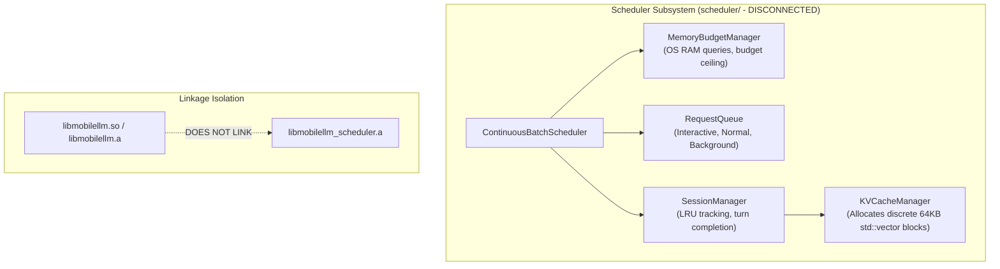

---

## 2. Current Limitations & Technical Deficiencies

1. **Uncoordinated Thread Spawning (Core Thrashing):**  
   Every invocation of `EngineImpl::generate_async` launches a new `std::thread`. On asymmetric mobile big.LITTLE CPUs (e.g., 1 Cortex-X4 prime + 3 Cortex-A720 performance + 4 Cortex-A520 efficiency cores), multiple concurrent requests spawn competing threads that fight for CPU caches and memory bandwidth, triggering thermal throttling and severe frame drops.
2. **Zero In-Flight Request Queuing & Prioritization:**  
   There is no admission control. Interactive UI requests, streaming chat turns, and background batch jobs compete identically, leading to high latency spikes for interactive users.
3. **Unchecked Memory Allocation & OOM SIGKILL Risk:**  
   `EngineImpl::load_model` and `EngineImpl::create_session` do not query `MemoryBudgetManager`. If a user loads a 4 GB quantized model on a 6 GB device with 1.8 GB available RAM, the process is terminated uncatchably by `lmkd`.
4. **Phantom Memory Double-Allocation:**  
   `KVCacheManager` allocates `total_blocks * bytes_per_kv_block` (e.g., 512 * 64 KB = 32 MB) of raw `std::vector<uint8_t>` buffers on the C++ heap. However, `llama.cpp` never touches these buffers; `llama_new_context_with_model` allocates its own KV cache internally. Running both simultaneously doubles memory overhead with zero functional utility.
5. **Handle Space Discrepancy:**  
   `EngineImpl` generates `SessionHandle` (1, 2, ...), `SessionManager` generates its own `SessionHandle` (1, 2, ...), and `IBackend` generates `BackendSessionHandle` (1, 2, ...). In the existing unit tests, numeric values accidentally aligned, but without explicit mapping, lifecycle tracking across layers breaks under real workloads.
6. **Dead-End Android OS Memory Hooks:**  
   In `android/sdk/.../MobileLLMClient.kt`, `onMemoryPressure(level)` is an empty stub. `NativeBridge` has no JNI binding for memory trimming, and neither `c_api.h` nor `engine.h` provides a memory trim entry point.

---

## 3. Proposed Component Responsibilities

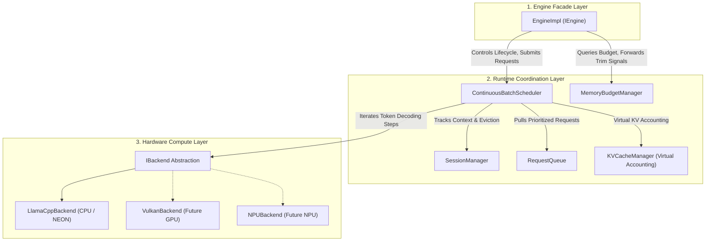

### Detailed Component Roles:

| Component | Strict Responsibility Boundary | What It Must NOT Do |
| :--- | :--- | :--- |
| **`EngineImpl`** | Public API implementation, external handle translation, engine initialization/shutdown, model registry, delegating execution to the scheduler. | Must NOT spawn worker threads per generation; must NOT invoke `IBackend::evaluate_prompt` or `IBackend::sample_next_token` directly. |
| **`ContinuousBatchScheduler`** | Dedicated single worker thread loop, iteration-level continuous batching, admitting requests from `RequestQueue`, invoking single-step backend evaluations, streaming token callbacks, retiring finished requests. | Must NOT manage low-level hardware memory buffers or execute tensor math. |
| **`MemoryBudgetManager`** | Dynamic OS RAM inspection (`/proc/meminfo`, `mach_vm`), enforcing safety margins (512 MB) and budget ceilings (70%), tracking allocations across model/KV/scratch buckets, processing OS trim events. | Must NOT dictate token sampling or request priority. |
| **`SessionManager`** | Maintaining session metadata (model association, context limits, sliding window policies, LRU timestamp), finding eviction candidates under memory pressure, triggering context truncation. | Must NOT perform raw token tensor decoding. |
| **`KVCacheManager`** | **Virtual Block Accounting**: Tracking 16-token logical blocks, mapping logical token indices to virtual blocks, tracking prefix hash sharing, computing KV memory usage for `MemoryBudgetManager`. | **Must NOT allocate physical raw tensor storage vectors when running on top of llama.cpp.** |
| **`RequestQueue`** | Thread-safe multi-tier priority queue (`INTERACTIVE`, `NORMAL`, `BACKGROUND`), starvation prevention, cooperative cancellation indexing. | Must NOT invoke backend operations. |
| **`IBackend`** | Pure hardware execution: context allocation, prompt prefill tokenization/evaluation, single/batched token decode, logit generation, logit sampling, detokenization. | Must NOT know about Android lifecycle, UI priorities, or higher-level request queues. |

---

## 4. Interfaces & Ownership Model

### 4.1 Ownership Hierarchy
To guarantee clean shutdown, zero memory leaks, and deterministic thread joining:
1. `EngineImpl` is the root owner. It holds:
   - `std::shared_ptr<MemoryBudgetManager> memory_mgr_`
   - `std::unique_ptr<ContinuousBatchScheduler> scheduler_`
   - `std::unique_ptr<IBackend> backend_`
   - `std::unordered_map<ModelHandle, ModelEntry> models_`
   - `std::unordered_map<SessionHandle, RuntimeSession> sessions_`
2. `ContinuousBatchScheduler` holds:
   - `std::shared_ptr<RequestQueue> queue_`
   - `std::shared_ptr<SessionManager> session_mgr_`
   - `std::shared_ptr<KVCacheManager> kv_mgr_`
   - `std::shared_ptr<MemoryBudgetManager> memory_mgr_`
   - `IBackend* backend_` (non-owning raw pointer/reference to `EngineImpl`'s backend)
   - `std::thread worker_thread_` (the single scheduler execution thread)

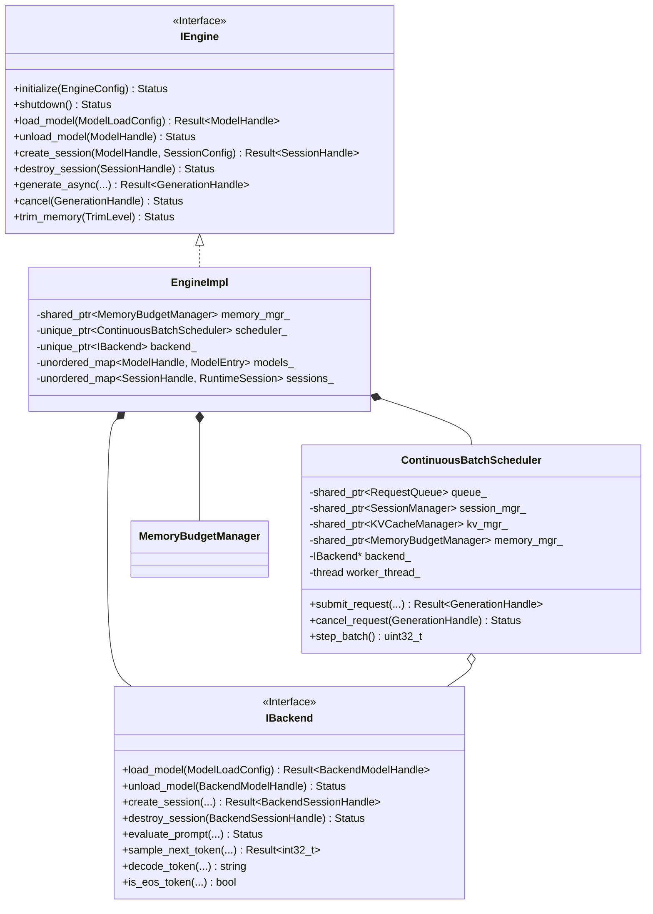

### 4.2 Runtime Session Mapping Struct
To bridge handle spaces cleanly without confusion:
```cpp
struct RuntimeSession {
    SessionHandle handle{0};                      // External engine session handle
    ModelHandle model_handle{0};                  // Associated model handle
    BackendSessionHandle backend_handle{0};        // Low-level backend context handle
    uint32_t max_context_tokens{2048};
    bool enable_prefix_caching{true};
    std::vector<int32_t> cached_prompt_tokens;    // Retained for context rehydration
};
```

---

## 5. Model & Session Lifecycle Architecture

### 5.1 Model Loading Sequence with Memory Gating

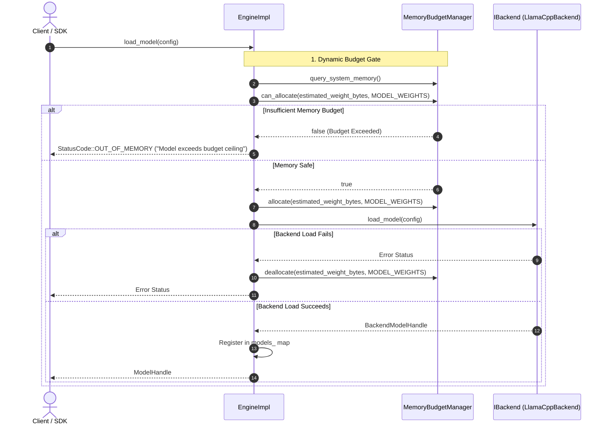

### 5.2 Session Lifecycle & State Machine
A session transitions through five deterministic states:

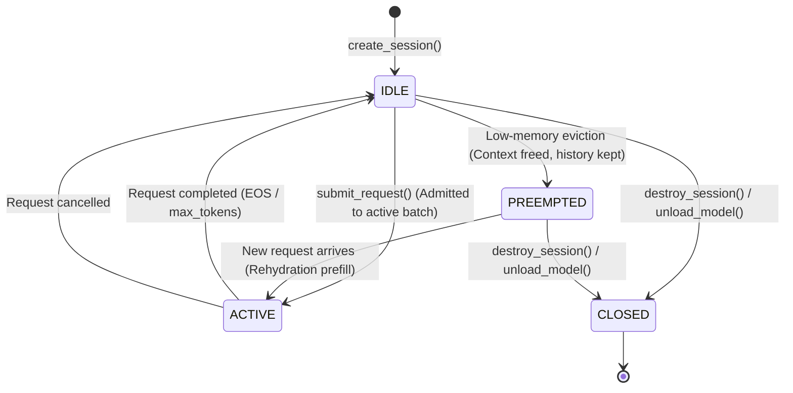

### 5.3 Model Unloading Cascading Teardown Contract
When `EngineImpl::unload_model(ModelHandle model)` is invoked:
1. **Cancel & Drain In-Flight Requests:** Identify all requests in `scheduler_->queue()` and `scheduler_->active_batch()` belonging to sessions tied to `model`. Mark their atomic cancellation flag.
2. **Synchronize:** Wait for active scheduler step iteration to retire those requests cleanly.
3. **Destroy Associated Sessions:** For each session associated with `model`:
   - Notify `SessionManager::destroy_session(session_id)`.
   - Release virtual KV blocks in `KVCacheManager`.
   - Destroy backend context via `backend_->destroy_session(backend_handle)`.
   - Deallocate estimated KV bytes from `MemoryBudgetManager`.
4. **Unload Backend Model:** Call `backend_->unload_model(backend_model_handle)`.
5. **Release Memory Accounting:** Call `memory_mgr_->deallocate(weight_bytes, AllocationType::MODEL_WEIGHTS)`.
6. **Erase Registry Entries:** Remove session and model entries from `EngineImpl` lookup tables.

---

## 6. Memory Budget & Eviction Design

### 6.1 Mathematical Formulation of Mobile Memory Budget

On mobile operating systems (especially Android), memory is unified, swap is absent, and the Low Memory Killer Daemon (`lmkd`) enforces harsh eviction policies.

$$\text{Usable RAM} = \max\left(0, \text{System Available RAM} - \text{Safety Margin (512 MB)}\right)$$

$$\text{Budget Ceiling} = \min\left(\text{Usable RAM} \times 0.70, \text{Config Ceiling}\right)$$

Total memory accounted by MobileLLM must satisfy at all times:

$$\text{Total Usage} = \text{Usage}_{\text{Model Weights}} + \text{Usage}_{\text{KV Cache}} + \text{Usage}_{\text{Scratch Workspace}} \le \text{Budget Ceiling}$$

```
+-------------------------------------------------------------------------+
|                           Total Device RAM                              |
+-------------------------------------------------------------------------+
|     OS & Foreground App Reserved (>= 512 MB)     |     Remaining RAM    |
+--------------------------------------------------+----------------------+
                                                   | 30% Buffer | 70% Max |
                                                   |  Headroom  | Budget  |
                                                   +------------+---------+
                                                                | MobileLLM
                                                                | Ceiling
```

### 6.2 Tiered Eviction & Preemption Protocol
When available memory approaches the critical threshold or an OS trim event is received:

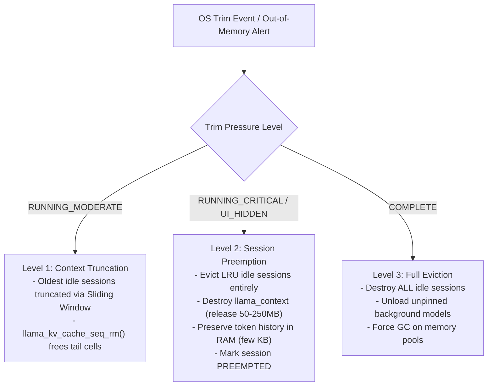

> [!IMPORTANT]
> **Strict Active Context Invariant (Approved Architectural Decision):** Session eviction must **never** destroy an active backend context. Sessions actively participating in the execution loop (`SessionState::ACTIVE`) are strictly protected from preemption. Only idle (`SessionState::IDLE`) or already preempted sessions are eligible for context eviction.

### 6.3 Transparent Context Rehydration & Configurable History
When a user submits a prompt to a session marked `SessionState::PREEMPTED`:
1. `SessionManager` detects the `PREEMPTED` state during request intake.
2. The scheduler re-allocates a backend context via `backend_->create_session(model, config)`.
3. The scheduler concatenates `session.cached_prompt_tokens` + `new_prompt_tokens`.
4. The backend evaluates the rehydration prompt in a prefill pass (`backend_->evaluate_prompt`).
5. Session state transitions from `PREEMPTED` to `ACTIVE`. The user experiences a brief prefill latency (TTFT) rather than a session failure or crash.

**Configurable Session History Retention (Approved Architectural Decision):**
- Preempted sessions retain conversation history up to a default limit of 2,048 tokens (configurable per session via `SessionConfig::max_history_tokens`).
- Bounding history to 2,048 tokens by default prevents unbounded native metadata growth while preserving rich conversation context for rehydration.
- If history exceeds the configured ceiling, oldest conversation turns are truncated (sliding window) prior to rehydration.

---

## 7. KV-Cache Integration Feasibility: Execution vs. Accounting

### 7.1 The Five Layers of KV-Cache Architecture

To maintain strict engineering rigor, the architecture distinguishes the five independent layers of KV-cache functionality:

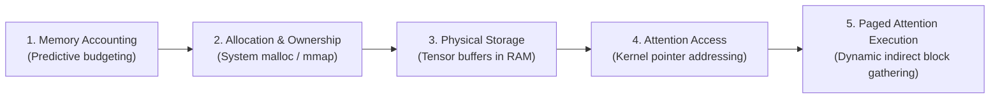

| Architectural Layer | Scheduler Prototype Current State | llama.cpp Baseline Reality | Integrated Architecture Decision |
| :--- | :--- | :--- | :--- |
| **1. Memory Accounting** | Simulates fixed 64 KB blocks in `KVCacheManager`. | Internal calculation inside `llama_new_context_with_model`. | **Scheduler manages accounting:** Calculates true KV bytes from model hyper-parameters and registers with `MemoryBudgetManager`. |
| **2. Allocation & Ownership** | `KVCacheManager` owns `std::vector<KVBlock>`. | `llama_context` owns and allocates KV tensor memory internally. | **`llama_context` owns physical memory.** Scheduler manages virtual logical block mappings without allocating duplicate heap buffers. |
| **3. Physical Storage** | Dummy 64 KB heap byte vectors (`KVBlock::buffer`). | Contiguous GGML tensor memory buffers allocated in unified RAM. | **Eliminate dummy heap buffers:** `KVBlock::buffer` is made empty/disabled during llama.cpp execution. Physical memory resides solely in llama.cpp. |
| **4. Attention Access** | None. No kernel accesses `KVBlock`. | Attention operators address tensors contiguously or via ring buffers. | **llama.cpp handles attention access directly** over its internal context structures. |
| **5. Paged Attention Execution** | **NON-EXISTENT.** | **NOT SUPPORTED via public API.** (Uses FlashAttention/contiguous sliding window). | **Do NOT claim paged attention.** State clearly that Phase 1 uses **Virtual Block Accounting with Sequence Compaction**. |

### 7.2 Llama.cpp KV Allocation Formula
To account for llama.cpp's KV cache accurately in `MemoryBudgetManager` before creating a session, use the exact architectural tensor formula:

$$\text{Bytes per Token} = 2 \times N_{\text{layers}} \times N_{\text{kv\_heads}} \times D_{\text{head}} \times \text{sizeof}(\text{type}_{\text{kv}})$$

$$\text{Session KV Memory} = \text{Bytes per Token} \times N_{\text{ctx}}$$

*Example (SmolLM2-135M, 30 layers, 3 KV heads, head dimension 64, FP16):*
$$\text{Bytes per Token} = 2 \times 30 \times 3 \times 64 \times 2 = 23,040 \text{ bytes} \approx 22.5 \text{ KB/token}$$
For $N_{\text{ctx}} = 2048$, $\text{Session KV Memory} \approx 45.0 \text{ MB}$.

*Example (Llama-3.2-3B, 28 layers, 8 KV heads, head dimension 128, FP16):*
$$\text{Bytes per Token} = 2 \times 28 \times 8 \times 128 \times 2 = 114,688 \text{ bytes} \approx 112 \text{ KB/token}$$
For $N_{\text{ctx}} = 2048$, $\text{Session KV Memory} \approx 224.0 \text{ MB}$.

`MemoryBudgetManager` must check this exact value against remaining budget before permitting `backend_->create_session()`.

### 7.3 Virtual Sequence Compaction Adapter
While llama.cpp does not support external arbitrary page table binding in attention kernels, it **does** provide sequence manipulation APIs:
- `llama_kv_cache_seq_rm(ctx, seq_id, p0, p1)`: Clears cached KV tokens in range $[p0, p1)$ for a sequence.
- `llama_kv_cache_seq_add(ctx, seq_id, p0, p1, delta)`: Shifts token positions to close holes after eviction.
- `llama_kv_cache_seq_cp(ctx, seq_id_src, seq_id_dst, p0, p1)`: Copies KV representations across sequence IDs (enabling instant prefix sharing).

The integrated `KVCacheManager` operates as a **Virtual Block & Sequence Compaction Adapter**:
1. It tracks logical token spans in units of 16 tokens (`TOKENS_PER_BLOCK = 16`).
2. When context exceeds limits or sliding-window truncation is required, the scheduler issues `llama_kv_cache_seq_rm` and `llama_kv_cache_seq_add` to compact the backend cache without destroying and recreating the entire session.

---

## 8. Backend Compatibility & Hardware Future-Proofing

### 8.1 Why Scheduling Must Remain an Engine-Level Service
Placing scheduling inside `IBackend` would be an architectural anti-pattern:
- **Portability:** Moving scheduling into `IBackend` forces every future backend (`VulkanBackend`, `QnnNpuBackend`) to re-implement request queuing, thread safety, priority starvation prevention, and Android OS trim handlers.
- **Resource Scope:** Memory budgets are global to the mobile device. A single backend has no visibility into system-wide memory or cross-backend transitions.
- **Hardware Agnosticism:** Hardware drivers should focus strictly on executing tensor graphs.

### 8.2 Backend Capabilities Negotiation
The `IBackend` interface is augmented with a lightweight, non-breaking capability discovery method:

```cpp
struct BackendCapabilities {
    bool supports_continuous_batching{false}; // True if backend can decode heterogeneous sequences in one pass
    bool supports_virtual_kv_shift{true};     // True if backend supports seq_rm / seq_add
    bool supports_physical_paged_kv{false};   // True only if backend has custom paged-attention kernels
    uint32_t max_optimal_batch_size{1};       // 1 on CPU big.LITTLE, 4-8 on Vulkan, 1 on fixed-shape NPU
};
```

### 8.3 Backend Execution Matrix

```mermaid
flowchart TD
    Scheduler["ContinuousBatchScheduler"]
    
    subgraph CPU["CPU (NEON / AMX)"]
        CPU_Exec["LlamaCppBackend<br/>- max_optimal_batch_size: 1 (avoid memory bandwidth thrashing)<br/>- FlashAttention: Enabled<br/>- KV Management: llama_kv_cache_seq_*"]
    end

    subgraph GPU["Vulkan GPU (Future Phase)"]
        GPU_Exec["VulkanBackend<br/>- max_optimal_batch_size: 4-8 (parallel compute pipes)<br/>- Batching: Multi-sequence llama_batch or custom compute shader<br/>- KV Management: Dedicated GPU VRAM buffer pool"]
    end

    subgraph NPU["Vendor NPU (Future Phase)"]
        NPU_Exec["QNN / MediaTek NPU Backend<br/>- max_optimal_batch_size: 1 (static execution graph)<br/>- Shapes: Fixed context length padding<br/>- KV Management: Static ping-pong buffer"]
    end

    Scheduler -->|Batch Size = 1 (Round-Robin)| CPU
    Scheduler -.->|Continuous Dynamic Batch| GPU
    Scheduler -.->|Single Queued Stream| NPU
```

### 8.4 Configurable Chunked vs. Single-Burst Prefill Strategy (Approved Architectural Decision)
Autoregressive token generation is memory-bandwidth bound, but prompt prefill is compute-bound. On mobile chipsets, prefilling long prompts (e.g. 1,000+ tokens) can stall concurrent token generation for hundreds of milliseconds:

1. **Chunked Prefill for Long Prompts:**  
   - Prompts exceeding 256 tokens are divided into configurable chunks (default: 256 tokens).
   - Each iteration of the scheduler evaluates one 256-token chunk of a prefill alongside single-token decode steps of active sequences.
   - This prevents interactive decode latency degradation and prevents audio/streaming hiccups on mobile devices.
2. **Single-Burst Prefill for Short Prompts:**  
   - Prompts with $\le 256$ tokens bypass chunking and are prefilled in a single burst, delivering the lowest possible Time-To-First-Token (TTFT) latency for short turns and commands.
3. **Configuration:**  
   - Configurable via `SchedulerConfig::prefill_chunk_size` (default: 256). Setting `prefill_chunk_size = 0` disables chunking for all prompts.

---

## 9. Thread Safety, Concurrency & Cancellation Model

### 9.1 Mutex Hierarchy & Deadlock Prevention Protocol
To guarantee total freedom from lock-order inversion deadlocks, locks must **always** be acquired in the following strict global order:

```
Level 1: EngineImpl::engine_mutex_
    └── Level 2: ContinuousBatchScheduler::batch_mutex_
            └── Level 3: RequestQueue::mutex_
                    └── Level 4: SessionContext::session_mutex
```

*Rule:* A thread holding a lower-level lock (e.g., `session_mutex`) must **never** attempt to acquire a higher-level lock (e.g., `batch_mutex_` or `engine_mutex_`).

### 9.2 The Single Scheduler Worker Thread Model
Instead of launching ad-hoc threads per generation, the integrated architecture utilizes a **dedicated single worker thread** per scheduler instance:

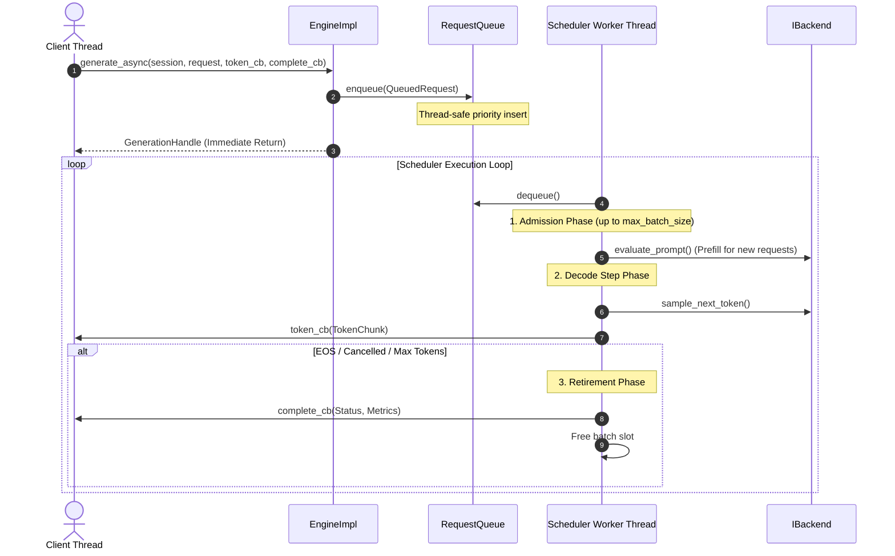

### 9.3 Cooperative Cancellation Latency Contract
- When `IEngine::cancel(GenerationHandle handle)` is called:
  1. `RequestQueue::cancel(handle)` searches the queue. If found, `is_cancelled` is set to `true`. When dequeued, it is discarded immediately without touching the backend.
  2. If the request is currently in `active_batch_`, its atomic `is_cancelled` flag is set to `true`.
  3. At the beginning of the next decode iteration in `step_batch()`, the scheduler detects `is_cancelled == true`, skips backend evaluation, retires the request with `StatusCode::CANCELLED`, and frees the slot.
- **Latency Upper Bound:** Less than or equal to the decode duration of a single token ($\approx 15\text{--}40\text{ ms}$ on ARM64 mobile hardware).

---

## 10. Android Lifecycle & System Integration

### 10.1 End-to-End `onTrimMemory` Propagation Flow

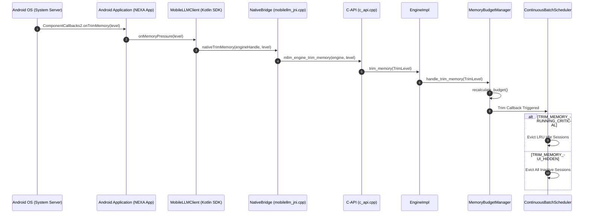

### 10.2 Android Trim Level Mapping Table

| Android OS Constant (`ComponentCallbacks2`) | Numeric Level | Native `TrimLevel` | Action Taken by MobileLLM Runtime |
| :--- | :--- | :--- | :--- |
| `TRIM_MEMORY_RUNNING_MODERATE` | 5 | `RUNNING_MODERATE` | Context compaction: Truncate sliding-window context of oldest idle sessions. Recalculate budget. |
| `TRIM_MEMORY_RUNNING_LOW` | 10 | `RUNNING_MODERATE` | Recalculate budget ceiling; reject non-essential background admissions. |
| `TRIM_MEMORY_RUNNING_CRITICAL` | 15 | `RUNNING_CRITICAL` | **Emergency Eviction:** Destroy backend contexts of all idle sessions. Retain only active generation. |
| `TRIM_MEMORY_UI_HIDDEN` | 20 | `COMPLETE` | App moved to background: Destroy all idle session contexts to shrink RSS below background killer threshold. |
| `TRIM_MEMORY_COMPLETE` | 80 | `COMPLETE` | Process is nearing top of LRU kill list: Immediate purge of all reclaimable caches. |

---

## 11. Error Handling & Resilience Architecture

1. **Thread-Safe Error Propagation:**  
   In compliance with the verified P0-1 remediation, all C-API operations store error messages in thread-local storage (`tls_last_error_message`). Callbacks executed on the scheduler thread pass copies of `mobilellm::Status` by value, ensuring zero dangling pointer dereferences across thread boundaries.
2. **Backend Execution Fault Isolation:**  
   If `IBackend::sample_next_token` fails on session $A$ (e.g. logit NaN or context corrupted), the scheduler retires session $A$ with `StatusCode::BACKEND_EXECUTION_ERROR`, notifies session $A$'s completion callback, and continues decoding session $B$ in the active batch without crashing the worker thread.
3. **Out-of-Memory Pre-Check Resilience:**  
   All memory allocations (model loading, session creation) are gated *prior* to calling backend allocation functions. If `can_allocate()` fails, the operation fails cleanly with `StatusCode::OUT_OF_MEMORY` and leaves the existing engine state uncorrupted.

---

## 12. Testing & Verification Strategy

### 12.1 Verification Matrix

| Test Category | Target Component | Verification Method | Pass Criteria |
| :--- | :--- | :--- | :--- |
| **Unit Tests** | `ContinuousBatchScheduler` + `MockBackend` | GoogleTest (`test_continuous_batching.cpp`) | Multi-session admission, priority queuing, and retirement under mock execution. |
| **Memory Budget Tests** | `MemoryBudgetManager` | Simulated memory unit tests (`test_memory_manager.cpp`) | Correct ceiling calculation, rejection of over-budget allocations, trim event callback firing. |
| **Real Model Integration** | `EngineImpl` + `LlamaCppBackend` + Scheduler | Integration test loading `models/smollm2-135m-instruct-q4_k_m.gguf` | End-to-end token generation through scheduler path; correct token counts and EOS termination. |
| **Concurrency Stress** | `ContinuousBatchScheduler` | Stress test (`test_scheduler_stress.cpp`) | 10 concurrent sessions, random cancellations, zero deadlocks, zero TSAN warnings. |
| **Android Instrumented Test** | JNI Bridge & SDK | Android AVD Emulator (API 37 ARM64 16 KB) | Native library loading, `nativeTrimMemory` invocation, background/foreground lifecycle stability. |

---

## 13. Migration Steps & Implementation Roadmap

The implementation must proceed in five non-breaking milestones:

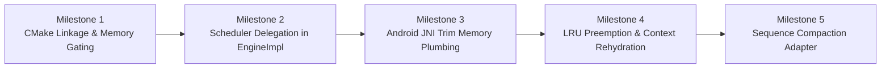

1. **Milestone 1: CMake Linkage & Memory Gating**
   - Update `runtime/CMakeLists.txt` to link `mobilellm_scheduler`.
   - Update `android/jni/CMakeLists.txt` to include scheduler targets.
   - Inject `MemoryBudgetManager` into `EngineImpl::load_model` and `EngineImpl::create_session`.
2. **Milestone 2: Scheduler Delegation in `EngineImpl`**
   - Refactor `EngineImpl::generate_async` to submit requests to `ContinuousBatchScheduler::submit_request`.
   - Remove ad-hoc `std::thread` spawning in `EngineImpl`.
   - Connect `EngineImpl::cancel` to `ContinuousBatchScheduler::cancel_request`.
3. **Milestone 3: Android JNI Trim Memory Plumbing**
   - Add `mllm_engine_trim_memory` to `c_api.h` and `c_api.cpp`.
   - Add `nativeTrimMemory` to `mobilellm_jni.cpp` and `NativeBridge.kt`.
   - Implement `MobileLLMClient.onMemoryPressure(level)` forwarding.
4. **Milestone 4: LRU Preemption & Context Rehydration**
   - Connect `MemoryBudgetManager` trim callback to `SessionManager::evict_lru_session`.
   - Implement backend context release on evicted sessions.
   - Add prompt token history retention and rehydration prefill on preempted session reuse.
5. **Milestone 5: Sequence Compaction Adapter**
   - Remove dummy heap buffer allocations from `KVBlock::buffer`.
   - Integrate `llama_kv_cache_seq_rm` and `llama_kv_cache_seq_add` into `KVCacheManager` truncation methods.

---

## 14. Risks, Trade-offs & Mitigations

| Risk / Trade-off | Architectural Impact | Mitigation Strategy |
| :--- | :--- | :--- |
| **Context Rehydration Latency** | When an evicted session is resumed, prefilling historical tokens takes time ($100\text{--}400\text{ ms}$). | High-priority prefill; only evict when physical RAM pressure demands it; notify client via `SessionState::PREEMPTED`. |
| **Single Worker Thread Contention** | A slow prompt prefill could delay ongoing token decoding for other requests in the batch. | Chunked prefill (splitting long prompts into 512-token batches) scheduled across decode steps. |
| **Llama.cpp Version Coupling** | Direct calls to `llama_kv_cache_seq_*` depend on internal llama.cpp sequence semantics. | Encapsulate sequence operations strictly inside `LlamaCppBackend`; keep `IBackend` interface clean. |
| **Phantom Paged Attention Misconception** | Developers might expect arbitrary non-contiguous vLLM-style paged attention kernels. | Documentation explicitly clarifies that Phase 1 provides **Virtual Block Accounting & Compaction**, not custom paged GPU kernels. |

---

## Summary Architecture Answers to Mandatory Review Questions

1. **Where should the scheduler be owned?**  
   Owned exclusively by `EngineImpl` as a runtime-level coordination service.
2. **How should `EngineImpl` communicate with the scheduler?**  
   Synchronous control plane (`submit_request`, `cancel_request`, `trim_memory`), asynchronous callback data plane (`TokenCallback`, `CompletionCallback`).
3. **Should scheduling be part of `IBackend` or remain a runtime-level service?**  
   Strictly a runtime-level service above `IBackend`. `IBackend` remains a pure tensor execution engine.
4. **How should model and session lifetimes interact?**  
   Strict cascading dependency: Unloading a model immediately cancels in-flight requests, purges queued requests, destroys associated sessions, and frees both KV cache and model memory.
5. **How should `MemoryManager` calculate memory budgets?**  
   Dynamic query of OS available RAM minus 512 MB safety margin, capped at 70% of available RAM, enforcing explicit buckets for Model, KV Cache, and Scratch.
6. **How should KV-cache accounting map to llama.cpp's actual allocations?**  
   Predictive parameter formula ($2 \times N_{\text{layers}} \times N_{\text{kv\_heads}} \times D_{\text{head}} \times N_{\text{ctx}} \times \text{sizeof}(\text{type})$) accounted in `MemoryBudgetManager`. Dummy heap vectors in `KVBlock` are eliminated.
7. **Can the current backend support paged KV allocation, or is an adapter or deeper backend modification necessary?**  
   Standard llama.cpp does NOT support external paged attention kernels. An adapter pattern (**Virtual Block Accounting & Sequence Compaction**) using `llama_kv_cache_seq_*` is the correct, safe path.
8. **How should cancellation and session eviction work?**  
   Cancellation via atomic cooperative polling in `RequestQueue` and active batch iterations. Eviction via LRU idle session preemption with transparent context rehydration upon reactivation.
9. **How should Android `onTrimMemory` events reach the runtime?**  
   `ComponentCallbacks2` $\rightarrow$ Kotlin SDK $\rightarrow$ JNI $\rightarrow$ C API $\rightarrow$ `IEngine::trim_memory` $\rightarrow$ `MemoryBudgetManager` $\rightarrow$ Scheduler emergency eviction callback.
10. **How can the design preserve future Vulkan and NPU backend compatibility?**  
    Decoupled `IBackend` with capability querying (`supports_continuous_batching`, `max_optimal_batch_size`). Scheduler respects batch size 1 on fixed-shape NPUs and multi-sequence batches on Vulkan.

---

## 15. Approved Architectural Decisions Log

The architecture review for ADR-0008 was formally reviewed and approved with the following 10 binding decisions:

1. **Owner:** `ContinuousBatchScheduler` is owned by `EngineImpl` as a runtime-level coordination service.
2. **Layering:** Scheduling remains above `IBackend`; compute backends remain pure tensor engines.
3. **Memory Budgeting:** Memory budgeting is runtime-managed via `MemoryBudgetManager` enforcing a 512 MB OS margin and 70% available RAM ceiling.
4. **Physical KV Ownership:** `llama.cpp` retains ownership of actual physical KV-cache allocations in Phase 1.
5. **No False Paged Attention:** Phase 1 implements virtual KV-cache accounting and sequence management (`llama_kv_cache_seq_*`), not paged attention.
6. **Android Lifecycle:** Android memory-pressure events propagate through Kotlin (`onTrimMemory`), JNI, C API, and runtime to trigger emergency preemption.
7. **Chunked Prefill:** Chunked prefill is configurable, with an initial 256-token chunk size for long prompts.
8. **Single-Burst Prefill:** Short prompts ($\le 256$ tokens) use single-burst prefill for lowest TTFT.
9. **Configurable Session History:** Session history defaults to 2,048 tokens and is configurable by users.
10. **Active Context Invariant:** Session eviction must **never** destroy an active backend context. Active sessions currently in generation are strictly protected from preemption.

---

## 16. Milestone 2: Request Execution Delegation Architecture

Milestone 2 connects `EngineImpl::generate_async` to `ContinuousBatchScheduler`, eliminating the legacy ad-hoc per-request worker thread bypass.

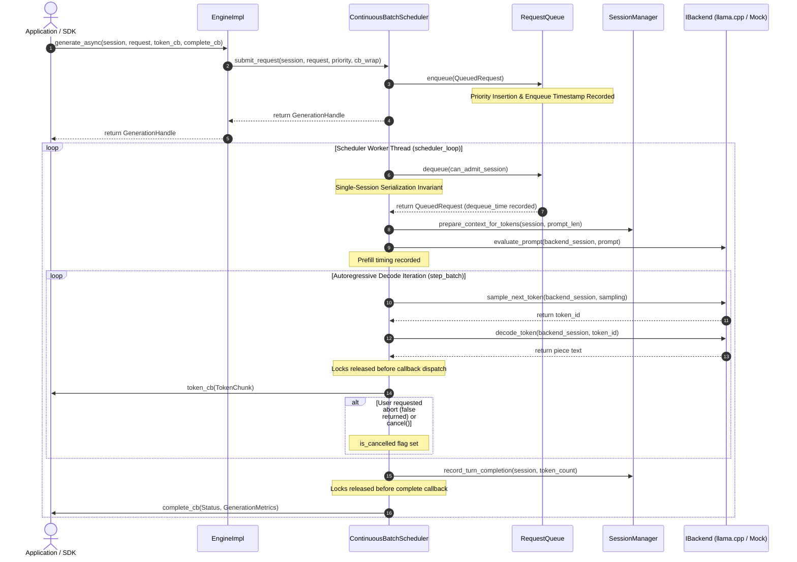

### 16.1 Request Lifecycle State Machine

1. **Submission Phase (`EngineImpl::generate_async`):**
   - Caller supplies `SessionHandle`, `GenerationRequest`, `TokenCallback`, and `CompletionCallback`.
   - Engine validates session existence and non-empty prompt.
   - Envelopes callbacks in an `ActiveRequestInfo` lifecycle tracker.
   - Submits request to `ContinuousBatchScheduler::submit_request`.
   - Generates and returns a unique `GenerationHandle`.

2. **Queued Phase (`RequestQueue`):**
   - Requests are prioritized into `INTERACTIVE`, `NORMAL`, and `BACKGROUND` sub-queues.
   - Initial timestamp recorded: `enqueue_time_us`.
   - If queue capacity (256) is exceeded, immediately rejected with `StatusCode::OUT_OF_MEMORY`.

3. **Admission Phase (`step_batch`):**
   - The scheduler worker dequeues the highest priority request satisfying the **Single-Session Serialization Invariant** (`can_admit_session`).
   - `dequeue_time_us` is recorded; `queue_wait_time_ms = (dequeue_time_us - enqueue_time_us) / 1000.0`.
   - Session context is prepared via `SessionManager::prepare_context_for_tokens`.
   - Prompt evaluation is executed on `IBackend::evaluate_prompt`.
   - Prompt tokens and prefill duration (`prefill_time_ms`) are recorded.
   - Request enters `active_batch_`.

4. **Decoding Iteration Phase (`step_batch`):**
   - Each request in `active_batch_` undergoes a single token sampling step per iteration.
   - Checks `is_cancelled` flag: if true, immediately schedules request for retirement.
   - Calls `backend_->sample_next_token(backend_session, sampling)`.
   - If EOS token is encountered, schedules request for normal retirement (`Status::ok()`).
   - Emits `TokenChunk` to `token_cb`. **Critical invariant:** `batch_mutex_` is NOT held during callback execution.
   - If `token_cb` returns `false`, `is_cancelled` is set to `true` and the request retires.
   - If `generated_tokens >= max_tokens`, schedules request for normal retirement.

5. **Retirement Phase:**
   - Request is removed from `active_batch_`.
   - `decode_time_ms` and `decode_tokens_per_second` are finalized.
   - `SessionManager::record_turn_completion` updates token counts and sets session state to `IDLE`.
   - `complete_cb` is dispatched with `Status` and complete `GenerationMetrics` outside all internal locks.
   - Ownership context drops to zero ref-count, cleanly deallocating the request payload.

### 16.2 Invariants and Safety Guarantees

1. **Single-Session Serialization Invariant:**
   A single session context (`llama_context`) cannot execute multiple concurrent prompts or decodes without corrupting memory, logits, and token positions. The scheduler guarantees that at most ONE request per `SessionHandle` is in `active_batch_` at any time. Subsequent requests for the same session wait in the queue and are admitted immediately once the previous request retires.
2. **Multi-Session Concurrency:**
   Requests for distinct sessions can be admitted into `active_batch_` up to `max_batch_size`, enabling interleaved iteration-level decoding across independent conversation contexts.
3. **Reentrancy and Deadlock Immunity:**
   Neither `batch_mutex_` nor `RequestQueue::mutex_` nor `engine_mutex_` is held while invoking `token_cb` or `complete_cb`. Callbacks are free to query `engine->get_metrics()`, call `engine->cancel()`, or perform session management without risking deadlocks.
4. **Cooperative Cancellation Boundaries:**
   - Cancellation before execution: Request discarded from queue and completed with `CANCELLED`.
   - Cancellation during generation: `is_cancelled` atomic flag checked at the start and end of each single-token step; retires cleanly within $< 40\text{ ms}$.
5. **Drain Invariant on Unload / Shutdown:**
   - `unload_model()` cancels active requests belonging to that model and waits on `in_flight_cv_` before freeing backend models or session buffers.
   - `shutdown()` signals `shutting_down_ = true`, cancels outstanding work, joins the worker thread via `scheduler_->stop()`, and frees resources without dangling pointer errors.


