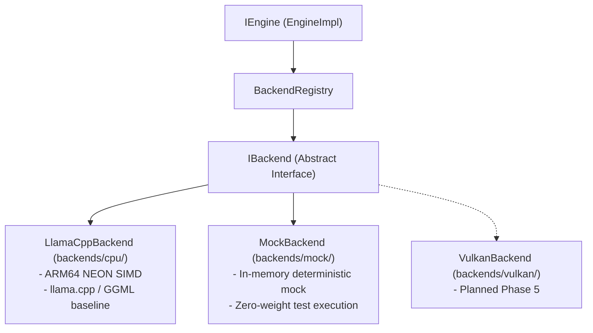

# MobileLLM Engine — Backend Architecture & Limitations

> **Module:** `backends/` and `runtime/`  
> **Author:** Agent 1 (C++ Runtime Engineer)  
> **Reviewer:** Agent 0 (Lead Architect)  
> **Date:** 2026-11-11

---

## 1. Inference Backend Architecture Overview

MobileLLM Engine employs a decoupled backend abstraction layer centered on the [`IBackend`](file:///Users/Apple/Developer/ai-apps/MobileLLM/backends/common/backend.h) interface. This decouples upper-level runtime orchestration, token streaming, cancellation, and Kotlin/Python bindings from specific tensor execution engines.

---

## 2. Supported Formats & Capabilities

| Feature | Support Status | Notes |
| :--- | :--- | :--- |
| **Model Format** | GGUF (v2, v3) | Validates magic `0x46554747`, tensor metadata, and bounds |
| **Quantization Formats** | Q4_0, Q4_K_M, Q4_K_S, Q8_0, F16 | Optimized with ARM NEON dotprod and matmul intrinsics |
| **Architectures** | Llama 3/3.2, Qwen 2/2.5, Gemma 2/3, Mistral, Phi-3 | Validated via GGML operator kernels |
| **Memory Mapping** | POSIX `mmap` | Weights loaded on-demand to minimize resident RSS |
| **Sampling Algorithms** | Greedy, Temp, Top-K, Top-P, Min-P, Repetition Penalty | Implemented in [`Sampler`](file:///Users/Apple/Developer/ai-apps/MobileLLM/runtime/src/sampling/sampler.h) |
| **Cancellation** | Cooperative Atomic Polling | Checked at every token decode step (< 50ms latency) |

---

## 3. Documented Backend Limitations & Constraints

### 3.1 GGUF Version Compatibility
- **Supported:** GGUF specification v2 and v3.
- **Unsupported:** Legacy GGUF v1 or raw GGML files are rejected with `StatusCode::UNSUPPORTED_FORMAT`. Users must convert legacy checkpoints with modern `gguf-py` tools.

### 3.2 Mobile RAM & Context Ceilings
- On Android ARM64 devices with 4–6 GB of total RAM, context lengths exceeding 2,048 tokens may exceed memory budget constraints and trigger `StatusCode::OUT_OF_MEMORY`.
- The runtime limits model loading if estimated weight footprint + KV cache exceeds 70% of available memory.

### 3.3 CPU Thread Affinity & Concurrency
- Autoregressive token decoding is memory-bandwidth bound. On asymmetric big.LITTLE mobile CPUs (e.g. 1 Cortex-X + 3 Cortex-A7xx + 4 Cortex-A5xx), assigning more than 4 threads often causes thermal throttling without throughput gain.
- Concurrent sessions on CPU are serialized across decode steps to avoid cache thrashing. True concurrent generation requires batching or Vulkan offload.

### 3.4 Cancellation Latency Bound
- Cancellation is cooperative. When `mllm_cancel()` is invoked or a `TokenCallback` returns `false`, execution halts at the boundary of the next token decode step. The cancellation latency is bounded by the time required to compute one token ($\approx 15\text{--}40\text{ ms}$ on modern mobile chipsets).

### 3.5 Metal / Vulkan Portability
- Host macOS builds automatically enable the Metal framework for local desktop testing.
- Android builds compile with ARM NEON CPU compute by default, with Vulkan GPU compute capability-probed dynamically at runtime.

