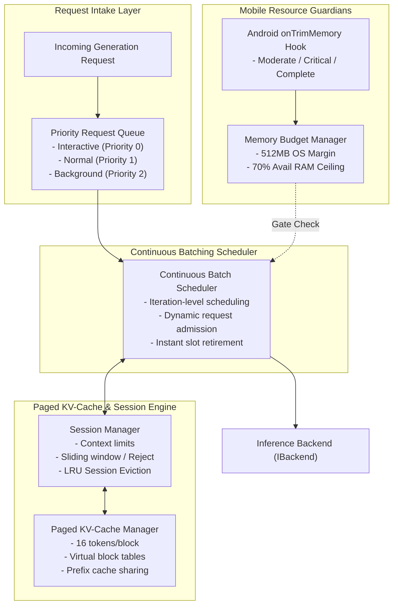

# MobileLLM Engine — Memory Management & Scheduler Architecture

> **Module:** `scheduler/`  
> **Author:** Agent 2 (Memory and Scheduler Engineer)  
> **Reviewer:** Agent 0 (Lead Architect)  
> **Date:** 2026-11-11

---

## 1. Subsystem Overview & Mobile Constraints

Mobile devices present operating constraints distinct from cloud servers:
1. **Aggressive Low Memory Killer Daemon (`lmkd`):** When memory is exhausted, Android issues a `SIGKILL` without opportunity to catch exceptions or clean up.
2. **Unified Shared Memory:** CPU, GPU, display buffers, and background services compete for the same physical RAM.
3. **Thermal Throttling:** Unchecked multi-threaded continuous decode causes CPU core down-clocking.

The `scheduler/` module acts as the mobile resource guardian of MobileLLM Engine, comprising four core subsystems:
1. **Memory Budget Manager** ([`memory_manager.h`](file:///Users/Apple/Developer/ai-apps/MobileLLM/scheduler/include/mobilellm/scheduler/memory_manager.h))
2. **Paged KV-Cache Manager** ([`kv_cache_manager.h`](file:///Users/Apple/Developer/ai-apps/MobileLLM/scheduler/include/mobilellm/scheduler/kv_cache_manager.h))
3. **Session Lifecycle Manager** ([`session_manager.h`](file:///Users/Apple/Developer/ai-apps/MobileLLM/scheduler/include/mobilellm/scheduler/session_manager.h))
4. **Continuous Batching Scheduler & Request Queue** ([`request_queue.h`](file:///Users/Apple/Developer/ai-apps/MobileLLM/scheduler/include/mobilellm/scheduler/request_queue.h), [`scheduler.h`](file:///Users/Apple/Developer/ai-apps/MobileLLM/scheduler/include/mobilellm/scheduler/scheduler.h))

---

## 2. Memory Budgeting & OOM Defense

The memory budget manager dynamically inspects `/proc/meminfo` on Linux/Android and `sysctl` on macOS:

$$\text{Usable RAM} = \max(0, \text{Available RAM} - \text{Safety Margin (512 MB)})$$
$$\text{Budget Ceiling} = \min(\text{Usable RAM} \times 0.70, \text{Config Ceiling})$$

Inside this ceiling, memory is accounted across three discrete buckets:
$$\text{Current Usage} = \text{Model Weights} + \text{Paged KV Cache} + \text{Scratch Workspace}$$

- **OOM Prevention Gate:** If any allocation would cause $\text{Current Usage} + \text{Requested Bytes} > \text{Budget Ceiling}$, the allocation immediately returns `StatusCode::OUT_OF_MEMORY`.
- **Android `onTrimMemory` Lifecycle Handling:**
  - `TRIM_MEMORY_RUNNING_CRITICAL`: Triggers emergency LRU session cache eviction, releasing inactive session blocks back to the free pool.
  - `TRIM_MEMORY_COMPLETE`: Reclaims all non-primary cached models.

---

## 3. Paged KV-Cache (16-Token Blocks)

In contrast to monolithic static arrays, MobileLLM divides KV memory into discrete physical blocks of 16 tokens (`TOKENS_PER_BLOCK = 16`):
- **Zero Heap Fragmentation:** Memory is allocated in uniform, fixed-size blocks.
- **On-Demand Allocation:** As prompt tokens are evaluated or generated tokens decoded, new blocks are allocated from the free block arena.
- **Prefix Cache Sharing:** Sessions starting with identical system prompts share the same physical blocks (ref-counted via `prefix_hash`), reducing memory footprint for multi-turn chats.
- **Strict Zero-SQLite for Tensors:** Relational SQLite storage is reserved strictly for metadata. KV tensors reside exclusively in native memory buffers.

---

## 4. Continuous Batching & Iteration-Level Scheduling

The continuous batch scheduler executes iteration-level scheduling:
1. **Dynamic Admission:** As soon as an active batch slot opens, the next waiting request from the priority queue is admitted and prefilled.
2. **Decode Stepping:** All active requests in the batch evaluate one token decode step per iteration.
3. **Instant Retirement:** Requests that generate EOS, hit `max_tokens`, or receive cancellation are retired immediately, freeing their batch slot for waiting requests without stalling the pipeline.
4. **Fair Scheduling:** Deficit round-robin scheduling across sessions prevents a long-running request from starving interactive sessions.
