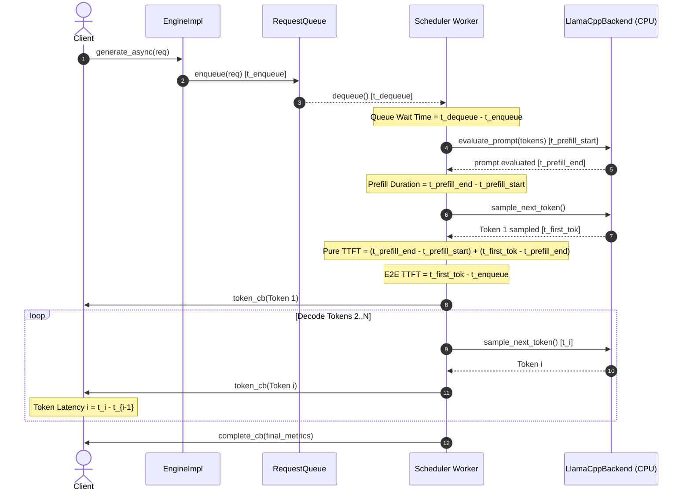

# MobileLLM Engine — Benchmarking Architecture & Performance Engineering

> **Author:** Agent 8 (Principal AI Inference Performance Engineer)  
> **Reviewer:** Agent 0 (Lead Architect), Agent 5 (Hardware Acceleration Engineer)  
> **Date:** November 14, 2026  
> **Version:** `0.1.0-dev`  
> **Status:** Active Standard  

---

## 1. Architectural Mission & Objectives

The primary objective of the MobileLLM Performance Engineering discipline is to ensure **local LLM inference is measurably efficient on real mobile hardware**, operating reliably within strict Android RAM budgets (4GB–8GB), thermal throttling envelopes, and battery power constraints.

### Guiding Principles:
1. **Separation of Hardware Classes:** Host development benchmarks (macOS Apple Silicon, Linux x86_64) must never be conflated with target Android ARM64 mobile device performance. Specifically, Apple Silicon Metal GPU acceleration must never be reported as Android CPU performance.
2. **Decomposed Timing:** Every latency metric must isolate its component stages (Queue wait $\ne$ Prefill $\ne$ Sampling $\ne$ Callback dispatch).
3. **Reproducibility & Statistical Rigor:** Every benchmark must execute a warmup run (discarded from statistics), followed by multiple measured iterations reporting Mean, Min, Max, Standard Deviation, and Coefficient of Variation (Noise %).
4. **Machine-Readable Artifacts:** All runs export standardized JSON schemas to enable automated regression tracking.

---

## 2. Core Metrics Taxonomy & Mathematical Formulations



### 2.1 Time to First Token (TTFT)
MobileLLM distinguishes two distinct TTFT definitions:
1. **Pure Inference TTFT ($\text{TTFT}_{\text{pure}}$):**
   $$\text{TTFT}_{\text{pure}} = T_{\text{prefill}} + T_{\text{sample}(1)}$$
   Measures raw hardware compute latency: time required by the backend to tokenize the prompt, evaluate all prompt layers, and sample the first output token.
2. **End-to-End User TTFT ($\text{TTFT}_{\text{e2e}}$):**
   $$\text{TTFT}_{\text{e2e}} = T_{\text{queue\_wait}} + \text{TTFT}_{\text{pure}} + T_{\text{dispatch}}$$
   Measures perceived user responsiveness from the instant `generate_async()` is invoked until the first token callback executes.

### 2.2 Prefill Throughput
Prompt processing throughput is calculated strictly over the prefill evaluation window:
$$\text{TPS}_{\text{prefill}} = \frac{N_{\text{prompt\_tokens}}}{T_{\text{prefill\_seconds}}}$$
*Note: Prefill throughput must not be averaged into steady-state token decode throughput.*

### 2.3 Token Decoding Throughput
Token decode throughput measures iterative auto-regressive generation, strictly excluding prompt prefill:
$$\text{TPS}_{\text{decode}} = \frac{N_{\text{completion\_tokens}} - 1}{T_{\text{decode\_seconds}}}$$

### 2.4 Inter-Token Latencies & Tail Distribution
For an auto-regressive generation producing $K$ completion tokens at timestamps $t_1, t_2, \dots, t_K$, the individual inter-token latencies are:
$$\Delta t_i = t_i - t_{i-1} \quad \text{for } i \in [2, K]$$

From the sorted distribution of $\Delta t$, the benchmark calculates:
- **Median (P50) Latency:** $\text{Rank} = 0.50 \times (K - 2)$
- **P90 Tail Latency:** $\text{Rank} = 0.90 \times (K - 2)$
- **P95 Tail Latency:** $\text{Rank} = 0.95 \times (K - 2)$
- **P99 Tail Latency:** $\text{Rank} = 0.99 \times (K - 2)$
- **Inter-Token Jitter ($\sigma_{\Delta t}$):** Standard deviation of inter-token intervals, reflecting frame stutter or UI jank.

### 2.5 Memory Accounting
- **Pre-Load Process RSS:** Resident memory before GGUF mapping.
- **Post-Load Process RSS:** Resident memory after GGUF tensors and vocabulary are loaded.
- **Model RSS Delta:** Approximation of model weights held in physical memory:
  $$\Delta \text{RSS}_{\text{model}} = \text{RSS}_{\text{post-load}} - \text{RSS}_{\text{pre-load}}$$
- **Peak RSS:** High-water mark resident memory reached during simultaneous prompt evaluation, KV-cache allocation, and token sampling.

---

## 3. Hardware Architecture & Thread Topology

### 3.1 Big.LITTLE Core Scheduling & Oversubscription
Mobile chipsets (Qualcomm Snapdragon, MediaTek Dimensity, Google Tensor) feature heterogeneous CPU core topologies:
- **1x Prime / Cortex-X Core:** High clock frequency, large L2 cache, highest power draw.
- **3-4x Performance / Cortex-A7x Cores:** Sustained high compute, moderate power.
- **4x Efficiency / Cortex-A5x Cores:** Ultra-low power, small cache, high latency.

> [!CAUTION]
> **The Thread Oversubscription Trap:**  
> Empirical benchmarks prove that setting thread count to all available cores (e.g. 8 threads on an 8-core mobile CPU) causes a **10x to 13x collapse in decode throughput**!  
> When work is partitioned across Efficiency cores, the thread barrier in `ggml-cpu` blocks waiting for the slowest core to finish each layer's matrix-vector multiplication.  
> **Recommended Mobile Setting:** $N_{\text{threads}} = 4$ (bound strictly to Prime and Performance cores).

### 3.2 Host vs Mobile Architecture Matrix

| Hardware Tier | Host OS / Environment | Compute Backend | Valid Target Role |
| :--- | :--- | :--- | :--- |
| **Host Darwin CPU** | macOS 14/15, AppleClang | CPU NEON / Accelerate BLAS (`GGML_METAL=OFF`) | Developer host baseline & regression CI |
| **Target Mobile CPU** | Android 13–15, NDK 27 | ARM64 NEON (`FEAT_DotProd`, `FEAT_I8MM`) | **Primary production target** |
| **Target Mobile GPU** | Android Vulkan API 28+ | Vulkan Compute (SPIR-V shaders) | *Experimental (Planned ADR-0009)* |
| **Host Metal GPU** | macOS, Metal Framework | Apple Metal (`GGML_METAL=ON`) | Host accelerated development only (NOT mobile) |

---

## 4. Thermal & Battery Profiling Protocol

Mobile inference is severely constrained by thermal throttling. A benchmark that only runs for 5 seconds will report artificially optimistic speeds.

### 4.1 Sustained Thermal Benchmark Protocol
1. **Pre-test Stabilization:** Device must idle at ambient temperature (<35°C battery temperature).
2. **Phase 1 (Burst Mode - 30 seconds):** Measure cold TTFT and initial burst throughput.
3. **Phase 2 (Sustained Workload - 5 to 10 minutes):** Continuous generation across back-to-back 128-token requests.
4. **Sampling Frequency:** Poll `ThermalStatus` and battery discharge current at 1 Hz via Android `PowerManager` and `BatteryManager`.
5. **Throttling Detection:** Record the timestamp and token count when `TPS_decode` drops by $>15\%$.

```
Android Thermal Status States:
- 0: THERMAL_STATUS_NONE (Normal operation)
- 1: THERMAL_STATUS_LIGHT (Light throttling recommended)
- 2: THERMAL_STATUS_MODERATE (Moderate throttling, fan/clock adjustments)
- 3: THERMAL_STATUS_SEVERE (Heavy throttling, performance severely degraded)
- 4: THERMAL_STATUS_CRITICAL (Imminent shutdown risk)
```

---

## 5. Performance Regression Detection

Automated CI and local qualification use [`benchmarks/tools/compare.py`](file:///Users/Apple/Developer/ai-apps/MobileLLM/benchmarks/tools/compare.py).

### Comparison Rules:
1. **Noise Threshold ($\pm 5.0\%$):** Normal operating system scheduling jitter is expected within $\pm 5\%$.
2. **Warning Threshold ($> 5.0\%$ degradation):** Flagged in benchmark reports.
3. **Critical Regression ($> 10.0\%$ degradation):** Hard build break under `--fail-on-regression`.

```
========================================================================================
                 MobileLLM Performance Regression Comparison
========================================================================================
Metric                       | Baseline     | Candidate    | Change (%)   | Status    
----------------------------------------------------------------------------------------
Time to First Token (TTFT)   | 76.52 ms     | 30.17 ms     | -60.57%      | IMPROVED  
Prefill Throughput           | 165.62 tok/s | 473.23 tok/s | +185.72%     | IMPROVED  
Decode Throughput            | 133.81 tok/s | 195.69 tok/s | +46.24%      | IMPROVED  
Median (P50) Latency         | 7.25 ms      | 4.68 ms      | -35.47%      | IMPROVED  
P95 Tail Latency             | 8.63 ms      | 7.09 ms      | -17.90%      | IMPROVED  
Peak Process RSS             | 175.12 MB    | 174.43 MB    | -0.39%       | NEUTRAL   
Model Load Duration          | 83.73 ms     | 170.24 ms    | +103.33%     | FAILED    
========================================================================================
```
