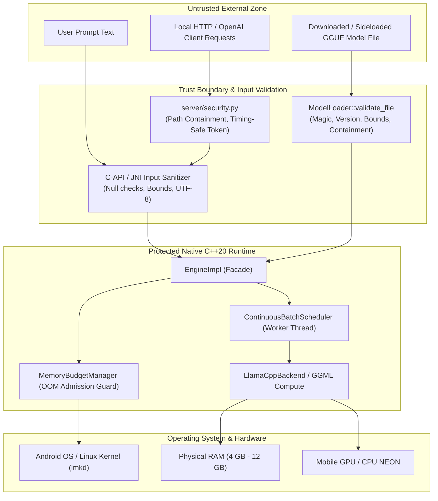
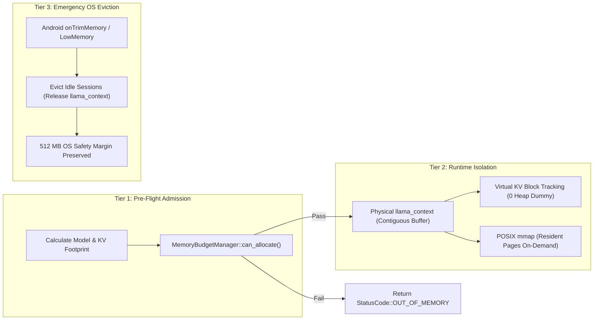

# MobileLLM Engine — QA, Reliability & Security Strategy

> **Module Ownership:** `tests/`, `.github/workflows/`, Security Policies & Fuzzers  
> **Author:** Agent 6 (Principal QA, Reliability & Security Engineer)  
> **Direct Reports to:** Agent 0 (Lead Architect)  
> **Key Downstream Dependents:** Agent 1 (Runtime), Agent 2 (Scheduler), Agent 3 (Android), Agent 4 (Python), Agent 5 (Hardware), Agent 7 (Release)  
> **Date:** November 14, 2026  
> **Governing ADRs:** [ADR-0001](file:///Users/Apple/Developer/ai-apps/MobileLLM/docs/adr/0001-core-language-and-cpp20-standards.md), [ADR-0005](file:///Users/Apple/Developer/ai-apps/MobileLLM/docs/adr/0005-hardware-backend-abstraction-and-fallback-policy.md), [ADR-0008](file:///Users/Apple/Developer/ai-apps/MobileLLM/docs/adr/ADR-0008-scheduler-runtime-integration.md), [ADR-0009](file:///Users/Apple/Developer/ai-apps/MobileLLM/docs/adr/0009-hardware-capability-detection-and-modular-acceleration-architecture.md)

---

## 1. Executive Mission & Verification Principles

MobileLLM Engine brings local, privacy-first Large Language Model inference to Android and edge platforms. Because local inference operates on untrusted edge devices with constrained memory, variable hardware drivers, and multi-tenant mobile OS environments, quality and security cannot be treated as an afterthought.

### Core Testing Invariants:
1. **Adversarial Skepticism:** Agent 6 never accepts self-reported test success without independent, reproducible execution logs.
2. **Beyond Passing Tests:** Passing unit tests do not prove the absence of defects. Testing must actively probe edge cases, race windows, integer bounds, malformed inputs, and resource exhaustion.
3. **No Flaky Tests:** Concurrency tests must rely on explicit synchronization, condition variables, and deterministic mocks rather than arbitrary `sleep` timeouts.
4. **Sanitizer Enforcement:** Native C++ code must pass cleanly under **ThreadSanitizer (TSan)**, **AddressSanitizer (ASan)**, and **UndefinedBehaviorSanitizer (UBSan)**.
5. **Privacy Non-Negotiable:** Local inference must remain 100% offline. Zero prompts, generated tokens, or filesystem paths may be transmitted externally or leaked into persistent logs.

---

## 2. Threat Model & Security Boundaries

### 2.1 Threat Vectors & Mitigations

| Threat Vector | Attack Scenario | Impact | Mitigation Strategy |
| :--- | :--- | :--- | :--- |
| **Path Traversal / Arbitrary File Read** | Caller supplies `../../../../etc/shadow` or Android private database path as `model_path`. | Information disclosure of sensitive system/app data. | Canonicalize paths via `std::filesystem::canonical` and enforce strict directory containment within permitted model directories. |
| **Integer Overflow in Memory Admission** | Malformed GGUF or hostile config specifies $2^{64}-1$ bytes for model or KV cache. | Overflow bypasses budget ceiling check; process terminates with Android `lmkd` `SIGKILL`. | Safe unsigned saturation arithmetic: check `bytes > ceiling || current > ceiling - bytes` before addition. |
| **GGUF Binary Parsing Exploits** | Corrupt tensor offsets, huge array counts, or circular structures in GGUF metadata. | Stack exhaustion, infinite loop, buffer overflow, or process crash. | Enforce depth limits on nested arrays, upper bounds on `count` ($\le 65536$), and validate tensor byte offsets against physical file size. |
| **C++ Exception in `noexcept` Callbacks** | Client-supplied token/completion callback throws an unhandled exception. | Immediate `std::terminate()` process abort. | Wrap all external user callback invocations in `try { ... } catch (...)` blocks, converting uncaught exceptions to error statuses. |
| **JNI Worker Thread Exit Crash** | Native scheduler worker thread attaches to JVM but exits without `DetachCurrentThread`. | Android ART aborts with fatal thread cleanup error. | Implement thread-local RAII guard or register explicit worker thread lifecycle cleanup hooks. |
| **Localhost API Exposure** | Optional HTTP server binds to `0.0.0.0` or exposes endpoints to other apps on the device. | Unauthorized prompt submission or model extraction across local network. | Hardcode binding to loopback `127.0.0.1` only; require constant-time Bearer token verification. |
| **User Data Leakage in Logs** | Prompts or completions emitted to Android `logcat` or stdout. | Privacy breach of confidential user conversations. | Zero prompt or token logging in native runtime; restrict logs to handles, token counts, and operational errors. |

---

## 3. Memory Safety Strategy & Budget Enforcement

MobileLLM operates under strict hardware RAM constraints. The memory safety architecture enforces defense-in-depth across three tiers:

### 3.1 Strict Invariants:
1. **Saturation Arithmetic:** Every memory calculation (`current + bytes`) must be verified against integer overflow before evaluation.
2. **Pre-Allocation Gating:** Neither model weights nor session KV caches may be allocated without a pre-checked memory reservation via `MemoryBudgetManager`.
3. **Rollback Guarantee:** If native backend allocation (`llama_load_model_from_file`, `llama_new_context_with_model`) fails, the reserved memory budget must roll back cleanly before returning.
4. **Session Eviction Invariant:** Session eviction under memory pressure must **never destroy an active backend context** currently executing generation. Only `IDLE` or `PREEMPTED` sessions may be evicted.

---

## 4. Concurrency & Scheduling Verification Strategy

### 4.1 Invariants Mandated by Milestone 2
- **Single-Session Serialization:** Only one generation request may execute on a given session context at any point in time. Multiple queued requests for the same session must execute sequentially.
- **Deadlock-Free Callback Dispatch:** Neither `batch_mutex_` nor `engine_mutex_` may be held while invoking user callbacks (`TokenCallback`, `CompletionCallback`). Callbacks must have complete freedom to call engine APIs reentrantly (e.g. querying telemetry or submitting new requests).
- **Graceful Lifecycle Draining:** `EngineImpl::unload_model()` and `EngineImpl::destroy_session()` must cooperatively cancel in-flight requests and await their termination before destroying native backend contexts.

### 4.2 Concurrency Stress Test Suite Structure
The test harness must execute:
1. **Parallel Multi-Session Contention:** 4 threads submitting concurrent requests across 2 independent sessions to verify continuous batching without state cross-contamination.
2. **Rapid Cancellation Hammer:** 50 requests submitted and immediately cancelled in randomized states (pre-admission, during prefill, during decode).
3. **Model Unload with Active Request:** Verifying that model unloading waits for active requests to cancel and exit before deallocating `llama_model`.
4. **Repeated Initialize/Shutdown Cycles:** 20 consecutive engine create/init/generate/shutdown/destroy cycles to detect thread leaks or dangling scheduler workers.

---

## 5. Android & JNI Verification Strategy

### 5.1 JNI Boundary Rules
1. **Reference Management:** Every `jstring`, `jobject`, and `jclass` allocated in JNI methods must be paired with explicit `DeleteLocalRef` or `DeleteGlobalRef`.
2. **Thread Attachment RAII:** Any native worker thread calling Java callbacks must attach via `AttachCurrentThread` and guarantee `DetachCurrentThread` on thread termination.
3. **Exception Boundary:** Native code must never allow a pending JNI exception to propagate into C++ code without calling `ExceptionCheck()` and `ExceptionClear()`.
4. **16 KB ELF Page Size:** All Android shared libraries must compile with `-Wl,-z,max-page-size=16384` to guarantee zero crashes on Android 15 and Android 17 16 KB page-size kernels.

### 5.2 Android Lifecycle Simulation Tests
- Activity destruction during streaming generation.
- Application backgrounding triggering `ComponentCallbacks2.onTrimMemory(TRIM_MEMORY_RUNNING_CRITICAL)`.
- Concurrent generation across multiple `MobileLLMClient` instances.

---

## 6. Sanitizer & Dynamic Analysis Strategy

### 6.1 Sanitizer Target Matrix

| Sanitizer | Target Scope | Flag Configuration | CI Gate Status |
| :--- | :--- | :--- | :--- |
| **ThreadSanitizer (TSan)** | Multithreaded Engine, Scheduler, RequestQueue | `-fsanitize=thread -O1 -g` | **Mandatory:** Zero data races, zero deadlocks tolerated. Verified clean in `build_tsan`. |
| **AddressSanitizer (ASan)** | Core Runtime, ModelLoader, Sampler, C API | `-fsanitize=address -fno-omit-frame-pointer -O1 -g` | **Mandatory:** Zero buffer overflows, zero use-after-free, zero heap leaks. |
| **UndefinedBehaviorSanitizer (UBSan)** | Math kernels, Quantization, Integer operations | `-fsanitize=undefined -fno-omit-frame-pointer -O1 -g` | **Mandatory:** Zero shift overflows, zero signed integer overflows, zero null pointer dereferences. |

---

## 7. Fuzz Testing Architecture

To harden the outer perimeter of MobileLLM against hostile or corrupted data, dedicated libFuzzer / bounded fuzz targets are defined:

1. **`fuzz_model_loader`:** Feeds mutated, truncated, and corrupt GGUF byte streams into `ModelLoader::validate_file` and `ModelLoader::inspect_file` to discover parser crashes, infinite loops, and integer overflows.
2. **`fuzz_c_api_inputs`:** Fuzzes `mllm_generate`, `mllm_model_load`, and `mllm_model_inspect` with malformed strings, null pointers, huge integers, and negative buffer lengths.
3. **`fuzz_sampling_parameters`:** Fuzzes `Sampler::sample` with extreme logit vectors (NaNs, infinities, empty vectors, negative temperatures, out-of-range top-k/top-p).

---

## 8. Regression Policy & Defect Lifecycle

Every identified bug must follow a strict **Zero-Regression Lifecycle**:
1. **Defect Discovery & Triage:** Report documented with reproduction steps, affected file lines, and severity classification (Critical, High, Medium, Low).
2. **Failing Test Isolation:** Author a minimal, automated test that reproduces the defect and fails on unpatched code.
3. **Remediation Implementation:** Apply the minimal, non-invasive architectural fix.
4. **Regression Verification:** Run the full test suite under sanitizers to confirm the defect is resolved with zero side effects.
5. **Permanent CI Inclusion:** The test becomes a permanent regression barrier in the test suite.
