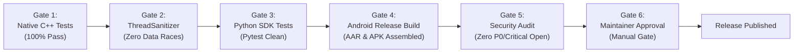

# MobileLLM Engine — Open-Source Release & Versioning Policy

> **Governing Standards:** Semantic Versioning 2.0.0, CodeSec Open-Source Governance  
> **Author:** Agent 7 (Principal Integration & Release Engineer)  
> **Approved By:** Agent 0 (Lead Architect)  
> **Date:** November 14, 2026  
> **Status:** Active Release Policy  

---

## 1. Versioning Principles (Semantic Versioning 2.0.0)

MobileLLM Engine follows strict Semantic Versioning (`MAJOR.MINOR.PATCH[-PRERELEASE]`):

```
vMAJOR.MINOR.PATCH
  │     │     └─ Bug fixes, security remediation, documentation (Zero API/ABI changes)
  │     └─────── New backward-compatible features, new backends, new model architectures
  └───────────── Breaking C-ABI alterations, breaking public SDK signatures
```

### 1.1 When to Increment Versions:
- **PATCH (e.g., `0.1.0` $\to$ `0.1.1`):**
  - Security remediation (such as fixing integer overflow SEC-01).
  - Memory leak fixes, thread synchronization patches, bug fixes in existing algorithms.
  - Zero modifications to public function signatures or struct layouts.
- **MINOR (e.g., `0.1.0` $\to$ `0.2.0`):**
  - Addition of new compute backends (e.g. Vulkan GPU compute).
  - Addition of new model architectures (e.g. Gemma 3, DeepSeek-Lite).
  - Additive, non-breaking extensions to C-API or Kotlin/Python SDKs.
  - Performance optimizations and memory reductions.
- **MAJOR (e.g., `0.2.0` $\to$ `1.0.0`):**
  - Breaking changes to C-API declarations in [`runtime/include/mobilellm/c_api.h`](file:///Users/Apple/Developer/ai-apps/MobileLLM/runtime/include/mobilellm/c_api.h).
  - Breaking changes to Kotlin SDK [`MobileLLMClient`](file:///Users/Apple/Developer/ai-apps/MobileLLM/android/sdk/src/main/java/ai/codesec/mobilellm/MobileLLMClient.kt) or Python [`Engine`](file:///Users/Apple/Developer/ai-apps/MobileLLM/python/mobilellm/engine.py).
  - Removal of previously deprecated interfaces or GGUF specification support.

---

## 2. Release Qualification Gates

A release candidate cannot be tagged, built, or published unless it satisfies all six mandatory quality gates:



### Gate Checklist:
1. **Gate 1 — Native Test Suite:** 100% test pass on host C++20 build (`ctest --test-dir build --output-on-failure`).
2. **Gate 2 — ThreadSanitizer:** Zero data races, zero deadlocks, and zero thread leaks in `build_tsan`.
3. **Gate 3 — Python SDK Matrix:** 100% pytest pass across supported Python versions (3.11, 3.12, 3.13) without skips in native tests.
4. **Gate 4 — Android Distribution Build:** Successful compilation of `libmobilellm.so`, `libmobilellm_jni.so`, and assembly of signed release AAR and APK with 16 KB page alignment.
5. **Gate 5 — Security & Privacy Audit:** Zero open Critical or High severity vulnerabilities in [`reports/AGENT_6_SECURITY_AUDIT.md`](file:///Users/Apple/Developer/ai-apps/MobileLLM/reports/AGENT_6_SECURITY_AUDIT.md). Strict verification of zero network calls.
6. **Gate 6 — Maintainer Authorization:** Explicit manual sign-off by repository maintainer. Automated CD triggers are strictly prohibited from publishing without human authorization.

---

## 3. Release Classification Hierarchy

Every build and commit belongs to one of five release readiness tiers:

1. **`NOT READY`:** Codebase has broken builds, failing unit tests, or unverified architecture.
2. **`INTERNAL TESTING`:** Compiles cleanly; unit tests pass, but end-to-end integration or hardware validation is incomplete.
3. **`BETA CANDIDATE` (Current Status):** Feature complete for milestones; passing C++, Python, and Android tests; pending security defect remediation and real-device matrix execution.
4. **`RELEASE CANDIDATE` (RC):** All P0/Critical security findings remediated; full regression test suites pass; release packages (AAR, Wheel) assembled and validated.
5. **`PRODUCTION RELEASE READY`:** Verified on physical mobile devices; zero regressions; documentation complete; approved for public tagging.

---

## 4. Release Asset Packaging & Integrity

Every official GitHub release tag (`vX.Y.Z`) produces the following cryptographic artifacts:
1. **Source Tarballs:** `mobilellm-vX.Y.Z.tar.gz` and `zip`.
2. **Android SDK Artifact:** `mobilellm-sdk-vX.Y.Z.aar` (including `arm64-v8a` and `x86_64` `.so` binaries).
3. **Android Flagship Demo APK:** `nexa-vX.Y.Z-release.apk`.
4. **Python Wheels:** Source distribution (`.tar.gz`) and universal wheel (`.whl`).
5. **Checksums File (`SHA256SUMS.txt`):** Generated using `sha256sum * > SHA256SUMS.txt` and cryptographically signed.
6. **Software Bill of Materials (SBOM):** Machine-readable SPDX (`sbom.spdx.json`) detailing all open-source dependencies and license attributions.
