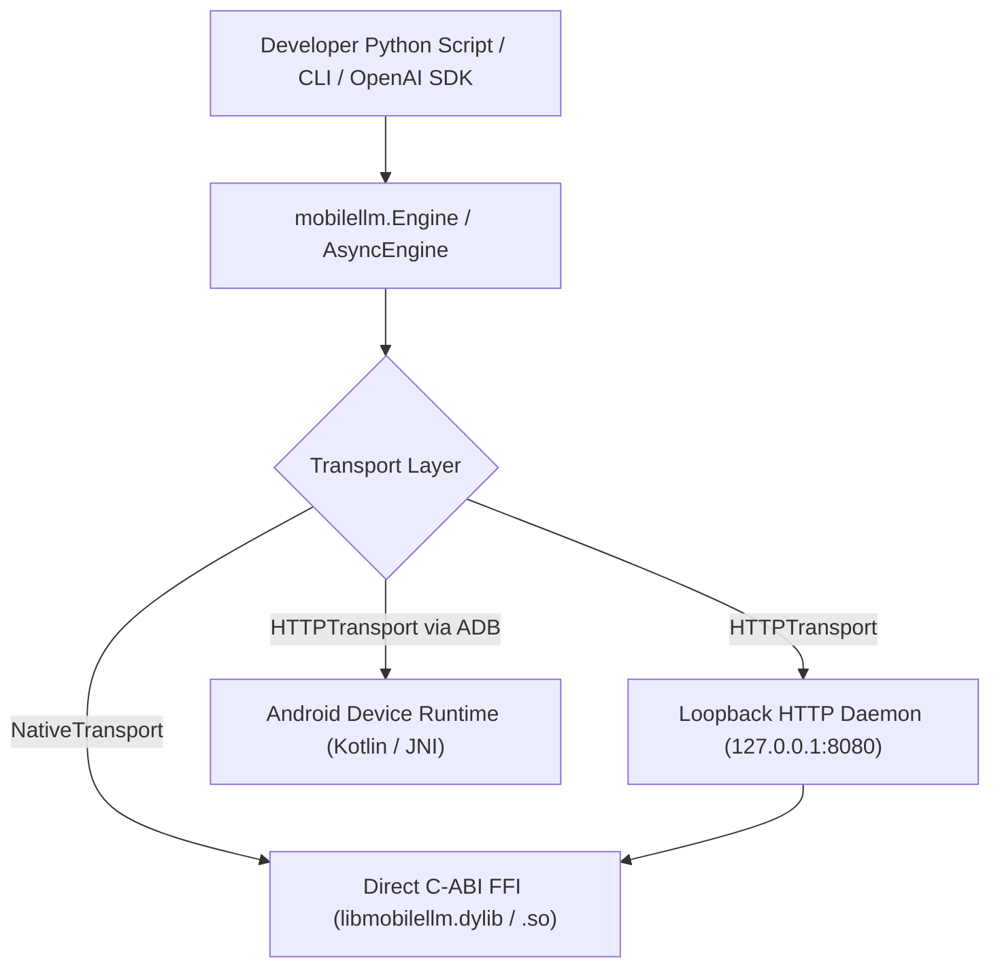
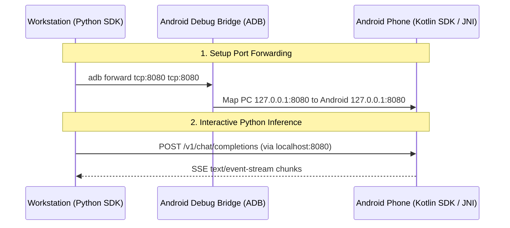

# MobileLLM Python SDK & Local Edge Server

The official, production-quality Python SDK, CLI tool, and local loopback OpenAI-compatible edge server for **MobileLLM Engine** — an open-source, mobile-first local LLM inference framework.

---

## Table of Contents

1. [Features](#features)
2. [Installation Guide](#installation-guide)
3. [Architecture & Transport Modes](#architecture--transport-modes)
4. [Quick-Start Examples](#quick-start-examples)
   - [Synchronous Inference](#1-synchronous-inference)
   - [Streaming Token Generation](#2-streaming-token-generation)
   - [Asynchronous Client](#3-asynchronous-client)
   - [Multi-Turn Stateful Sessions](#4-multi-turn-stateful-sessions)
   - [OpenAI Python SDK Interoperability](#5-openai-python-sdk-interoperability)
5. [Command-Line Interface (CLI)](#command-line-interface-cli)
6. [API Reference](#api-reference)
7. [Android Runtime Connection Guide](#android-runtime-connection-guide)
8. [Troubleshooting Guide](#troubleshooting-guide)
9. [Development & Testing](#development--testing)

---

## Features

- **Typed Public API**: 100% strict type annotations validated with `mypy --strict` and PEP 561 compliance (`py.typed`).
- **Unified Engine Interface**: Single clean `Engine` (and `AsyncEngine`) supporting sync, async, unary generation, streaming, and session contexts.
- **Dual Transport Architecture**:
  - **HTTPTransport**: Connects to the local MobileLLM daemon or Android devices over ADB using standard REST and SSE wire protocols.
  - **NativeTransport**: Direct in-process C-ABI FFI linking `libmobilellm` via `ctypes` for zero-overhead local execution on macOS (ARM64/Metal/CPU) and Linux (x86_64/ARM64 NEON).
- **OpenAI-Compatible Loopback Server**: Built-in HTTP daemon exposing `/v1/chat/completions`, `/v1/models`, `/v1/models/load`, `/v1/models/unload`, and `/v1/health`.
- **Strict Loopback Security (ADR-0007)**: Binds strictly to `127.0.0.1` by default. Binding to `0.0.0.0` or remote interfaces requires explicit `--allow-remote-connections` and an `--api-key`.
- **Developer CLI (`mobilellm`)**: Built-in terminal commands for runtime status, model listing, weight loading/unloading, streaming generation, benchmarking, and daemon serving.
- **Zero Heavy Core Dependencies**: Minimal footprint relying only on modern standard Python libraries and `httpx` for HTTP transport.

---

## Installation Guide

### Prerequisites
- Python 3.11 or higher (Python 3.11, 3.12, 3.13 tested).
- macOS (Apple Silicon / Intel) or Linux (ARM64 / x86_64).

### 1. Standard Installation
```bash
pip install mobilellm
```

### 2. Development & Editable Installation
From the root of the repository:
```bash
# Clone the repository with submodules
git clone --recursive https://github.com/codesec-ai/mobilellm-engine.git
cd mobilellm-engine/python

# Create and activate virtual environment
python3 -m venv .venv
source .venv/bin/activate

# Install in editable mode with development dependencies
pip install -e ".[dev]"
```

---

## Architecture & Transport Modes

The MobileLLM Python SDK is architected with a decoupled transport layer to support both in-process desktop experimentation and remote on-device mobile workflows without duplicating inference code:



1. **Native Mode (`use_native=True` or `endpoint="native://"`):**  
   Directly loads the compiled `libmobilellm` dynamic library via `ctypes`. No background server or network ports are opened. Ideal for desktop testing, model conversion verification, and CI pipelines.
2. **HTTP Mode (`endpoint="http://127.0.0.1:8080"`):**  
   Sends HTTP REST and SSE streaming requests to a running loopback daemon or connected Android phone forwarded over ADB.

---

## Quick-Start Examples

### 1. Synchronous Inference

```python
from mobilellm import Engine, SamplingParams

# Connect to local daemon or native runtime
engine = Engine(endpoint="http://127.0.0.1:8080")
engine.connect()

# Load GGUF model into runtime memory
model = engine.load_model("./models/smollm2-135m-instruct-q4_k_m.gguf")

# Unary text generation
response = model.generate(
    "Explain Python in simple words.",
    SamplingParams(max_tokens=64, temperature=0.7),
)

print(response.text)
if response.metrics:
    print(f"Generated {response.metrics.completion_tokens} tokens at {response.metrics.tokens_per_second:.1f} tok/s")

# Unload model and clean up
model.unload()
engine.close()
```

### 2. Streaming Token Generation

Stream tokens in real-time as they are emitted by the autoregressive decoder:

```python
from mobilellm import Engine, SamplingParams

with Engine(endpoint="http://127.0.0.1:8080") as engine:
    model = engine.load_model("./models/smollm2-135m-instruct-q4_k_m.gguf")

    print("Assistant: ", end="")
    for token in model.generate_stream(
        "Explain machine learning in 3 bullet points.",
        SamplingParams(max_tokens=128, temperature=0.6),
    ):
        print(token, end="", flush=True)
    print()
```

### 3. Asynchronous Client

Use `asyncio` for non-blocking execution in high-concurrency applications:

```python
import asyncio
from mobilellm import Engine, SamplingParams

async def main() -> None:
    async with Engine.async_client(endpoint="http://127.0.0.1:8080") as engine:
        model = await engine.load_model("./models/smollm2-135m-instruct-q4_k_m.gguf")

        # Async unary generation
        response = await model.generate("Hello edge AI!")
        print(response.text)

        # Async streaming token generation
        async for token in model.generate_stream(
            "Tell me an interesting science fact.",
            SamplingParams(max_tokens=64),
        ):
            print(token, end="", flush=True)
        print()

asyncio.run(main())
```

### 4. Multi-Turn Stateful Sessions

Retain KV-cache allocations across conversational turns to eliminate redundant prompt evaluation:

```python
from mobilellm import Engine, SessionConfig, SamplingParams

with Engine(use_native=True) as engine:
    model = engine.load_model("./models/smollm2-135m-instruct-q4_k_m.gguf")

    # Allocate dedicated session context
    session = model.create_session(SessionConfig(max_context_tokens=1024, enable_prefix_caching=True))

    # Turn 1
    r1 = session.generate("Hi, my favorite color is teal.", SamplingParams(max_tokens=32))
    print("Turn 1:", r1.text.strip())

    # Turn 2 (Session retains memory of previous turns)
    r2 = session.generate("What is my favorite color?", SamplingParams(max_tokens=32))
    print("Turn 2:", r2.text.strip())

    session.close()
```

### 5. OpenAI Python SDK Interoperability

MobileLLM's loopback server implements the standard OpenAI wire format. Standard OpenAI client libraries work without modification:

```python
from openai import OpenAI

# Connect official OpenAI client to MobileLLM loopback server
client = OpenAI(
    base_url="http://127.0.0.1:8080/v1",
    api_key="not-needed",  # Default loopback binding requires no key
)

response = client.chat.completions.create(
    model="default",
    messages=[{"role": "user", "content": "What is MobileLLM?"}],
    stream=True,
)

for chunk in response:
    if chunk.choices and chunk.choices[0].delta.content:
        print(chunk.choices[0].delta.content, end="", flush=True)
print()
```

---

## Command-Line Interface (CLI)

The package installs the `mobilellm` (and `mobilellm-cli`) executable.

### 1. Query Runtime Status
```bash
# Query remote or loopback daemon
mobilellm status --endpoint http://127.0.0.1:8080

# Query native C-ABI directly
mobilellm status --native
```
*Output:*
```
MobileLLM Runtime Status
========================
  Status:          OK
  Engine Version:  0.1.0-dev
  Backend:         ARM64
  Uptime:          124.5s
  Models Loaded:   1
  Hardware:        {'device': 'Host', 'arch': 'ARM64', 'neon': True, 'vulkan': False, 'npu': False}
```

### 2. List Loaded Models
```bash
mobilellm models
```

### 3. Load & Unload Models
```bash
# Load model into runtime memory
mobilellm load models/smollm2-135m-instruct-q4_k_m.gguf --context-len 2048 --threads 4

# Unload model
mobilellm unload smollm2-135m-instruct-q4_k_m
```

### 4. Text Generation
```bash
# Stream generation in terminal
mobilellm generate "Explain quantum physics in one sentence" --model models/smollm2-135m-instruct-q4_k_m.gguf --max-tokens 64

# Direct native generation without server
mobilellm generate "Why is the sky blue?" --native --model models/smollm2-135m-instruct-q4_k_m.gguf
```

### 5. Benchmark Performance
Measures Time to First Token (TTFT), tokens per second (TPS), and latency:
```bash
mobilellm benchmark --native --model models/smollm2-135m-instruct-q4_k_m.gguf --runs 3 --tokens 64
```
*Output:*
```
Initializing benchmark with model: models/smollm2-135m-instruct-q4_k_m.gguf
Runs: 3 | Tokens per run: 64
-------------------------------------------------------
Run 1: TTFT = 14.2ms | TPS = 86.40 tok/s | Tokens = 64
Run 2: TTFT = 12.8ms | TPS = 87.12 tok/s | Tokens = 64
Run 3: TTFT = 12.5ms | TPS = 88.05 tok/s | Tokens = 64
-------------------------------------------------------
Benchmark Results Summary:
  Avg Time To First Token (TTFT): 13.17 ms
  Avg Throughput:                 87.19 tokens/sec
  Total Duration:                 2.21 s
```

### 6. Start Loopback HTTP Server
```bash
# Default safe loopback binding on 127.0.0.1:8080
mobilellm serve --model models/smollm2-135m-instruct-q4_k_m.gguf --port 8080

# Exposing to network (Requires --allow-remote-connections AND --api-key)
mobilellm serve --host 0.0.0.0 --port 8080 --allow-remote-connections --api-key "my-secure-token"
```

---

## API Reference

### `mobilellm.Engine`
- `Engine(endpoint=None, api_key=None, timeout=60.0, use_native=False, lib_path=None)`: Constructs sync client.
- `connect() -> Engine`: Connects to runtime.
- `health() -> RuntimeHealth`: Returns health telemetry.
- `status() -> EngineStatus`: Returns engine status and active sessions count.
- `capabilities() -> Dict[str, Any]`: Returns hardware backend information.
- `list_models() -> List[ModelInfo]`: Returns list of models.
- `load_model(model_path_or_config, session_config=None) -> Model`: Loads weights into memory.
- `unload_model(model_or_id) -> bool`: Unloads weights from memory.
- `create_session(model_or_id, config=None) -> Session`: Allocates conversational session.
- `close() -> None`: Shuts down client and frees resources.
- `Engine.async_client(...) -> AsyncEngine`: Creates async engine instance.

### `mobilellm.Model` & `mobilellm.AsyncModel`
- `generate(prompt, params=None) -> GenerateResponse`: Generates full text.
- `generate_stream(prompt, params=None) -> Iterator[TokenStr]`: Yields tokens in real-time.
- `generate_stream_chunks(prompt, params=None) -> Iterator[TokenChunk]`: Yields full chunk objects with logprobs.
- `chat(messages, params=None) -> GenerateResponse`: Multi-turn chat completion.
- `create_session(config=None) -> Session`: Creates session tied to this model.
- `unload() -> bool`: Releases weights from memory.

### `mobilellm.SamplingParams`
- `temperature`: float (default: `0.7`, `>= 0.0`)
- `top_p`: float (default: `0.9`, `(0.0, 1.0]`)
- `top_k`: int (default: `40`, `>= 1`)
- `min_p`: float (default: `0.05`, `[0.0, 1.0]`)
- `repetition_penalty`: float (default: `1.1`, `>= 1.0`)
- `max_tokens`: int (default: `512`, `>= 1`)
- `stop`: List[str] (stop sequences)

---

## Android Runtime Connection Guide

MobileLLM Engine is designed primarily for Android devices. You can control the inference engine executing on a real Android device directly from Python scripts on your workstation.



### Step-by-Step Connection Setup

1. **Connect Device via USB or Wi-Fi ADB:**
   ```bash
   adb devices
   # Ensure your device appears as authorized:
   # List of devices attached
   # 1234567890ABCDEF    device
   ```

2. **Launch MobileLLM on Android:**
   Launch the MobileLLM / NEXA Android application or start the background Android inference service.

3. **Configure Port Forwarding:**
   Forward your development workstation's loopback port to the Android device loopback port:
   ```bash
   adb forward tcp:8080 tcp:8080
   ```

4. **Verify Connectivity in Python:**
   ```bash
   mobilellm status --endpoint http://127.0.0.1:8080
   ```

5. **Run Inference on Device Hardware from Python:**
   ```python
   from mobilellm import Engine

   # Commands execute on phone's CPU/NEON/NPU
   engine = Engine(endpoint="http://127.0.0.1:8080")
   engine.connect()

   model = engine.load_model("smollm2-135m-instruct-q4_k_m.gguf")
   for token in model.generate_stream("What are the advantages of on-device AI?"):
       print(token, end="", flush=True)
   ```

---

## Troubleshooting Guide

### 1. `FileNotFoundError: Could not find libmobilellm dynamic library`
- **Cause:** `NativeClient` could not locate `libmobilellm.dylib` (macOS) or `libmobilellm.so` (Linux).
- **Resolution:**
  - Build the C++ runtime with CMake: `cmake -B build -S . && cmake --build build`.
  - Or specify the library path explicitly via environment variable:
    ```bash
    export MOBILELLM_LIB_PATH="$(pwd)/build/runtime/libmobilellm.dylib"
    ```
  - Or pass `lib_path` to `Engine(use_native=True, lib_path="/path/to/libmobilellm.dylib")`.

### 2. `MobileLLMConnectionError: Failed to connect to MobileLLM at http://127.0.0.1:8080`
- **Cause:** No loopback server is running on port 8080.
- **Resolution:**
  - Start the local daemon: `mobilellm serve --model models/model.gguf --port 8080`.
  - Or if connecting to Android, ensure ADB forwarding is active: `adb forward tcp:8080 tcp:8080`.
  - Or switch to native in-process execution: `engine = Engine(use_native=True)`.

### 3. `SecurityViolationError: Binding to non-loopback interface '0.0.0.0' is forbidden by default`
- **Cause:** Per ADR-0007, binding to external network interfaces requires explicit opt-in and authentication.
- **Resolution:**
  - Supply `--allow-remote-connections` together with `--api-key <secret>`:
    ```bash
    mobilellm serve --host 0.0.0.0 --port 8080 --allow-remote-connections --api-key "secret-token"
    ```

### 4. `OutOfMemoryError: [MobileLLM Error 3] RAM exhausted`
- **Cause:** The requested model weights and KV-cache exceed system memory budget.
- **Resolution:**
  - Reduce `context_length` (e.g. from 4096 to 1024 or 512).
  - Use smaller quantization variants (e.g. `Q4_K_M` instead of `F16`).
  - Set `memory_budget_mb` in `ModelConfig`.

---

## Development & Testing

### Running Tests
Execute the full pytest suite:
```bash
pytest python/tests -v
```

### Static Type Checking (`mypy`)
```bash
mypy python/mobilellm
```

### Code Formatting & Linting (`ruff`)
```bash
ruff check python/mobilellm python/tests
ruff format python/mobilellm python/tests
```

### Building Distribution Packages
```bash
python -m build python/
```
Output wheels and source tarballs are generated in `python/dist/`.
