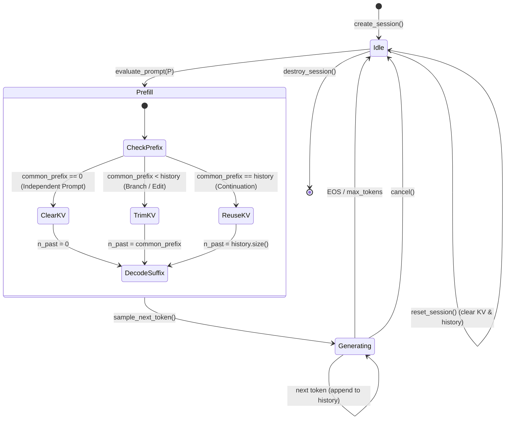

# Agent 10B — MobileLLM Session Lifecycle & Multi-Turn Semantics

> **Module:** `scheduler/`, `runtime/`, `backends/cpu/`, `android/sdk/`, `python/`  
> **Author:** Principal C++ Inference Engineer & AI Runtime QA Engineer  
> **Status:** APPROVED & TESTED  
> **Date:** 2026-11-16  

---

## 1. Executive Summary

A critical issue in modern on-device LLM inference engines is the management of stateful KV caches across conversational turns. Two failure modes frequently emerge:
1. **Stale Cache Contamination:** Evaluating independent queries on an existing session without clearing the KV cache results in attention to prior, unrelated prompt tokens, causing hallucination and degraded output quality.
2. **Context Annihilation:** Blindly clearing the KV cache at the start of every prompt evaluation (as implemented in Agent 10) prevents contamination but destroys conversation history, eliminating multi-turn recall.

Agent 10B defines and implements **formal multi-turn conversational semantics** supported by **prefix-aware KV cache management** and an **explicit session reset API** across C++, C-ABI, Python, and Android Kotlin SDKs.

---

## 2. Multi-Turn Conversational Semantics

MobileLLM formally defines the behavior for the five fundamental conversational interaction patterns:



### 2.1 The Five Conversational Interaction Patterns

#### 1. New Independent Request
- **Caller Behavior:** Caller reuses an existing session handle to execute an unrelated prompt.
- **Engine Semantics:** The backend checks the incoming token sequence against `sess->history_tokens`. Because the prompt is unrelated, `common_prefix == 0`.
- **KV Action:** `llama_kv_cache_clear(ctx)` is invoked automatically. `n_past` is reset to 0, and `history_tokens` is cleared. The prompt is decoded as a clean, independent request.
- **Guarantee:** Zero contamination from previous sessions or prompts.

#### 2. Continue Existing Conversation
- **Caller Behavior:** Caller submits a prompt that begins with the prior conversation history and appends a new user turn: `[History] + [New Turn]`.
- **Engine Semantics:** The backend compares the incoming token sequence against `sess->history_tokens`. The prefix matches: `common_prefix == sess->history_tokens.size()`.
- **KV Action:** Stored KV cells for the prefix are preserved intact. Only the new suffix tokens (length `tokens.size() - common_prefix`) are decoded starting at position `llama_pos(common_prefix)`.
- **Guarantee:** Prior context is preserved; time-to-first-token (TTFT) for turn $N$ is proportional only to the length of the new turn, not the entire conversational history.

#### 3. Reset Conversation (`reset_session`)
- **Caller Behavior:** Caller explicitly resets conversational state via SDK methods (`session.reset()`, `mllm_session_reset()`).
- **Engine Semantics:** Clears `sess->history_tokens`, resets `sess->n_past = 0`, invokes `llama_kv_cache_clear(sess->raw_ctx)`, and resets the sampler state.
- **Guarantee:** The session returns to pristine initial state without requiring session destruction and re-allocation overhead.

#### 4. Rebuild Full Conversation Prompt (Editing / Branching)
- **Caller Behavior:** In ChatML systems, the client maintains the transcript and occasionally edits an earlier message, regenerates a previous response, or re-formats the prompt.
- **Engine Semantics:** Incoming tokens match `history_tokens` up to some prefix index $K < \text{history.size()}$.
- **KV Action:** The backend invokes `llama_kv_cache_seq_rm(ctx, 0, K, -1)` to erase divergent KV positions $\ge K$, sets `n_past = K`, trims `history_tokens` to $K$, and decodes the new suffix from position $K$.
- **Guarantee:** Efficient tree-of-thought and conversation branching without full recomputation from scratch.

#### 5. Cancel and Retry Generation
- **Caller Behavior:** Caller cancels an in-flight generation (e.g., via `cancel()` or UI abort) and immediately retries or initiates a new query.
- **Engine Semantics:** Cancellation cooperative flag halts token sampling. When a new prompt is submitted, prefix matching or explicit reset safely aligns the KV position.
- **Guarantee:** No KV index misalignment, buffer corruption, or thread deadlock.

---

## 3. Public API & SDK Alignments

### 3.1 C-ABI (`runtime/include/mobilellm/c_api.h`)
```c
/**
 * @brief Resets conversational history and clears KV-cache for an active session.
 */
MOBILELLM_EXPORT mllm_status_t mllm_session_reset(
    mllm_engine_t engine,
    mllm_session_t session
);

/**
 * @brief Retrieves raw unnormalized logits of the most recent token step.
 */
MOBILELLM_EXPORT mllm_status_t mllm_get_last_logits(
    mllm_engine_t engine,
    mllm_session_t session,
    float* out_buffer,
    size_t max_len,
    size_t* out_len
);
```

### 3.2 Python SDK
```python
# Synchronous & Asynchronous Session APIs
with model.create_session() as session:
    resp1 = session.generate("My code is 1234")
    # Continuation
    resp2 = session.generate("What is my code?")
    assert "1234" in resp2.text
    
    # Explicit context reset
    session.reset()
    
    # Post-reset prompt has no memory of turn 1
    resp3 = session.generate("What is my code?")
    assert "1234" not in resp3.text
```

### 3.3 Android Kotlin SDK
```kotlin
val session = client.loadModel(modelConfig).createSession()

// Turn 1
session.generate("My favorite city is Tokyo").collect { chunk -> ... }

// Explicit Reset
session.reset()

// Post-reset prompt
session.generate("What is my favorite city?").collect { chunk -> ... }
```

---

## 4. Concurrency & Resource Safety Architecture

### 4.1 Mutex Granularity & Deadlock Avoidance
- Each `LlamaCppBackend::Session` possesses an independent `std::mutex mutex`.
- Operations on session state (`evaluate_prompt`, `sample_next_token`, `reset_session`, `get_last_logits`) acquire this mutex.
- Global model structures (`llama_model`) are read-only during inference; `llama_context` is exclusively owned per session.
- Consequently, multiple sessions on the same model execute concurrently across threads without data races. Verified in `Workstream6_ResourceConcurrencySafety`.

### 4.2 Safe Model Unload with Active Sessions
- In `EngineImpl::unload_model()`, all active sessions registered to the target model handle are first safely aborted and erased from the session registry before the underlying backend model is unloaded.
- This guarantees no dangling pointer dereferences occur if a caller attempts to use a stale session after model unloading.

---

## 5. Automated Verification Results

| Test Case | Description | Result |
| :--- | :--- | :--- |
| `Workstream1_SessionReuseRegression` | 3 cycles of Prompt A $\rightarrow$ Response A $\rightarrow$ Prompt B compared with fresh session | **PASSED** (0 KV leaks) |
| `Workstream2_MultiTurnSemantics` | Continuation recalls secret code; reset clears memory; rebuilt prompt works; cancellation retry works | **PASSED** |
| `Workstream6_ResourceConcurrencySafety` | 5x rapid lifecycle; 2 concurrent threads generating on same model; low memory budget check | **PASSED** |
| `test_native_session_reset_and_logits` | Python FFI integration test validating `reset()` and `get_last_logits()` | **PASSED** |
