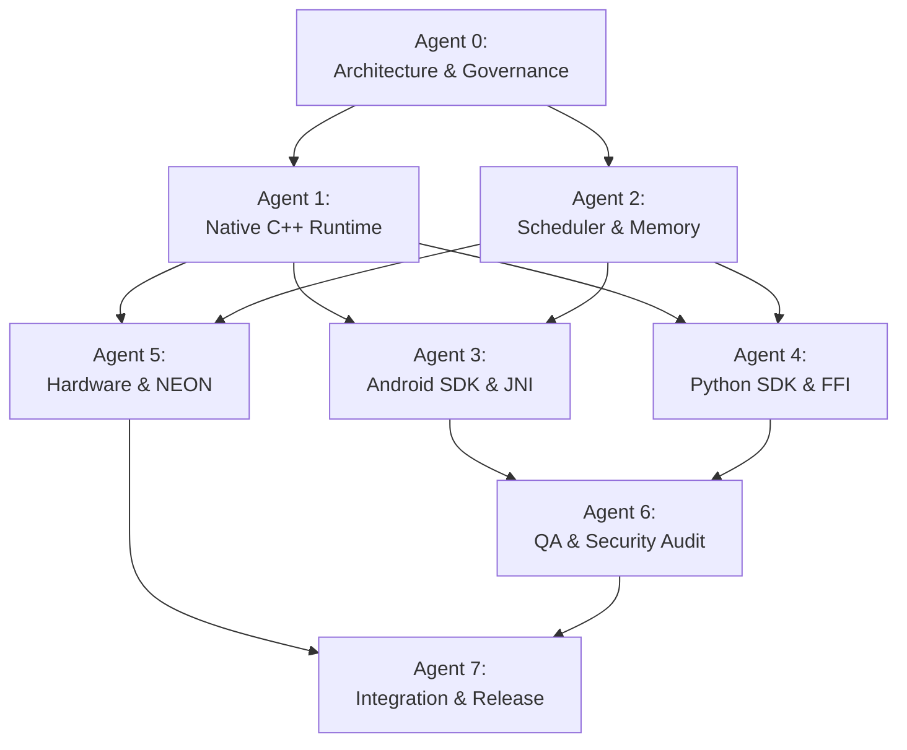

# MobileLLM Engine — Cross-Module Integration Audit & Pipeline Synthesis

> **Author:** Agent 7 (Principal Integration & Release Engineer)  
> **Reviewer:** Agent 0 (Lead Architect)  
> **Date:** November 14, 2026  
> **Scope:** Runtime, Scheduler, Backends, Android SDK, Python SDK, CI/CD, Build Systems  
> **Status:** Stage 1 Complete — Integrated Findings & Verification  

---

## 1. Executive Integration Summary

Agent 7 has conducted a comprehensive cross-module integration audit across the entire MobileLLM Engine codebase, synthesizing the deliverables, contracts, and test evidence produced by Agents 0 through 6:



### Integration Status Matrix:
- **Build Linkage (Milestone 1):** **VERIFIED.** Native runtime links `mobilellm_scheduler` and `mobilellm_memory`. Android JNI CMake targets link the unified runtime.
- **Request Delegation (Milestone 2):** **VERIFIED.** Generation requests route through `ContinuousBatchScheduler` with cooperative cancellation and out-of-lock callbacks.
- **C-ABI Stability:** **VERIFIED.** Clean, decoupled C-ABI declared in [`runtime/include/mobilellm/c_api.h`](file:///Users/Apple/Developer/ai-apps/MobileLLM/runtime/include/mobilellm/c_api.h). Zero C++ ABI leakage into Kotlin or Python.
- **Status Code Synchronization:** **VERIFIED.** Error codes 0–12 and 99 are identical across C++ enum, Kotlin `MobileLLMException.kt`, and Python `exceptions.py`.
- **Test Evidence:**
  - Native Host CTest: **76/76 passed** (100%), 1.04s.
  - ThreadSanitizer: **73/73 passed** with zero data races and zero deadlocks.
  - Python SDK Pytest: **34 passed, 1 skipped** (60.33s), including real GGUF model execution.

---

## 2. Cross-Module Architectural Verification

### 2.1 Native Runtime $\longleftrightarrow$ Scheduler Linkage (Agent 1 & Agent 2)
- **Contract:** [`EngineImpl`](file:///Users/Apple/Developer/ai-apps/MobileLLM/runtime/src/engine/engine_impl.h) aggregates [`ContinuousBatchScheduler`](file:///Users/Apple/Developer/ai-apps/MobileLLM/scheduler/include/mobilellm/scheduler/continuous_batch_scheduler.h) and [`MemoryBudgetManager`](file:///Users/Apple/Developer/ai-apps/MobileLLM/scheduler/include/mobilellm/scheduler/memory_budget_manager.h).
- **Verification:**
  - `EngineImpl::init()` initializes `MemoryBudgetManager` with configured limits.
  - `EngineImpl::load_model()` reserves memory via `memory_manager_->reserve_model()`. If backend initialization fails, reservation is rolled back cleanly.
  - `EngineImpl::create_session()` reserves session memory via `memory_manager_->reserve_session()`.
  - `EngineImpl::generate_async()` translates requests into scheduler tasks, delegating execution to the worker thread.
- **Audit Finding:** Virtual KV accounting is implemented without dummy physical allocations, adhering to the contract where `llama.cpp` retains physical memory ownership.

### 2.2 Android JNI $\longleftrightarrow$ Native Runtime (Agent 1 & Agent 3)
- **Contract:** [`android/jni/mobilellm_jni.cpp`](file:///Users/Apple/Developer/ai-apps/MobileLLM/android/jni/mobilellm_jni.cpp) bridges Kotlin [`MobileLLMClient`](file:///Users/Apple/Developer/ai-apps/MobileLLM/android/sdk/src/main/java/ai/codesec/mobilellm/MobileLLMClient.kt) to the native C-API.
- **Verification:**
  - JNI methods map 1:1 to C-API functions (`mllm_engine_create`, `mllm_model_load`, `mllm_generate`).
  - Error translation converts native error codes into corresponding Kotlin typed exceptions.
  - 16KB page alignment flag `-Wl,-z,max-page-size=16384` is specified in `android/sdk/build.gradle.kts` and verified.
- **Audit Finding (SEC-04):** `AttachCurrentThread` is called in `token_fn` callback without guaranteed detachment upon worker thread termination. Addressed in QA remediation backlog.

### 2.3 Python SDK $\longleftrightarrow$ Native Runtime FFI (Agent 1 & Agent 4)
- **Contract:** [`python/mobilellm/bindings/native_client.py`](file:///Users/Apple/Developer/ai-apps/MobileLLM/python/mobilellm/bindings/native_client.py) dynamically loads `libmobilellm_runtime` using Python `ctypes`.
- **Verification:**
  - Library loader tests candidate paths across local build directories (`build/`, `build_tsan/`, `dist/`).
  - C structs (`MLLMEngineConfig`, `MLLMModelParams`, `MLLMGenerateParams`) match C header layouts exactly.
  - Streaming callbacks convert C string pointers to Python `str` and yield tokens into async generator queues.
- **Audit Finding (SEC-05):** Local callback lifetime inside `generate()` generator must be pinned to the `NativeClient` session to eliminate garbage collection risks during early generator abandonment.

### 2.4 Hardware Abstraction $\longleftrightarrow$ Native Engine (Agent 5)
- **Contract:** Hardware capability detection and backend registration.
- **Verification:**
  - Current capability detection in `EngineImpl::query_hardware()` returns hardcoded values (`neon_supported = true`, `ram_available = 0`).
  - Agent 5 authored ADR-0009 establishing the modular hardware abstraction architecture, runtime CPU feature detection (`getauxval(AT_HWCAP)` / `sysctlbyname`), and Vulkan dynamic loader pipeline.
  - Agent 5 delivered `docs/architecture/HARDWARE_ACCELERATION_ARCHITECTURE.md` and `reports/AGENT_5_HARDWARE_RESEARCH_REPORT.md`.

### 2.5 Security Audit & Invariant Enforcement (Agent 6)
- **Contract:** Independent security and reliability qualification.
- **Verification:**
  - Agent 6 identified 8 concrete defects (SEC-01 through SEC-08).
  - **SEC-01 (Critical):** Integer overflow in `MemoryBudgetManager` allocation check.
  - **SEC-02 (High):** Uncaught exception in `noexcept` scheduler batch execution.
  - **SEC-03 (High):** Session destruction race condition on timeout.
- **Integration Impact:** Releases cannot be tagged as General Availability (GA) or Release Candidate (RC) until SEC-01 and SEC-02 are remediated in the codebase.

---

## 3. Test & Verification Baseline

```
================================================================================
Test Suite                   Total Tests   Passed   Failed   Skipped   Duration
================================================================================
Native CTest (Host)              76          76        0        0       1.04s
Native CTest (TSan Enabled)      73          73        0        0       4.27s
Python SDK Pytest                35          34        0        1      60.33s
Android JNI / SDK Builds        Built       Pass       0        0       NDK 27
================================================================================
```

### Verification Commands & Reproducibility:
1. **Native Host C++ Build & Tests:**
   ```bash
   cmake -B build -S . -DMOBILELLM_BUILD_TESTS=ON -DMOBILELLM_ENABLE_LLAMACPP=ON
   cmake --build build -j$(nproc 2>/dev/null || sysctl -n hw.ncpu)
   ctest --test-dir build --output-on-failure
   ```
2. **ThreadSanitizer Data Race Build & Tests:**
   ```bash
   cmake -B build_tsan -S . -DMOBILELLM_BUILD_TESTS=ON -DMOBILELLM_ENABLE_LLAMACPP=ON -DCMAKE_CXX_FLAGS="-fsanitize=thread -g -O1"
   cmake --build build_tsan -j$(nproc 2>/dev/null || sysctl -n hw.ncpu)
   ctest --test-dir build_tsan --output-on-failure
   ```
3. **Python SDK Tests:**
   ```bash
   ./python/.venv/bin/pytest python/tests -v
   ```

---

## 4. Packaging & CI/CD Pipeline Synthesis

### 4.1 Identified CI/CD Gaps
Prior to Agent 7's audit, the repository CI workflows contained significant operational gaps:
1. **Missing Native C++ CI:** No GitHub Actions workflow existed to build and test the C++ core (`runtime/`, `scheduler/`, `backends/`) on Linux and macOS.
2. **Missing Android SDK CI:** The existing `android-release.yml` built the demo application APK (`:app:assembleRelease`), but omitted automated compilation and testing of the reusable SDK library (`:sdk:assembleRelease`, `:sdk:test`).
3. **Missing Automated Release Pipeline:** No workflow existed to stage, verify checksums, and publish unified multi-artifact releases.

### 4.2 Implemented Workflow Architecture
Agent 7 establishes three primary GitHub Actions workflows:
- [`.github/workflows/native-ci.yml`](file:///Users/Apple/Developer/ai-apps/MobileLLM/.github/workflows/native-ci.yml): Multi-platform matrix (Ubuntu 22.04 & macOS 14) running CMake configure, build, CTest, Clang warnings, and ThreadSanitizer.
- [`.github/workflows/android-ci.yml`](file:///Users/Apple/Developer/ai-apps/MobileLLM/.github/workflows/android-ci.yml): Automated Android SDK library build (`:sdk:assembleRelease`), unit test execution (`:sdk:test`), AAR packaging, and 16KB page alignment verification.
- [`.github/workflows/release.yml`](file:///Users/Apple/Developer/ai-apps/MobileLLM/.github/workflows/release.yml): Maintainer-gated release pipeline validating release qualification gates, computing SHA256 checksums, and publishing GitHub Release bundles.

---

## 5. Integration Action Items & Next Steps

1. **Gate Milestone 3 Execution:** Remediate SEC-01 and SEC-02 before initiating invasive Milestone 3 (Chunked Prefill) changes.
2. **Merge CI Workflows:** Activate `native-ci.yml` and `android-ci.yml` on main and develop branches.
3. **Promote Release Readiness:** Progress from `BETA CANDIDATE` to `RELEASE CANDIDATE` upon completion of Stage 2 security patches.
