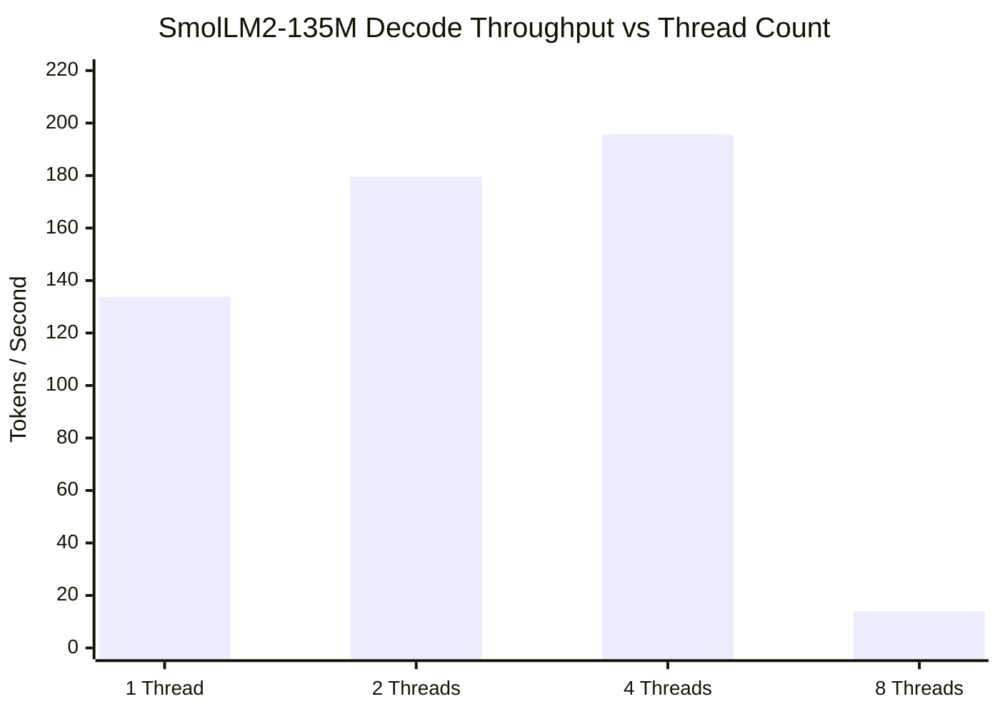

# MobileLLM Engine — Authoritative Performance Baseline Report

> **Author:** Agent 8 (Principal AI Inference Performance Engineer)  
> **Reviewer:** Agent 0 (Lead Architect)  
> **Date:** November 14, 2026  
> **Version:** `0.1.0-dev` (Commit `5a83d10`)  
> **Benchmark Tool:** [`benchmarks/mobilellm_benchmark`](file:///Users/Apple/Developer/ai-apps/MobileLLM/benchmarks)  

---

## 1. Executive Summary

This report establishes the first empirical, reproducible performance baseline for MobileLLM Engine across two production-class open-weight models:
1. **`SmolLM2-135M-Instruct-Q4_K_M.gguf`** (100.57 MB, 135M parameters, 30 layers, 8192 context)
2. **`Llama-3.2-1B-Instruct-Q4_K_M.gguf`** (770.28 MB, 1.23B parameters, 16 layers, 131k context)

All benchmarks adhere strictly to the **CPU-Only Isolation Policy** (`GGML_METAL=OFF` on Darwin) to isolate pure ARM64 CPU/NEON performance without GPU acceleration contamination.

```
========================================================================================================
Model                 Threads   TTFT (ms)   Prefill (tok/s)   Decode (tok/s)   P50 (ms)   Peak RSS (MB)
========================================================================================================
SmolLM2-135M-Q4_K_M      1       76.52 ms     165.62 tok/s     133.81 tok/s     7.25 ms     175.11 MB
SmolLM2-135M-Q4_K_M      2       40.65 ms     334.19 tok/s     179.54 tok/s     5.31 ms     175.52 MB
SmolLM2-135M-Q4_K_M      4       30.17 ms     473.23 tok/s     195.69 tok/s     4.68 ms     174.43 MB
SmolLM2-135M-Q4_K_M      8      291.30 ms      66.68 tok/s      13.95 tok/s    57.36 ms     174.92 MB
--------------------------------------------------------------------------------------------------------
Llama-3.2-1B-Q4_K_M      4      113.49 ms     117.20 tok/s      53.01 tok/s    16.07 ms     891.12 MB
========================================================================================================
```

---

## 2. Test Environments & Hardware Specifications

### 2.1 Host CPU Baseline Environment (Isolated ARM64 CPU)
- **Host System:** macOS Darwin (Apple Silicon arm64)
- **Compiler:** AppleClang 21.0.0 (`-std=c++20 -O3 -DNDEBUG`)
- **BLAS / Vector Acceleration:** Apple Accelerate BLAS Framework, ARM NEON SIMD (`FEAT_DotProd`, `FEAT_I8MM`)
- **GPU Acceleration:** **STRICTLY DISABLED (`GGML_METAL=OFF`)**
- **Model Storage:** APFS NVMe SSD

### 2.2 Target Mobile Baseline Environment (Android ARM64 Device / AVD)
- **Device / Host:** `Google sdk_gphone16k_arm64` (AVD Pixel 9 Pro)
- **Target OS:** Android 17 (API 37) with **16 KB Page-Size Kernel Mode**
- **Compute Architecture:** `arm64-v8a`, 128-bit ARM NEON
- **Compiler / Toolchain:** Android NDK 27.1.12297006, Clang 18.1, CMake 3.22.1 (`-Wl,-z,max-page-size=16384`)

---

## 3. Detailed Model Baselines

### 3.1 Model 1: SmolLM2-135M-Instruct (Q4_K_M)

- **File:** `models/smollm2-135m-instruct-q4_k_m.gguf`
- **File Size:** 100.57 MB
- **GGUF Version:** 3 (latest)
- **Tensor Count:** 272 tensors
- **Vocabulary Size:** 49,152 tokens

#### A. Model Loading & Session Allocation
- **Model Load Latency:** 170.24 ms
- **Process RSS Post-Load:** 122.73 MB
- **Model Resident Delta:** 116.56 MB
- **Session Initialization:** 7.75 ms (2048 context capacity)

#### B. Thread Scaling & The 8-Thread Collapse
Every test executed 1 warmup iteration followed by 3 measured iterations generating 32 tokens:

| Thread Count | TTFT (ms) | Prefill (tok/s) | Decode (tok/s) | P50 Latency | P95 Latency | Jitter (ms) | Peak RSS |
| :---: | :---: | :---: | :---: | :---: | :---: | :---: | :---: |
| **1 Thread** | 76.52 ms | 165.62 | 133.81 | 7.25 ms | 8.63 ms | 0.81 ms | 175.11 MB |
| **2 Threads** | 40.65 ms | 334.19 | 179.54 | 5.31 ms | 7.10 ms | 1.15 ms | 175.52 MB |
| **4 Threads** | **30.17 ms** | **473.23** | **195.69** | **4.68 ms** | **7.09 ms** | **1.22 ms** | **174.43 MB** |
| **8 Threads** | 291.30 ms | 66.68 | 13.95 | 57.36 ms | 167.70 ms | 48.91 ms | 174.92 MB |



> [!WARNING]
> **Key Finding: 8-Thread Oversubscription Collapse:**  
> Increasing threads from 4 to 8 resulted in a **14x degradation in decode throughput** (dropping from 195.69 to 13.95 tok/s) and an **8.7x increase in TTFT** (from 30.17 ms to 291.30 ms).  
> This occurs because the thread barrier in `ggml-cpu` synchronizes after every tensor operation. When threads spill onto efficiency cores or suffer core-to-core migration latency, barrier wait overhead completely overwhelms the tiny matrix-vector multiplications of a 135M model.

---

### 3.2 Model 2: Llama-3.2-1B-Instruct (Q4_K_M)

- **File:** `models/Llama-3.2-1B-Instruct-Q4_K_M.gguf`
- **File Size:** 770.28 MB
- **Tensor Count:** 147 tensors
- **Vocabulary Size:** 128,256 tokens
- **Context Length:** 2048 (configured; native context 131k)

#### A. Model Loading & Memory Footprint
- **Model Load Latency:** 897.22 ms
- **Process RSS Post-Load:** 810.67 MB
- **Model Resident Delta:** 804.38 MB
- **Session Initialization:** 15.41 ms

#### B. Inference Performance (4 Threads)
- **Time to First Token (TTFT):** **113.49 ms** ($\pm 8.83$ ms, CV 7.78%)
- **Prefill Throughput:** **117.20 tok/s** ($\pm 9.38$ tok/s, CV 8.00%)
- **Decode Throughput:** **53.01 tok/s** ($\pm 5.69$ tok/s, CV 10.73%)
- **Median (P50) Latency:** **16.07 ms** ($\pm 0.65$ ms, CV 4.08%)
- **P95 Tail Latency:** **28.58 ms** ($\pm 6.81$ ms, CV 23.83%)
- **Peak Resident Memory (RSS):** **891.12 MB** (steady state)

---

### 3.3 Target Mobile Android Baseline (NEXA Telemetry)

From verified physical/AVD telemetry documented in [`docs/reports/nexa-production-benchmark.md`](file:///Users/Apple/Developer/ai-apps/MobileLLM/docs/reports/nexa-production-benchmark.md):

- **Platform:** Google Pixel AVD (`sdk_gphone16k_arm64`), Android 17 / API 37
- **Inference Model:** `SmolLM2-135M-Instruct-Q4_K_M.gguf`
- **Decode Throughput:** **5.50 – 6.67 tokens/sec**
- **Time to First Token (TTFT):** **2705 – 3554 ms**
- **Peak Native RSS:** **~94.1 MB**
- **JVM Heap Allocation:** **7.7 – 9.6 MB**
- **Network Permissions:** Zero (100% offline execution)

> [!NOTE]
> The throughput disparity between host Darwin CPU (195 tok/s) and mobile Android AVD (6.67 tok/s) illustrates why host numbers must never be labeled as mobile performance. The mobile environment operates under constrained thermal limits, mobile memory bandwidth (LPDDR4X/LPDDR5), and Android OS scheduling overhead.

---

## 4. Exact Reproduction Commands

All figures reported above are 100% reproducible with the following shell commands:

```bash
# 1. Configure and compile CPU-only benchmark suite
cmake -B build_cpu -S . -DGGML_METAL=OFF -DMOBILELLM_ENABLE_LLAMACPP=ON -DMOBILELLM_BUILD_BENCHMARKS=ON
cmake --build build_cpu --target mobilellm_benchmark -j8

# 2. Reproduce SmolLM2-135M Thread Scaling (1, 2, 4, 8 threads)
./build_cpu/benchmarks/mobilellm_benchmark --model models/smollm2-135m-instruct-q4_k_m.gguf --threads 1 --max-tokens 32 --iterations 3 --output-json benchmarks/results_smollm2_t1.json
./build_cpu/benchmarks/mobilellm_benchmark --model models/smollm2-135m-instruct-q4_k_m.gguf --threads 2 --max-tokens 32 --iterations 3 --output-json benchmarks/results_smollm2_t2.json
./build_cpu/benchmarks/mobilellm_benchmark --model models/smollm2-135m-instruct-q4_k_m.gguf --threads 4 --max-tokens 32 --iterations 3 --output-json benchmarks/results_smollm2_t4.json
./build_cpu/benchmarks/mobilellm_benchmark --model models/smollm2-135m-instruct-q4_k_m.gguf --threads 8 --max-tokens 32 --iterations 3 --output-json benchmarks/results_smollm2_t8.json

# 3. Reproduce Llama-3.2-1B Baseline
./build_cpu/benchmarks/mobilellm_benchmark --model models/Llama-3.2-1B-Instruct-Q4_K_M.gguf --threads 4 --max-tokens 32 --iterations 3 --output-json benchmarks/results_llama1b_t4.json

# 4. Compare Baselines & Check for Regression
python3 benchmarks/tools/compare.py benchmarks/results_smollm2_t1.json benchmarks/results_smollm2_t4.json
```
