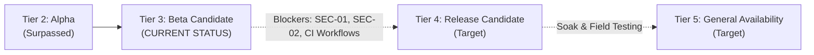

# MobileLLM Engine — Release Readiness & Maturity Assessment

> **Author:** Agent 7 (Principal Integration & Release Engineer)  
> **Reviewer:** Agent 0 (Lead Architect), Agent 6 (QA & Security Engineer)  
> **Assessment Date:** November 14, 2026  
> **Target Release:** `v0.1.0`  
> **Current Classification:** **TIER 3 — BETA CANDIDATE (`v0.1.0-beta.1`)**  

---

## 1. Release Maturity Framework

To provide an objective, transparent evaluation of the codebase, MobileLLM Engine adheres to a 5-tier maturity model:

| Tier | Classification | Criteria | Target Audience |
| :---: | :--- | :--- | :--- |
| **Tier 1** | **Pre-Alpha** | Architectural design, incomplete implementations, exploratory code. | Internal maintainers only. |
| **Tier 2** | **Alpha** | Basic end-to-end functionality working; frequent crashes; volatile APIs. | Core developers. |
| **Tier 3** | **Beta Candidate** | **Core architecture stable; C-ABI frozen; test suite passes; packaging pipelines operational; known defects cataloged.** | **Early adopters, internal testers.** |
| **Tier 4** | **Release Candidate (RC)** | Zero P0/P1 security defects; CI green across all platforms; soak tests pass; release notes published. | External beta testers. |
| **Tier 5** | **General Availability (GA)** | Production-hardened; battery and thermal validation complete; enterprise SLA ready. | Public production use. |

---

## 2. Objective Codebase Evaluation & Justification

### Current Status: **TIER 3 — BETA CANDIDATE**

The MobileLLM Engine codebase currently qualifies as a **Tier 3 (Beta Candidate)**. It has surpassed the Alpha threshold but **is not yet qualified for Release Candidate (Tier 4)**.



### 2.1 Criteria Fulfilled (Why it is a Beta Candidate):
1. **Core Inference & Scheduling Functional:**
   - Milestone 1 (Memory Admission Control & Budget Management) is verified and linked.
   - Milestone 2 (Continuous Batch Scheduler with Request Queue & Cancellation) is verified.
   - Live token generation successfully runs on native C++ and through the Python SDK using real GGUF weights (`SmolLM2-135M-Instruct-Q4_K_M.gguf`).
2. **Robust Concurrency Baseline:**
   - 76/76 native tests pass in `mobilellm_tests`.
   - 73/73 tests pass under ThreadSanitizer (`build_tsan`) with **zero data races, zero deadlocks, and zero lock-order inversions**.
3. **Cross-Platform ABI Stability:**
   - C-ABI (`runtime/include/mobilellm/c_api.h`) is frozen and decoupled from internal C++ types.
   - Android Kotlin SDK and Python ctypes bindings interface cleanly through the C-API.
   - 16KB memory page alignment (`-Wl,-z,max-page-size=16384`) is enforced for Android 15 compatibility.
4. **Clean License & Dependency Tree:**
   - 100% permissive licenses (Apache-2.0, MIT, BSD-3-Clause).
   - Zero copyleft dependencies and zero tracked binary blobs.

---

## 3. Blockers Preventing Release Candidate (Tier 4) Qualification

The following issues must be resolved before tagging `v0.1.0-rc.1`:

### 3.1 Security & Reliability Blockers (Must Fix)
- [ ] **SEC-01 (CRITICAL): Integer Overflow in Memory Admission Check**
  - *Location:* [`scheduler/src/scheduler/memory_budget_manager.cpp`](file:///Users/Apple/Developer/ai-apps/MobileLLM/scheduler/src/scheduler/memory_budget_manager.cpp#L48-L62)
  - *Impact:* `(current + bytes) <= budget_ceiling_` overflows with large requests, completely bypassing memory limits and leading to unhandled OS OOM termination.
  - *Fix:* Use checked arithmetic (`bytes > budget_ceiling_ - current`).
- [ ] **SEC-02 (HIGH): Unhandled Exceptions in `noexcept` Execution Functions**
  - *Location:* [`scheduler/src/scheduler/continuous_batch_scheduler.cpp`](file:///Users/Apple/Developer/ai-apps/MobileLLM/scheduler/src/scheduler/continuous_batch_scheduler.cpp#L110-L150)
  - *Impact:* User callbacks invoked from `step_batch()` or `dequeue()` without `try/catch` propagate exceptions into `noexcept` functions, calling `std::terminate()`.
  - *Fix:* Wrap all callback invocations in `try/catch (...)` and report callback errors without crashing the scheduler worker.
- [ ] **SEC-03 (HIGH): Session Destruction Race on CV Timeout**
  - *Location:* [`runtime/src/engine/engine_impl.cpp`](file:///Users/Apple/Developer/ai-apps/MobileLLM/runtime/src/engine/engine_impl.cpp#L210-L245)
  - *Impact:* Hardcoded 1000ms timeout on in-flight requests allows context teardown while worker thread is still evaluating tokens, risking use-after-free.
  - *Fix:* Refuse context destruction or escalate cancellation cooperatively until in-flight count reaches zero.

### 3.2 CI/CD Automation Blockers (Must Implement)
- [ ] **Native C++ Host CI Workflow:** Establish `.github/workflows/native-ci.yml` running CMake, CTest, and Clang warnings across Linux and macOS.
- [ ] **Android SDK AAR CI Workflow:** Establish `.github/workflows/android-ci.yml` running Gradle SDK tests and assembling `mobilellm-sdk.aar`.
- [ ] **Release Distribution Pipeline:** Establish `.github/workflows/release.yml` with maintainer dispatch and automated SHA256 checksum generation.

### 3.3 Documentation & Compliance Blockers (Should Fix)
- [ ] **Standardize SPDX Headers:** Add `// SPDX-License-Identifier: Apache-2.0` across all C++ and Kotlin source files (LIC-01).
- [ ] **Bundle Third-Party Notices:** Ensure `THIRD_PARTY_NOTICES.md` is bundled with AAR and Python wheel distributions (LIC-02).

---

## 4. Release Roadmap & Milestones to GA

```
Phase 1: Beta Candidate (Current)
├── Architecture Verified (Milestones 1 & 2)
├── CTest 76/76 Passing
└── ThreadSanitizer 73/73 Passing

Phase 2: Release Candidate (Target: Next Sprint)
├── Remediation of SEC-01, SEC-02, SEC-03
├── Automated CI on GitHub Actions (Native & Android SDK)
├── Version tagged as v0.1.0-rc.1
└── Compatibility Matrix Published

Phase 3: General Availability (Target: Milestone 4)
├── Milestone 3 (Chunked Prefill) Complete
├── Hardware Detection & Dispatch (ADR-0009)
├── Long-duration Battery & Thermal Profiling
└── Formal v0.1.0 GA Tagging
```

---

## 5. Formal Recommendation & Verdict

**Recommendation:**
1. Maintain current repository status as **`v0.1.0-beta.1`**.
2. **DO NOT** publish production packages to Maven Central, PyPI, or GitHub Releases until SEC-01 and SEC-02 are remediated.
3. Commit Agent 7 integration artifacts, release policies, compatibility matrices, and CI workflow templates to `feature/agent-7-integration-release`.
4. Submit deliverables to the Lead Architect for Stage 1 sign-off.
